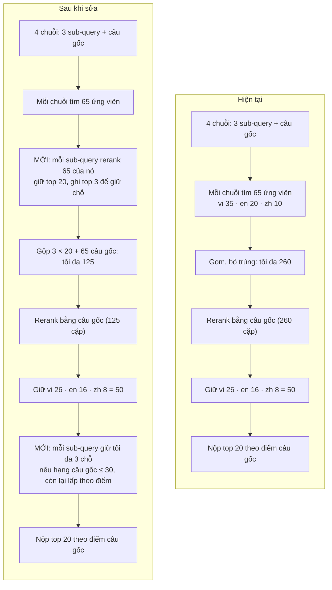

# Luồng truy xuất query phân rã

21/10/2026 · Bản gốc: https://claude.ai/artifact/8NRLZcnNWCSDajP4MKpk7n

## Tóm tắt

Sau khi sửa, mỗi sub-query tự rerank 65 ứng viên của nó và giữ top 20, và mỗi sub-query được bảo đảm tối đa 3 chỗ trong 20 chunk nộp. Hiện tại không sub-query nào được rerank riêng: mọi ứng viên bị chấm bằng câu gốc dài, nên một khía cạnh hẹp có thể có chunk tốt trong pool mà vẫn rớt khỏi bài nộp.

Thay đổi chỉ áp cho query dài có phân rã (trên 30 từ, khoảng 34% query). Query ngắn chạy như cũ.

**Câu gốc có ứng viên riêng không? Có.** Câu gốc là chuỗi thứ 4 (unit `raw`), đem đi tìm nguyên văn, không augment, và cũng lấy 65 ứng viên như mỗi sub-query. Nó là lưới an toàn khi phân rã đi chệch ý. Sau khi sửa, câu gốc vẫn giữ đủ 65 ứng viên (không cắt trước), vì chúng vốn được chấm bằng chính câu gốc ở bước cuối.

Tài liệu này mô tả code ở chế độ mặc định `branch-rerank`. Luồng sau khi sửa đã được code (bật mặc định, tắt bằng `--no-sub-rerank`); mới kiểm tra bằng retriever và reranker giả.

## Trước và sau

Hai bước tô màu là phần thêm mới; các bước còn lại giữ nguyên, chỉ pool đưa vào rerank câu gốc nhỏ lại.

## Luồng hiện tại

Ví dụ một query dài được phân rã thành 3 sub-query. Chỉ có một lần rerank, và lần đó dùng câu gốc.

1. **4 chuỗi truy xuất:** sub-query 1, 2, 3 (đã augment: sub-query + thuật ngữ + targets) và câu gốc (thô).
2. **Mỗi chuỗi tìm 3 nhánh:** vi 35 / en 20 / zh 10 = 65 ứng viên. Chưa rerank, chưa cắt.
3. **Gom theo nhánh ngôn ngữ, bỏ trùng:** tối đa 4 × 65 = 260 ứng viên. Không còn biết chunk nào do sub-query nào tìm ra.
4. **Rerank một lần bằng câu gốc** trên toàn bộ pool (tối đa 260 cặp).
5. **Giữ theo nhánh:** vi 26 / en 16 / zh 8 điểm cao nhất = 50 chunk.
6. **Xếp 50 chunk theo điểm câu gốc, nộp top 20.**

**Vấn đề:** sub-query chỉ ảnh hưởng việc *tìm*, không ảnh hưởng việc *chấm*. Chunk nói riêng về "buồn nôn sau khi uống thuốc" bị so với cả đoạn câu hỏi 74 từ, nên dễ điểm thấp hơn chunk tổng quan về bệnh chính. Không có gì bảo đảm mỗi khía cạnh có mặt trong 20 chunk nộp. Ngoài ra câu gốc dài có thể bị reranker cắt ở 512 token.

## Luồng sau khi sửa

Thêm một vòng rerank theo từng sub-query trước khi gộp, và một bước giữ chỗ ở cuối. Các bước 1, 2, 5, 6 giữ nguyên.

1. **4 chuỗi truy xuất** như cũ.
2. **Mỗi chuỗi tìm 3 nhánh:** vi 35 / en 20 / zh 10 = 65 ứng viên, như cũ.
3. **MỚI — rerank theo sub-query:** mỗi sub-query chấm 65 ứng viên của chính nó, bằng câu sub-query tự nhiên (không phải chuỗi đã augment, vì reranker được train trên câu tự nhiên). Giữ **top 20**, và ghi lại top 3 làm ứng viên giữ chỗ. Câu gốc không qua bước này, giữ đủ 65.
4. **Gộp, bỏ trùng:** 3 × 20 từ sub-query + 65 từ câu gốc, tối đa 125 ứng viên. Pool gọn hơn (từ 260 xuống 125) và ít nhiễu hơn, vì ứng viên yếu của sub-query đã bị lọc.
5. **Rerank một lần bằng câu gốc** trên pool đó, như cũ. Mọi chunk có chung một thang điểm.
6. **Giữ theo nhánh:** vi 26 / en 16 / zh 8 = 50 chunk, như cũ.
7. **MỚI — chọn 20 chunk nộp có giữ chỗ:** mỗi sub-query được tối đa 3 chỗ (tối đa 9 chỗ cho 3 sub-query), phần còn lại lấp theo điểm câu gốc. Quy tắc chi tiết ở phần sau.
8. **Thứ tự nộp:** 20 chunk xếp theo điểm câu gốc, để các biến thể cắt V2/V3 vẫn dùng một thang điểm.

**Top-k mỗi sub-query:** chọn 20 cho rộng tay, vì bước 5 còn lọc lại. Để thành tham số (15 hoặc 20) để so khi nộp.

## Quy tắc giữ chỗ và ngưỡng sàn

Một chunk được giữ chỗ khi nó nằm trong top 3 của sub-query **và** xếp hạng 30 trở lên theo câu gốc. Ngưỡng hạng 30 chặn trường hợp sub-query lạc đề ép chunk rác vào bài nộp.

Cách chọn 20 chunk nộp:

1. Xếp 50 chunk (sau bước giữ theo nhánh) theo điểm câu gốc, đánh hạng 1–50.
2. Với từng sub-query, xét 3 chunk đầu của nó (theo điểm sub-query). Chunk được giữ chỗ nếu nằm trong 50 và có hạng câu gốc ≤ 30. Chunk đã được sub-query khác giữ thì không tính lại.
3. Chỉ xét đúng 3 chunk đầu. Nếu chunk nào rớt ngưỡng thì sub-query mất chỗ đó, không lấy chunk hạng 4–5 thay vào.
4. Lấp phần còn lại của 20 bằng chunk hạng cao nhất chưa được chọn.

Ví dụ (số minh họa):

| Chunk | Do sub-query nào đưa lên | Hạng theo câu gốc | Kết quả |
| --- | --- | --- | --- |
| X | sub-query 2, hạng 1 | 7 | Vào 20, dù có giữ chỗ hay không |
| Y | sub-query 3, hạng 1 | 24 | Được giữ chỗ, đẩy chunk hạng 20 ra |
| Z | sub-query 3, hạng 2 | 41 | Không được giữ chỗ (dưới ngưỡng 30) |

**Tác động tối đa:** giữ chỗ chỉ đổi bài nộp khi chunk giữ chỗ có hạng 21–30. Chặn trên: 9 chunk hạng 21–30 thay chỗ 9 chunk hạng 12–20. Ngưỡng 30 nên thay đổi nhẹ tay; muốn mạnh hơn thì nới lên 40.

## So sánh trước / sau

Bản sửa tốn tối đa 320 cặp rerank cho mỗi query dài, hơn bản hiện tại (260) khoảng 23%. Đổi lại mỗi khía cạnh được chấm bằng chính câu hỏi của nó. Số dưới đây là mức tối đa, chưa trừ trùng.

|  | Hiện tại | Sau khi sửa |
| --- | --- | --- |
| Rerank theo sub-query | Không có | 3 × 65 = 195 cặp |
| Pool trước rerank câu gốc | 260 | 125 (3 × 20 + 65) |
| Rerank bằng câu gốc | 260 cặp | 125 cặp |
| Tổng cặp rerank | 260 | 320 |
| Mỗi khía cạnh có chỗ trong bài nộp | Không đảm bảo | Tối đa 3 chỗ, nếu hạng câu gốc ≤ 30 |
| Query ngắn | 65 cặp | 65 cặp, không đổi |

Rerank là bước nặng nhất trên GPU, nhưng chỉ 34% query là query dài, nên tổng thời gian chạy tăng ít hơn 23%. Chưa đo thời gian thật.

## Việc cần code và câu hỏi còn mở

Toàn bộ nằm trong `src/rag/pipeline/multiquery.py`, bật tắt bằng cờ để so với bản hiện tại trong cùng một lượt nộp.

- [x] Rerank 65 ứng viên của mỗi sub-query bằng câu sub-query tự nhiên, giữ top k (mặc định 20)
- [x] Ghi lại top 3 của mỗi sub-query làm ứng viên giữ chỗ
- [x] Gộp 3 × top k với 65 ứng viên của câu gốc, giữ nguyên rerank câu gốc và quota 26 / 16 / 8
- [x] Chọn 20 chunk nộp theo quy tắc giữ chỗ, ngưỡng hạng 30
- [x] Tham số và cờ: `sub_rerank_top_k` (20), `slots_per_sub` (3), `slot_max_rank` (30)
- [ ] Kiểm tra bằng retriever và reranker giả, rồi chạy thật sau khi ingest xong

**Câu hỏi còn mở:**

- Sub-query nào không có chunk nào qua ngưỡng: chấp nhận mất chỗ (theo thiết kế trên), hay nới ngưỡng cho riêng nó?
- Bài nộp có bị chấm theo thứ tự không? Nếu metric xét thứ tự, có nên đặt chunk giữ chỗ lên trước thay vì xếp theo điểm câu gốc?
- Biến thể C (tách dòng) đang tạm đóng băng vì chi phí, nên quy tắc giữ chỗ chỉ áp cho B và B'. Xem lại nếu C được mở lại.
