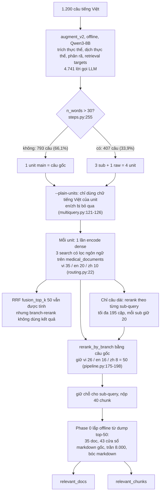
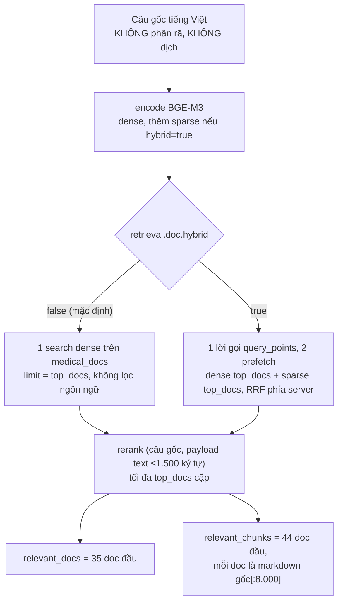
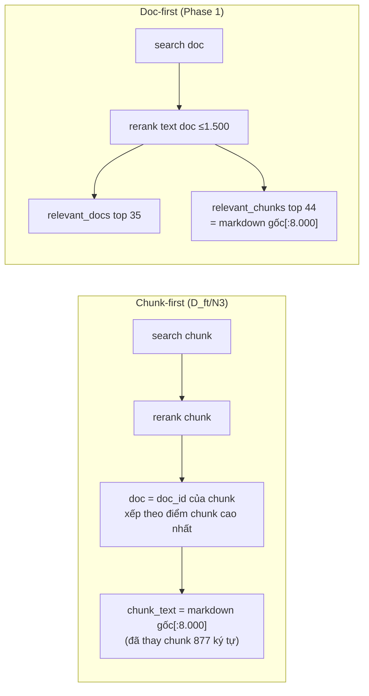
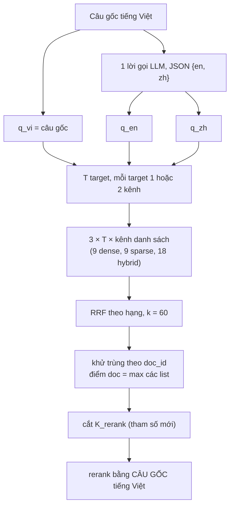

# Audit: dịch query EN/ZH và chiến lược retrieval

Lập ngày 2026-10-24. Chỉ audit, chưa sửa pipeline.
Trạng thái mỗi con số: `VERIFIED` (đọc thẳng từ code/config/dữ liệu), `DERIVED` (tính từ số VERIFIED),
`ASSUMPTION` (giả định để minh hoạ), `UNKNOWN` (chưa đủ bằng chứng).

## 1. Tóm tắt

1. **Sơ đồ tham chiếu không khớp code.** `VERIFIED`
   - Không có bước dịch query nào chạy lúc retrieval.
   - Không có bước exact dot-product, không có kNN expansion: grep `recommend(`, `query_batch`, `knn` trong `src/` và `scripts/` đều không ra kết quả. Hai bước này mới nằm trong kế hoạch (`docs/ke-hoach-phase-1-2.md` mục 4).
   - Bài tốt nhất hiện tại (`chunk_d35_c44_full8k_plain`) tìm hoàn toàn bằng tiếng Việt: chạy với `--plain-units`, nên mọi bản en/zh trong `augment_v2` đều bị bỏ qua.
2. **Bản EN/ZH đã có sẵn cho cả 1.200 câu nhưng chưa từng được dùng đúng cách.** `VERIFIED`
   - `augment_v2` sinh 2,92 retrieval target mỗi unit, mỗi target đủ vi/en/zh (5.890 target, 5.887 có zh).
   - Hai cách dùng đã thử đều nhồi nhiều ngôn ngữ vào một chuỗi:
     - mode `concat` ghép cả khối;
     - mode `lines` ghép `vi; en; zh` thành một dòng (`src/rag/pipeline/multiquery.py:205-210`).
   - Vì vậy kết luận "dịch không giúp" ở vòng 1-2 chưa kiểm được ý tưởng mỗi ngôn ngữ một lượt tìm riêng.
3. **Glossary ICD-11 chỉ đáng dùng làm ràng buộc hẹp, không làm nguồn dịch.** `VERIFIED`
   - Cột vi chỉ có 7.845 / 41.204 dòng.
   - Khớp tiếng Việt chính xác: 2,6% tên bệnh, 3,4% triệu chứng, 0% thuốc.
   - Khớp qua bản en của LLM rồi tra zh: chỉ 197 / 1.200 câu (16,4%) có ít nhất một thuật ngữ.
   - Trên 226 cặp so được, zh của LLM trùng zh của ICD-11 ở 151 cặp (66,8%). Phần lệch chủ yếu là đồng nghĩa (疲劳 / 乏力), một số là LLM sai thật (`chàm khô` → 银屑病, tức vảy nến).
4. **Chưa biết thêm EN/ZH có đáng không.** `UNKNOWN`
   - Thí nghiệm quyết định là thăm dò ngôn ngữ (TODO mục G): xem trong số gold doc tìm được có bao nhiêu là en/zh.
   - Thí nghiệm này chưa chạy được ở máy này vì thiếu dump `D_ft_top50.jsonl`.
   - BGE-M3 dense vốn đã tìm xuyên ngôn ngữ, nên lợi ích riêng của bản dịch phải đo, không suy được.
5. **Hai blocker trước mọi bài nộp Phase 1 trên máy này.** `VERIFIED`
   - `data/raw_documents` không có: `phase1_doc_retrieve.py` gọi `load_index()` → `build_index()` → `os.scandir(RAW_ROOT)` (`scripts/phase0_assemble.py:44-59`), sẽ chết với `FileNotFoundError` trước khi chạy câu nào.
   - Đổi reranker sang `BAAI/bge-reranker-v2-m3` (config hôm nay) khiến S1 so với N3 khác **hai** biến: biểu diễn doc và reranker. N3 dùng `models/medical-reranker` (`scripts/sub1200/01_D_ft_k40.sh`).

## 2. Pipeline thực tế theo code

### 2.1 Đường đang thắng (D_ft → N3 → `_plain`)



### 2.2 Đường Phase 1 cấp document (đã viết, chưa chạy)



### 2.3 Bảng truy vết

| Thành phần | Vị trí | Giá trị thực tế | Trạng thái |
|---|---|---|---|
| Ngưỡng câu dài | `src/rag/augment/steps.py:255`, `src/rag/augment/config.py:16` | `n_words > 30` | VERIFIED |
| Tỉ lệ câu dài | `data/augment_v2_full/augmented.jsonl` | 407/1.200 = 33,9%; mọi câu dài có đúng 3 sub | VERIFIED |
| Thực thể mỗi câu | như trên | bệnh 0,44 / thuốc 0,22 / triệu chứng 1,02; 244 câu (20,3%) không có thực thể nào | VERIFIED |
| Nguồn bản en của thực thể | như trên | llm 1.661, original 240, icd 98, rxnorm 22 (ICD chỉ 4,8%) | VERIFIED |
| Lời gọi LLM của augment_v2 | `steps.py:build()` | câu ngắn 2-6 (TB 2,84), câu dài 5-11 (TB 6,11), tổng 4.741 | DERIVED |
| Chiến lược tìm | `pipeline.py:34`, `retrieval.py:43` | `qdrant-language`, chỉ dense | VERIFIED |
| Quota nhánh | `routing.py:22`, `pipeline.py:55` | lấy 35/20/10, giữ 26/16/8 | VERIFIED |
| Chế độ chọn | `pipeline.py:54` | `branch-rerank` | VERIFIED |
| Hybrid trên index chunk | `vectorstore.py:385-440` | 1 lời gọi, prefetch dense 100 + sparse 100, RRF phía server | VERIFIED (nhưng không bật) |
| Batching Qdrant | grep `query_batch` | không có, mỗi search một HTTP call | VERIFIED |
| Retry | `vectorstore.py:347`, `run_full_submission.py:259-267` | mỗi call tối đa 4 lần; cả câu thử lại 1 lần | VERIFIED |
| Exact dot-product, kNN expansion | grep | chưa triển khai | VERIFIED (không tồn tại) |

## 3. Chiến lược dịch query

### 3.1 So sánh phương án

| # | Phương án | Giữ nghĩa | Thuật ngữ | Lời gọi LLM / câu | Rủi ro chính |
|---|---|---|---|---|---|
| 0 | **Dùng lại target en/zh có sẵn** trong augment_v2, mỗi ngôn ngữ một list riêng | Thấp hơn câu gốc: target là diễn giải theo khía cạnh, không phải bản dịch | Theo LLM | **0** | Đã thấy lệch nghĩa thật (mục 3.3, ví dụ HIV) |
| 1 | Dịch thẳng câu gốc | Cao nhất về cấu trúc câu | Phụ thuộc LLM | 1 (một JSON trả cả en lẫn zh) | Thuật ngữ hiếm dịch sai, viết tắt (`TNTC`) |
| 2 | Câu gốc + thực thể từ augment_v2 | Như (1) | Tốt hơn ở thực thể đã có en/zh | 1 | 20,3% câu không có thực thể; thực thể sai thì lan sang bản dịch |
| 3 | (2) + few-shot lấy từ glossary | Như (2) | Tốt nhất ở 16,4% câu có khớp ICD-11 | 1, prompt dài hơn | Few-shot sai miền kéo bản dịch lệch; glossary khoá cả bản en sai |
| 4 | Dịch từng sub-query | Mất ngữ cảnh chung giữa các sub | Như (2) | 3-4 mỗi câu dài | Lỗi phân rã nhân lên ba lần |
| 5 | Mỗi bản là một list retrieval riêng, gộp RRF | Không đổi nghĩa từng bản | — | — | Là cách DÙNG, áp được cho cả 0-4. Không làm (5) thì mọi phương án khác lặp lại lỗi vòng 1 |

Khuyến nghị:
- Dùng (2) làm mặc định, cộng phần ràng buộc glossary của (3) nhưng chỉ khi khớp đủ tin cậy.
- Luôn dùng theo (5): mỗi bản dịch là một list retrieval riêng.
- (0) dùng làm thí nghiệm rẻ đầu tiên: không tốn LLM, đo được ngay khi `medical_docs` nạp xong.

### 3.2 Vai trò của thực thể và ICD-11

| Loại | Cách dùng | Lý do |
|---|---|---|
| Thực thể có khớp ICD-11 qua cả en và zh | **Ràng buộc mềm có ưu tiên**: "dùng thuật ngữ này nếu đúng ngữ cảnh" | 66,8% trùng với LLM; phần lệch lớn nhất là hậu tố 症, không sai |
| Thực thể chỉ có bản LLM | **Gợi ý**, cho phép model sửa lại theo ngữ cảnh câu | Bản en của LLM có lỗi: `rò luân nhĩ` → *labyrinthine fistula* (đúng phải là *preauricular fistula*) |
| Viết tắt (`TNTC`, `THA`...) | Bắt model trả `uncertain_terms`, không ép bản dịch | `TNTC` bị dịch thành *thrombocytopenia*. Nghĩa đúng trong câu cần kiểm tay (`ASSUMPTION`: có thể là thai ngoài tử cung) |
| Thực thể không liên quan việc tìm (tuổi, giới, tên người) | Không bắt buộc giữ | Làm loãng vector, không đổi tập tài liệu đúng |
| Phủ định, thời gian ("không bị HIV", "1-2 ngày sau") | **Bắt buộc giữ**, model phải trả lại riêng trong `constraints` | Thấy bị mất thật ở ví dụ HIV mục 3.3 |

ICD-11 dùng vào đâu:
- Dùng để **chuẩn hoá thuật ngữ zh** khi khớp được.
- **Không** dùng để lọc kết quả: phủ 16,4% câu, lọc theo nó là cắt mất phần còn lại.
- **Không** dùng làm nguồn tra tiếng Việt: chỉ 1.560 dòng có đủ ba thứ tiếng.

Chọn few-shot:
- Ưu tiên khớp thực thể: 2-3 cặp glossary có chung thuật ngữ với câu.
- Cộng 2 ví dụ dịch câu cố định, phủ phủ định và thời gian.
- Không chọn theo độ giống ngữ nghĩa toàn câu: ví dụ giống câu nhưng khác bệnh sẽ lôi thuật ngữ của bệnh khác vào.

### 3.3 Lỗi thật thấy trong augment_v2

| Câu hỏi | Lỗi | Loại |
|---|---|---|
| "Em là nam ... không bị HIV ... tinh dịch dính vào vết thương hở của bạn gái" | Không trích được thực thể nào. Sub 3 thành *"HIV transmission ... during sexual contact from male to female"* | Mất phủ định, đổi tình huống |
| "phồng bao quy đầu khi đi tiểu" ở trẻ sơ sinh | en *hooded foreskin*, zh 包皮水肿 (phù nề) | Dịch literal, sai thuật ngữ |
| "chàm khô" | zh 银屑病 (vảy nến); ICD-11 cho 白色糠疹 | Glossary sửa được |

### 3.4 Prompt dịch đề xuất

Một lời gọi cho mỗi câu, trả cả en lẫn zh. Nếu vLLM đang chạy hỗ trợ guided decoding thì ép output theo JSON schema; nếu không thì giữ cách bóc JSON hiện có (`steps.py:_json_blob`).

```text
## Nhiệm vụ
Dịch câu hỏi y khoa tiếng Việt sang tiếng Anh và tiếng Trung giản thể để TÌM TÀI LIỆU.
Bản dịch phải giữ đủ: triệu chứng, vị trí giải phẫu, thuốc, phủ định, thời gian, đối tượng (trẻ sơ sinh, phụ nữ có thai...).
Không thêm chẩn đoán. Không trả lời câu hỏi.

## Thuật ngữ đã kiểm chứng (dùng nếu đúng ngữ cảnh; có thể rỗng)
{{verified_terms}}      # [{"vi":..,"en":..,"zh":..,"source":"icd11"}]

## Gợi ý từ bước trích xuất (có thể sai, được phép sửa)
{{entity_hints}}        # [{"vi":..,"type":"disease|symptom|medication","en":..,"zh":..}]

## Ví dụ
{{few_shots}}

## Câu hỏi
{{query}}

## Chỉ trả về JSON
{"en": "...", "zh": "...",
 "constraints": ["phủ định / thời gian / đối tượng đã giữ, viết bằng tiếng Việt"],
 "terms": [{"vi": "...", "en": "...", "zh": "...", "changed_hint": false}],
 "uncertain_terms": ["viết tắt hoặc cụm không chắc nghĩa"]}
```

Các trường `constraints`, `terms`, `uncertain_terms` không đem đi tìm. Chúng để tự kiểm offline:
- câu có phủ định mà `constraints` rỗng thì đánh dấu;
- `changed_hint: true` cho biết model đã sửa gợi ý nào.

## 4. Đếm số lượt retrieval

Định nghĩa dùng trong bảng:
- **logical search**: một danh sách kết quả từ một kênh (dense hoặc sparse) trên một target.
- **physical call**: một HTTP `query_points`. Hybrid gộp 2 logical vào 1 physical nhờ prefetch.
- **RRF operation**: gộp danh sách, không phải search.
- **reranker call**: một lần `score_pairs`.

Công thức: `logical = units × variants × channels × targets`. Physical bằng logical khi chỉ dùng dense, bằng `logical / 2` khi dùng hybrid prefetch, và nhân tối đa 4 khi Qdrant lỗi tạm (`_retry`).

### 4.1 Pipeline hiện tại

| Kịch bản | Units | Variants | Channels | Targets | Logical | Physical (min / max có retry) | RRF | Reranker | LLM |
|---|---:|---:|---:|---:|---:|---:|---:|---:|---|
| D_ft, câu ngắn | 1 | 1 | 1 (dense) | 3 nhánh ngôn ngữ | **3** | 3 / 24 | 1 (kết quả không dùng) | 1 call, ≤65 cặp | 0 lúc chạy (2-6 offline) |
| D_ft, câu dài | 4 | 1 | 1 | 3 | **12** | 12 / 96 | 4 | 2 call, ≤195 + ≤125 = ≤320 cặp | 0 lúc chạy (5-11 offline) |
| Câu không có trong augmented.jsonl | 1 | 1 | 1 | 3 | 3 | 3 / 24 | 1 | 1 call, ≤65 cặp | 0 |
| Phase 1 doc, dense | 1 | 1 | 1 | 1 (`medical_docs`) | **1** | 1 / 4 | 0 | 1 call, ≤top_docs cặp | 0 |
| Phase 1 doc, hybrid | 1 | 1 | 2 | 1 | **2** | 1 / 4 | 1 (phía server) | 1 call, ≤top_docs cặp | 0 |

Ghi chú:
- Số search là cố định, không phụ thuộc dữ liệu (`VERIFIED`). Không có vòng lặp động nên giới hạn trên hữu hạn.
- Max = min × 4 (retry trong `_retry`) × 2 (retry cả câu).
- Cột reranker là giới hạn trên: câu dài có thể ít cặp hơn nếu các unit tìm ra chunk trùng nhau. Tỉ lệ trùng thực tế là `UNKNOWN`, đo được bằng `--dump-all`.

### 4.2 Phương án đề xuất: câu gốc + EN + ZH

| Kịch bản | Units | Variants | Channels | Targets | Logical | Physical | RRF | LLM dịch |
|---|---:|---:|---:|---:|---:|---:|---:|---:|
| Ngắn, 1 target, dense | 1 | 3 | 1 | 1 | 3 | 3 | 1 (3 list) | 1 |
| Ngắn, 1 target, sparse | 1 | 3 | 1 | 1 | 3 | 3 | 1 | 1 |
| Ngắn, 1 target, hybrid | 1 | 3 | 2 | 1 | 6 | 3 | 1 (6 list) hoặc 3 phía server + 1 | 1 |
| Ngắn, **3 target**, dense | 1 | 3 | 1 | 3 | **9** | 9 | 1 (9 list) | 1 |
| Ngắn, **3 target**, sparse | 1 | 3 | 1 | 3 | **9** | 9 | 1 | 1 |
| Ngắn, **3 target**, hybrid | 1 | 3 | 2 | 3 | **18** | 9 | 1 (18 list) | 1 |
| Dài, giữ phân rã, 1 target, hybrid | 4 | 3 | 2 | 1 | 24 | 12 | 1 | 1 (dịch câu gốc) hoặc 4 (dịch từng unit) |
| Dài, **giữ phân rã, 3 target**, dense | 4 | 3 | 1 | 3 | **36** | 36 | 1 | 1 hoặc 4 |
| Dài, **giữ phân rã, 3 target**, hybrid | 4 | 3 | 2 | 3 | **72** | 36 | 1 | 1 hoặc 4 |
| Dài, bỏ phân rã, 3 target, hybrid | 1 | 3 | 2 | 3 | 18 | 9 | 1 | 1 |

Tổng cho 1.200 câu (`DERIVED`, 793 ngắn + 407 dài):

| Cấu hình | Logical | LLM dịch |
|---|---:|---:|
| Hiện tại (D_ft) | 793×3 + 407×12 = **7.263** | 0 |
| 3 variant × 3 target × hybrid, bỏ phân rã | 1.200 × 18 = **21.600** | 1.200 |
| 3 variant × 3 target × hybrid, giữ phân rã | 793×18 + 407×72 = **43.578** | 1.200 hoặc 2.421 |

Có thể giảm physical call mà không đổi kết quả:
- dùng `query_batch_points` (chưa có trong code), gộp mọi search của một câu thành 1 HTTP call;
- ghép sparse theo ngôn ngữ: sparse là từ vựng nên bản EN chỉ có ích trên tài liệu en (mục 6.3).

## 5. Document retrieval và chunk retrieval

### 5.1 Hai index đang có (đọc từ Qdrant hôm nay)

| | `medical_documents` (chunk) | `medical_docs` (doc) |
|---|---|---|
| Số điểm | 3.927.800, green `VERIFIED` | 1.003.391 khi xong; đang nạp, 123.904 lúc audit `VERIFIED` |
| Payload | `chunk_id`, `doc_id`, `content` (~560-1.000 ký tự), `heading_path`, `title`, `language`, `domain` | `doc_id`, `text` = title + description + heading + phần đầu (≤1.500 ký tự, đã làm sạch), `title`, `language` |
| Dense | BGE-M3 cấp chunk | BGE-M3 cấp doc, encode mới |
| Sparse | có (`modifier: idf`) | có |
| Quan hệ | một doc nhiều chunk (`{doc_id}_cNNN`) | một doc một điểm |
| Index độc lập? | có | có, không phụ thuộc index chunk |

### 5.2 Luồng dữ liệu



Cả hai đường đều sinh `relevant_docs` và `relevant_chunks` từ **cùng một danh sách đã rerank**, khác nhau ở cách cắt (35 và 44). Không có nhánh retrieval riêng cho chunk (`VERIFIED`).

### 5.3 So sánh

| Thuộc tính | Document retrieval | Chunk retrieval |
|---|---|---|
| Đơn vị tìm | 1 điểm mỗi doc | ~3,9 chunk mỗi doc |
| Mục tiêu | Vét cụm ~51 gold doc | Khớp đoạn trả lời |
| Ưu điểm | Thấy doc có chủ đề đúng nhưng không đoạn nào khớp mạnh; có `description` mà index chunk không có; 60 doc = 60 doc khác nhau | Khớp chính xác đoạn nhắc tới thực thể hiếm |
| Nhược điểm | Chỉ thấy 1.500 ký tự đầu; nội dung nằm sâu trong bài thì vô hình | 65 chunk chỉ ra ~44 doc (do trùng doc); chunk giữa bài không có title |
| Recall cần đo | `h_doc` theo leaderboard (P × m) | như vậy, cộng tỉ số `h_chunk / h_doc` |
| Chi phí rerank | 1 cặp mỗi doc, text ≤1.500 ký tự | 1 cặp mỗi chunk; nhiều chunk cùng doc |
| Giới hạn token | 1.500 ký tự là khoảng 400-500 token (`ASSUMPTION`); zh dày token hơn | chunk ngắn, hiếm khi chạm 1.024 |
| Cách tạo output | chunk_text = phần đầu markdown gốc, KHÔNG phụ thuộc đoạn đã chấm | như vậy từ Phase 0 |

Không đánh giá được bên nào hơn trên lý thuyết:
- `chunk_text` của cả hai đường đều là phần đầu tài liệu, nên rủi ro bỏ sót chunk ở cuối bài là như nhau.
- Tài liệu dài hơn 8.000 ký tự chiếm khoảng 10% số doc được retrieve (p90 = 8.354, `CLAUDE.md`, `DERIVED`).
- So sánh thật là S1 (doc) với N3 (chunk) trên leaderboard, với điều kiện cùng reranker (mục 9).

## 6. Chiến lược 3 target

### 6.1 Code không có khái niệm "3 target"

| Cách hiểu | Có trong code? | Ghi chú |
|---|---|---|
| 3 nhánh ngôn ngữ (filter `language` trên một collection) | Có, đang chạy | Không phải 3 index; các nhánh rời nhau theo ngôn ngữ |
| 3 retrieval target (khía cạnh) của prompt `retrieval_target` | Có trong dữ liệu (TB 2,92, tối đa 7) | Đây là biến thể query, không phải nơi tìm |
| 3 index khác nhau | **Không**: chỉ có 2 (`medical_documents`, `medical_docs`) | Index thứ ba phải dựng mới |

**Đã chốt (2026-10-24): "3 target" = 3 khía cạnh của prompt `retrieval_target`.**
Như vậy target là biến thể QUERY, không phải nơi tìm. Mọi lượt tìm vẫn đi vào một index (`medical_docs`).

Mỗi khía cạnh có sẵn ba bản vi/en/zh. Cách dùng đúng là mỗi bản một list riêng, không ghép `vi; en; zh` như mode `lines`:

| Câu | Biến thể mỗi câu | Dense | Hybrid (logical / HTTP) | LLM mới |
|---|---|---:|---:|---:|
| Ngắn | câu gốc + 3 khía cạnh × 3 ngôn ngữ = 10 | 10 | 20 / 10 | 0 (dùng lại augment_v2) |
| Dài, giữ phân rã | câu gốc + 3 sub × 3 khía cạnh × 3 ngôn ngữ = 28 | 28 | 56 / 28 | 0 |
| Dài, bỏ phân rã | cần sinh lại khía cạnh cho câu gốc = 10 | 10 | 20 / 10 | 407 |

Số khía cạnh thật là trung bình 2,92, tối đa 7 (`VERIFIED`), nên 10 và 28 là số điển hình, không phải trần.
Tổng 1.200 câu khi giữ phân rã và chỉ dense: 793 × 10 + 407 × 28 = 19.326 search (`DERIVED`).

Phần tính tổng quát dưới đây vẫn giữ ký hiệu `T = 3` để đối chiếu.

### 6.2 Sơ đồ



### 6.3 Thêm target có thật sự vét thêm được không

Có năm nguồn tăng recall khác nhau, cần đo riêng:

| Nguồn | Cơ chế | Giới hạn |
|---|---|---|
| Thêm ngôn ngữ | Sparse khớp từ vựng en/zh mà câu tiếng Việt không có | Dense đa ngữ đã phủ một phần; trần là số gold en/zh (`UNKNOWN`, cần thăm dò ngôn ngữ) |
| Thêm target / index | Biểu diễn khác thấy doc mà biểu diễn kia bỏ sót | Index chunk và index doc cùng là BGE-M3 trên cùng corpus, nên thường trùng nhiều. Mức trùng `UNKNOWN`, đo bằng Jaccard top-k |
| Phân rã | Mỗi khía cạnh kéo cụm doc riêng | 21 thí nghiệm vòng 1-2 trong pool 65 cho delta ≈ 0. Chưa đo ở pool lớn |
| Tăng top-k | Nhìn sâu hơn trong cùng một xếp hạng | Đây là biến S2 (`top_docs` 1.000) đang chờ đo |
| Trần corpus | Gold không có trong 1.003.391 doc thì không target nào tìm ra | `UNKNOWN` |

Trả lời câu hỏi chính: tăng target chỉ tăng độ phủ của **chính các retriever hiện có**, trừ khi target mới có biểu diễn hoặc ngôn ngữ khác hẳn.
- Ba target cùng BGE-M3 trên cùng tập doc nhiều khả năng trả về phần lớn là cùng doc (`ASSUMPTION`). Thêm chúng chủ yếu nhân chi phí và nhân số bản trùng.
- Hướng có lý do cơ chế để vét thêm là:
  - sparse theo đúng ngôn ngữ: `q_en` chạy sparse trên doc en, `q_zh` trên doc zh;
  - mở rộng láng giềng (Phase 2).

### 6.4 Trade-off

| Khía cạnh | Giữ phân rã | Nhiều target | Kết hợp |
|---|---|---|---|
| Ý định câu hỏi | Tách khía cạnh; có rủi ro đổi nghĩa (ví dụ HIV) | Giữ nguyên câu | Cả hai rủi ro |
| Recall | Chưa đo ở pool lớn | Chưa đo; dễ trùng | Chưa đo |
| Precision | Sub chệch ý kéo doc lạc đề | Ít ảnh hưởng nếu rerank bằng câu gốc | Nhiều doc lạc đề nhất |
| Latency / search | ×4 search mỗi câu dài | ×T search | ×4T |
| Trùng ứng viên | Vừa (`UNKNOWN`) | Cao (`ASSUMPTION`) | Cao nhất |
| Tải rerank | +195 cặp sub-rerank mỗi câu dài | Phụ thuộc K_rerank, KHÔNG phụ thuộc T nếu cắt sau RRF | Như vậy |
| Bỏ sót | Khía cạnh không sub nào nhắc (463 thực thể bị rụng, `VERIFIED`) | Khía cạnh phụ chìm dưới khía cạnh chính | Ít nhất |
| Độ phức tạp | Đã có code | Cần code mới (variant lists + doc-level RRF) | Cao nhất |

## 7. Truy vết số ứng viên cho một câu ngắn

### 7.1 Hiện tại (D_ft, chunk)

| Bước | Trước | Sau | Công thức / giới hạn | Trạng thái |
|---|---:|---:|---|---|
| Dense | — | 65 chunk | 35 + 20 + 10, mỗi nhánh lọc một ngôn ngữ | VERIFIED |
| Sparse | — | 0 | không bật | VERIFIED |
| RRF | 65 | 50 | `fusion_top_k`; kết quả không dùng trong branch-rerank | VERIFIED |
| Khử trùng | 65 | 65 | ba nhánh rời nhau theo ngôn ngữ nên không có chunk trùng | DERIVED |
| Exact dot-product | — | — | chưa có | VERIFIED |
| kNN | — | — | chưa có | VERIFIED |
| Đầu vào reranker | 65 chunk | 65 cặp | 1 call, batch 32 | VERIFIED |
| Giữ theo nhánh | 65 | 50 | 26 + 16 + 8 | VERIFIED |
| Doc cuối | — | 35 | từ khoảng 44,4 doc distinct trong dump | VERIFIED (CLAUDE.md) |
| Chunk cuối | — | 42,7 TB | 1 cửa sổ mỗi doc, tối đa 44 | VERIFIED |

### 7.2 Phase 1 doc, và phương án mở rộng

| Bước | S1 dense | S1 hybrid | Đề xuất: 3 variant × hybrid × T target | Trạng thái |
|---|---:|---:|---|---|
| Dense | 60 doc | 60 | `3 × T × k` | VERIFIED / công thức |
| Sparse | 0 | 60 | `3 × T × k` | VERIFIED / công thức |
| RRF union | 60 | ≤120 trước RRF, cắt còn 60 | `≤ 6Tk` trước khử trùng | VERIFIED / DERIVED |
| Khử trùng doc_id | 60 | 60 | `U ≤ min(6Tk, N_corpus)`; thực tế `UNKNOWN` | UNKNOWN |
| Exact dot-product | — | — | đề xuất ≤800, chưa có code | UNKNOWN |
| kNN | — | — | `S × n` là trần; khử trùng theo seed, láng giềng trùng nhau, chính seed, doc đã có trong pool | UNKNOWN |
| Đầu vào reranker | 60 cặp | 60 | `K_rerank`, tham số nên cắt sau RRF | VERIFIED / thiết kế |
| Doc cuối | 35 | 35 | `submission.m_doc` | VERIFIED |
| Chunk cuối | 44 | 44 | `submission.m_chunk` | VERIFIED |

Trả lời các câu hỏi bắt buộc:
- **Tối đa bao nhiêu doc vào reranker ở câu ngắn?**
  - D_ft: ≤65 chunk, thuộc ≤65 doc.
  - S1: `top_docs` = 60.
  - S2: 1.000.
  - Phương án đề xuất: bằng `K_rerank` nếu cắt sau RRF; nếu không cắt thì bằng union `U`.
- **Rerank doc hay chunk?** D_ft rerank chunk; Phase 1 rerank text doc (≤1.500 ký tự).
- **Rerank cấp doc rồi sinh chunk có bỏ sót không?**
  - Có. Chunk nộp là 8.000 ký tự đầu bài, không phụ thuộc đoạn khớp câu hỏi.
  - Phần sau 8.000 ký tự không bao giờ được nộp.
- **T = 3 thì số ứng viên tăng theo gì?**
  - Union sau khử trùng tăng dưới tuyến tính, vì các list trùng nhau.
  - Tải reranker chỉ tăng nếu không đặt trần `K_rerank` toàn cục.
- **kNN 30 seed × 20 láng giềng:**
  - Nếu gọi 30 lần riêng: ≤600 doc mới, trước khi trừ phần trùng.
  - Nếu gọi 1 lần `recommend` với 30 positive: số trả về bằng đúng `limit`.
  - Qdrant có loại chính các seed khỏi kết quả không là `ASSUMPTION`, phải kiểm trên bản 1.20.

### 7.3 Ước lượng chi phí rerank

Giả định chi phí một cặp rerank tương đương encode một doc: bge-reranker-v2-m3 và bge-m3 cùng cỡ XLM-R large. Hôm nay đo được encode doc **78 doc/s** bền trên RTX 5060 Ti. Mọi số dưới đây vì thế là `ASSUMPTION`.

| Bài | Cặp / câu | Tổng cặp | Thời gian rerank |
|---|---:|---:|---:|
| S1 (60) | 60 | 72.000 | ~15 phút |
| S2 (1.000) | 1.000 | 1.200.000 | ~4,3 giờ |
| K_rerank = 800 | 800 | 960.000 | ~3,4 giờ |

## 8. Kế hoạch benchmark

### 8.1 Đo được gì khi không có nhãn

| Metric | Cần nhãn? | Cách lấy |
|---|---|---|
| `h_doc`, `h_chunk` | Không, cần leaderboard | `h = P × m` từ `res/<tên>.zip/scores.txt` (CLAUDE.md) |
| Kích thước union, tỉ lệ trùng | Không | log trong lúc chạy |
| Jaccard top-k so với S1 | Không | so dump `_pool.jsonl` |
| Tỉ lệ doc mới so với pool cũ | Không | như vậy |
| Phân bố ngôn ngữ trong pool | Không | payload `language` |
| Latency từng bước, số call | Không | timer + bộ đếm |
| Recall@k, nDCG | **Có** | không có tại chỗ; `dev_set.jsonl` chưa gán nhãn |

Không coi kết quả retrieve là nhãn. Nếu cần nhãn offline thì làm theo kiểu pooling:
- lấy khoảng 50 câu ngẫu nhiên, chia đều câu ngắn và câu dài;
- gộp top-50 của MỌI biến thể A-E;
- chấm bằng `prompts/judge_tier2.txt`, kiểm tay 10% số cặp;
- lưu ý gold của BTC là cụm chủ đề ~51 doc, nên nhãn "trả lời được câu hỏi" có thể lệch với nhãn của BTC. Chỉ dùng nhãn này để xếp hạng biến thể, không để ước lượng FINAL.

### 8.2 Các biến thể, mỗi bài đổi đúng một biến

| Bài | So với | Đổi gì | Lượt nộp | Chi phí ước lượng | Giữ lại khi |
|---|---|---|---:|---|---|
| A0 `doc_d35_c44_top60_bge` | — | Mốc doc-level, reranker BGE | 1 | ~15 phút rerank | (mốc) |
| A0' `chunk_N3_bge` | N3 | Chỉ đổi reranker sang BGE | 1 | chạy lại D_ft | Tách hiệu ứng reranker khỏi hiệu ứng biểu diễn |
| G `doc_enzh_only` | A0 | Chỉ nộp doc en+zh của pool A0 | 1 | 0 GPU | `h_enzh` > ~0,5 thì mới làm B |
| B0 `doc_q3_targets_reuse` | A0 | + list en, list zh từ target có sẵn (phương án 0) | 1 | 0 LLM | `h_doc` tăng |
| B `doc_q3_translate` | B0 | Thay target bằng bản dịch câu gốc (phương án 2) | 1 | 1.200 lời gọi LLM | `h_doc` tăng so với B0 |
| E `doc_q3_translate_gloss` | B | + ràng buộc glossary, few-shot | 1 | như B | `h_doc` tăng; kiểm riêng 197 câu có khớp |
| C `doc_q3_hybrid_lang` | B hoặc E | + sparse theo đúng ngôn ngữ | 1 | ×2 logical | `h_doc` tăng |
| D `doc_q3_hybrid_decomp` | C | + giữ phân rã cho câu dài | 1 | ×4 search câu dài | `h_doc` tăng ở câu dài |
| S2 `doc_top1000` | A0 | `top_docs` 60 → 1.000 | 1 | ~4,3 giờ rerank | Song song với nhánh dịch |

Mỗi khi `h_doc` nhảy bậc, chỉnh lại `m_doc` (`m*` tăng theo `h`, xem `docs/phat-hien-tang-diem.md` mục 2).

## 9. Câu hỏi mở và giới hạn

| # | Vấn đề | Tác động | Trạng thái |
|---|---|---|---|
| 1 | "3 target" nghĩa là gì | Quyết định cả kiến trúc lẫn chi phí | **Đã chốt: 3 khía cạnh của `retrieval_target`** (mục 6.1) |
| 2 | Reranker đổi sang BGE trong khi N3 dùng bản fine-tune | S1 so với N3 lẫn hai biến | Cần A0' hoặc chấp nhận lẫn |
| 3 | Thiếu `data/raw_documents` và `raw_documents_index.json` | `phase1_doc_retrieve.py` chết lúc khởi động. Chỉ tầng chunk cần raw (chunk_text phải nguyên văn; payload `medical_docs` là text đã làm sạch, không nộp được). Tầng doc chỉ cần doc_id | Blocker cho tầng chunk. Lối thay thế: ghép lại các chunk của doc từ `medical_documents` theo `chunk_index`, cắt phần chồng lấn (đo trên doc 1553126: chunk liền nhau chồng 104-174 ký tự) |
| 4 | Thiếu `D_ft_top50.jsonl` | Không chạy được thăm dò ngôn ngữ trên pool cũ | Dùng G trên pool A0 thay thế |
| 5 | `medical_docs` mới nạp 12% | Chưa đo được latency search cấp doc | Đợi khoảng 3 giờ |
| 6 | Mức trùng giữa các list, giữa các index | Quyết định T có đáng không | UNKNOWN, đo trong B và C |
| 7 | Qdrant `recommend` có loại seed không, trên bản 1.20 | Trần kNN | UNKNOWN |
| 8 | Tốc độ Qwen3-8B dịch trên GPU này | Latency của B và E | UNKNOWN; ước khoảng 10-15 phút cho 1.200 lời gọi (`ASSUMPTION`) |
| 9 | Prompt `retrieval_target` làm rơi phủ định | Chất lượng phương án 0 | Thấy ở ví dụ, tỉ lệ `UNKNOWN` |

## 10. Bước tiếp theo, theo thứ tự

1. Chép `data/raw_documents` (hoặc ít nhất bản markdown của các doc sẽ nộp) cùng `raw_documents_index.json` sang máy này. Không có bước này thì không bài Phase 1 nào nộp được.
2. Đợi `medical_docs` nạp xong (khoảng 3 giờ), rồi chạy A0. Chốt câu hỏi 2: có chạy A0' hay không.
3. Chạy G từ pool A0: 0 GPU, 1 lượt nộp, quyết định có làm nhánh dịch không.
4. Nếu G dương: làm B0 (0 LLM), rồi B, rồi E. Mỗi bài một lượt nộp.
5. Song song chạy S2 để đo hiệu ứng chiều sâu, không phụ thuộc nhánh dịch.
6. Chỉ khi B hoặc C có tác dụng mới tính đến T = 3 và phân rã (D). Viết code variant-list + RRF cấp doc sau khi bạn chốt câu hỏi 1.
