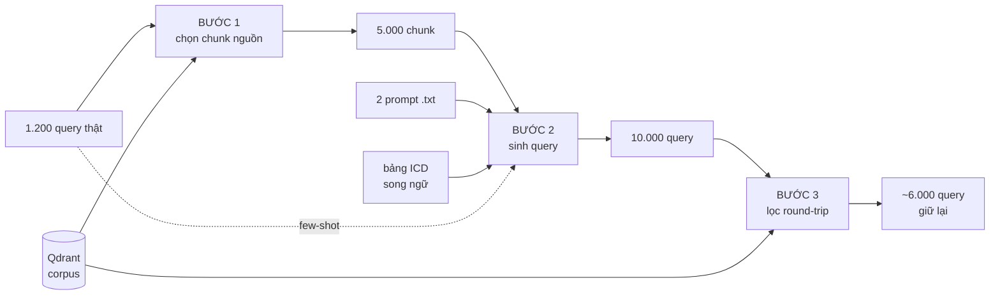
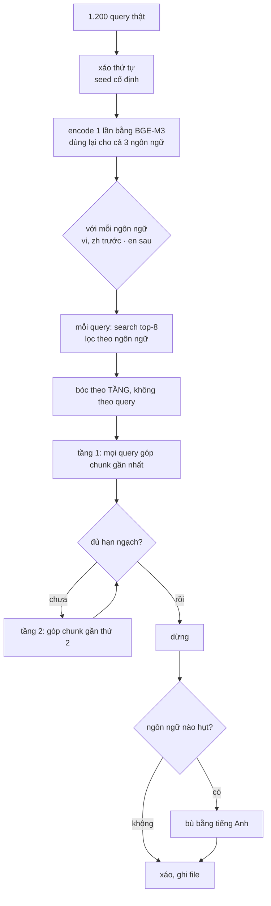
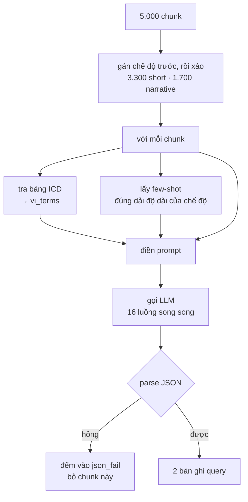
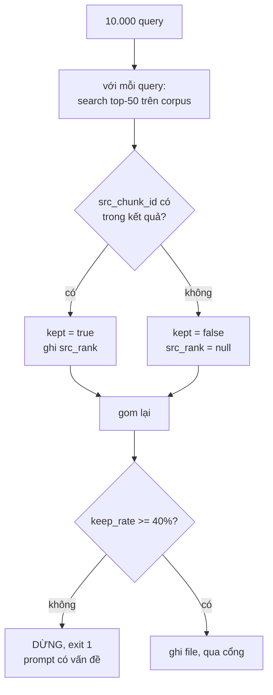

# Bước 1-2-3: từ query thật tới query tổng hợp đã lọc

Code: `src/rag/labeling/steps.py`, chạy qua `src/rag/labeling/run_generate.py`.
Cấu hình: `src/rag/labeling/config.py`.

## Tổng quan

| Bước | Input | Output | Cần LLM |
|---|---|---|---|
| 1 | 1.200 query thật + corpus Qdrant | 5.000 chunk nguồn | không |
| 2 | 5.000 chunk nguồn | 10.000 query tổng hợp | **có** |
| 3 | 10.000 query tổng hợp | ~6.000 query giữ lại | không |



---

## Bước 1 - Chọn chunk nguồn

**Input:** 1.200 query thật (từ `cache/.../vi_bio_mir-train.arrow`) và collection corpus trong Qdrant.
**Output:** 5.000 chunk → `data/labeling/source_chunks.jsonl`

Không chia cụm, không có `k`. Mỗi query thật tự đi lấy chunk gần nó.



**Vì sao bóc theo tầng:** nếu duyệt hết 8 chunk của query 1 rồi mới sang query 2, hạn ngạch sẽ đầy ở query thứ ~600 và 600 query còn lại không góp được gì, chủ đề của chúng biến mất. Bóc theo tầng thì mọi query góp đều nhau, nên chủ đề nào đông query sẽ tự có nhiều chunk hơn.

**Hạn ngạch ngôn ngữ:** EN 3.000 · VI 1.500 · ZH 500. Gom `vi` và `zh` trước để biết hụt bao nhiêu, rồi gom `en` với phần bù. Corpus `zh` phủ kém nên hạn ngạch của nó gần như chắc chắn hụt.

**Trần lý thuyết:** 1.200 query × 8 chunk = 9.600 chunk thô mỗi ngôn ngữ, trước khi bỏ trùng.

Một dòng output:

```json
{"chunk_id": "2522265_c000", "doc_id": "2522265", "language": "en",
 "content": "...", "title": "...", "url": "...",
 "seed_query": "query thật đã kéo chunk này về",
 "seed_depth": 2, "retrieval_score": 0.71}
```

`seed_query` và `seed_depth` không dùng cho bước sau, chúng để audit: đếm được mỗi query thật kéo về bao nhiêu chunk, và mỗi tầng đóng góp bao nhiêu.

---

## Bước 2 - Sinh query tiếng Việt

**Input:** 5.000 chunk nguồn, 2 prompt, bảng ICD song ngữ, pool few-shot.
**Output:** 10.000 query → `data/labeling/gen_queries.jsonl`



**Gán chế độ trước rồi xáo**, không bốc xúc xắc từng chunk: 5.000 lần bốc ngẫu nhiên sẽ lệch khỏi 66/34 vài phần trăm, mà khớp đúng phân phối độ dài chính là lý do bước này tồn tại dưới dạng hai chế độ.

**Bốn biến điền vào prompt:**

| Biến | Nguồn |
|---|---|
| `{{chunk}}` | `content` của chunk nguồn |
| `{{chunk_language}}` | `en` / `vi` / `zh` |
| `{{few_shots}}` | query thật gần chunk về chủ đề **và** đúng dải độ dài của chế độ |
| `{{vi_terms}}` | thuật ngữ tiếng Việt tra từ `icd_bilingual.tsv` khớp với nội dung chunk |

**Few-shot phải lọc theo độ dài**, không chỉ theo similarity. Nếu chỉ lấy top-2 giống chunk nhất thì chế độ `narrative` gần như không bao giờ có mẫu đúng dạng, và model sẽ chỉ sinh câu ngắn sạch.

**`vi_terms` làm hai việc cùng lúc:** cho model từ tiếng Việt đúng thay vì dịch máy móc từ chunk tiếng Anh, và đẩy query dùng từ khác chunk nguồn nên chunk gốc không thắng chỉ nhờ trùng từ vựng.

Một dòng output:

```json
{"qid": "g000123_1", "query": "...", "mode": "narrative", "n_words": 62,
 "src_chunk_id": "...", "src_doc_id": "...", "src_language": "en",
 "vi_terms": ["viêm âm đạo cấp tính"]}
```

---

## Bước 3 - Lọc round-trip

**Input:** 10.000 query tổng hợp.
**Output:** ~6.000 query → `data/labeling/gen_queries_kept.jsonl`



Thay cho bước "LLM judge chọn câu hỏi". Khách quan hơn vì nó đo đúng thứ ta quan tâm (query có định vị được tài liệu không) thay vì hỏi model xem câu hỏi có hay không, và rẻ hơn hàng trăm lần vì không gọi LLM.

Query bị loại là query quá mơ hồ hoặc lạc đề so với chunk nguồn.

**`src_rank` được ghi cả khi query bị loại**, vì nó là tín hiệu độ khó truy xuất miễn phí, không cần model nào sinh ra.

**Cổng chặn:** keep rate dưới 40% thì script thoát với mã lỗi 1. Dưới ngưỡng nghĩa là prompt sinh query đang có vấn đề, chạy tiếp chỉ tạo thêm nhãn rác.

---

## MLflow ghi lại gì

Một lần chạy = một run trong experiment `labeling_query_generation`.

**Params:** toàn bộ `LabelingConfig`, cộng `prompt_<tên>_uri` và `prompt_<tên>_version` của đúng version prompt đã dùng.

**Metrics:**

| Bước | Chỉ số |
|---|---|
| 1 | `b1_n_chunk`, `b1_chunk_en/vi/zh`, `b1_giay` |
| 2 | `b2_n_query`, `b2_ty_le_dai_thuc_te`, `b2_do_dai_trung_vi`, `b2_json_fail`, `b2_llm_fail` |
| 3 | `b3_n_giu`, `b3_keep_rate`, `b3_giu_short`, `b3_giu_narrative` |

`b2_ty_le_dai_thuc_te` là chỉ số quan trọng nhất của bước 2: nó phải gần 0,34. Lệch nhiều nghĩa là prompt không giữ được ràng buộc độ dài.

**Artifacts:** `sample_de_soat.json` (30 query ngẫu nhiên để soát tay) và `gen_queries_kept.jsonl`.

Prompt: file `.txt` là nguồn sự thật, MLflow là sổ ghi version. Sửa file là ăn ngay; `sync()` so nội dung với version mới nhất, giống thì dùng lại, khác thì đăng ký version mới.

---

## Chạy

```bash
python -m src.rag.labeling.run_generate --pilot   # 300 chunk
python -m src.rag.labeling.run_generate           # 5.000 chunk
```

Cần: Qdrant có corpus, vLLM phục vụ model sinh query.

Sau khi chạy, audit độ phủ:

```bash
python -m src.rag.labeling.audit_coverage --stage post
```

Nó đếm mỗi query thật kéo về bao nhiêu chunk và bao nhiêu query không kéo được gì.
