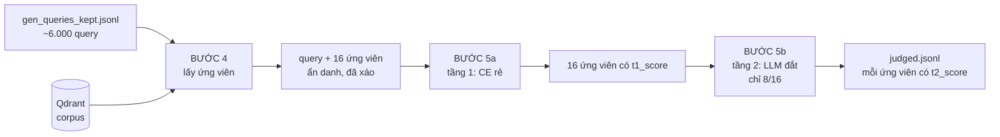
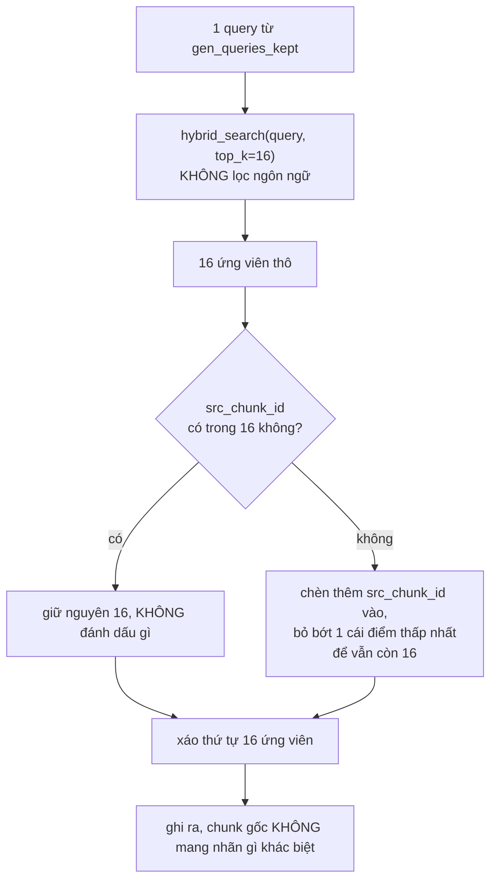
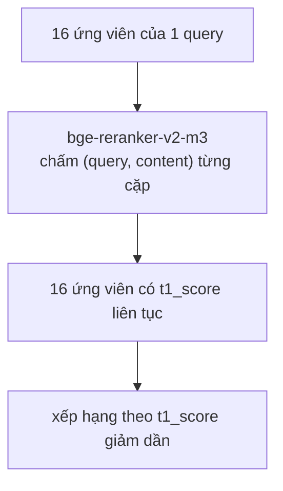
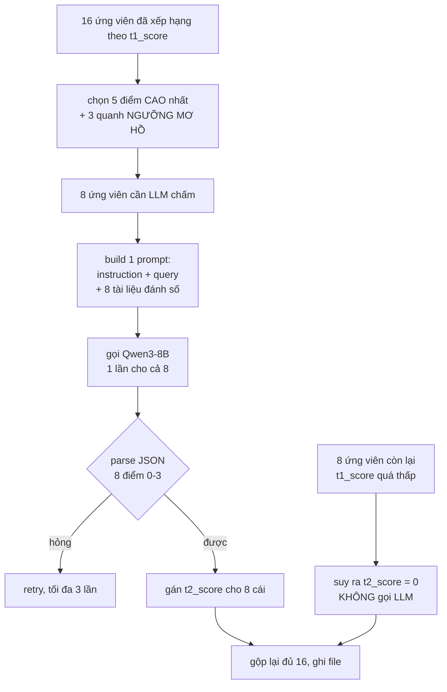

# Bước 4-5: lấy ứng viên, chấm utility hai tầng

**Trạng thái: THIẾT KẾ, CHƯA CODE.** Viết doc trước để thống nhất input/output và
luồng dữ liệu trước khi bắt tay viết `src/rag/labeling/candidates.py` và
`src/rag/labeling/judge.py`.

## Tổng quan

| Bước | Input | Output | Cần LLM |
|---|---|---|---|
| 4 | ~6.000 query giữ lại (từ bước 3) | mỗi query kèm 16 ứng viên chưa gắn nhãn | không |
| 5 | query + 16 ứng viên | mỗi ứng viên có điểm utility 0-3 | **có**, 2 tầng |



---

## Bước 4 - Lấy ứng viên

**Input:** `data/labeling/gen_queries_kept.jsonl` (~6.000 dòng, mỗi dòng có `query`, `src_chunk_id`).
**Output:** `data/labeling/candidates.jsonl` — mỗi dòng 1 query kèm 16 ứng viên.



**Vì sao luôn đưa `src_chunk_id` vào pool dù nó không nằm sẵn trong top-16:**
query được sinh ra TỪ chunk đó, nên nó luôn là ứng viên hợp lệ về mặt logic —
"liệu chunk sinh ra câu hỏi này có tự trả lời được câu hỏi của chính nó không"
là câu cần tầng 2 chấm, không phải câu cần bước 4 quyết định trước. Nhưng nó
**không được gắn nhãn positive trước**, không được đặt ở vị trí cố định, và bị
xáo lẫn vào 16 ứng viên như mọi chunk khác.

**Đây là điểm khác quan trọng nhất so với cách làm thông thường** (nhắc lại từ
spec gốc): nếu mặc định chunk gốc = positive, reranker học được đúng một việc —
đếm độ trùng từ vựng với chunk nguồn, vì query được viết ra từ chính chunk đó
nên luôn mượn thuật ngữ của nó. Trộn ẩn danh buộc tầng 5 phải tự đánh giá nó
dựa trên nội dung, không dựa trên xuất xứ.

**`hybrid_search`, không lọc ngôn ngữ:** cố ý để lẫn ứng viên vi/en/zh cho mỗi
query. Đây chính là chỗ dạy reranker nhận ra "tài liệu tiếng Anh này trả lời
đúng câu hỏi tiếng Việt" — khác với retrieval ban đầu vốn lọc theo nhánh ngôn
ngữ.

**Hard negative cùng chương ICD (tuỳ chọn, TẮT mặc định):** cắm thêm 2 ứng
viên lấy từ bệnh cùng chương ICD nhưng khác mã với bệnh trong query, dùng bảng
`icd_bilingual.tsv` đã có. Việc này **đợi sau khi pilot của bước 4-5 chạy ổn**
mới bật — thêm biến số sớm làm khó debug nếu keep_rate hay tỷ lệ positive lệch
bất thường.

Một dòng output:

```json
{"qid": "g000123_1", "query": "...",
 "candidates": [
   {"chunk_id": "...", "language": "en", "content": "...", "is_src": false},
   {"chunk_id": "src_chunk_cua_qid_nay", "language": "en", "content": "...", "is_src": true},
   ...14 cái nữa...
 ]}
```

`is_src` được ghi lại **chỉ để audit sau này** (ví dụ: đo xem chunk gốc thắng
hay thua bao nhiêu % thời gian ở tầng 5), **không được đưa vào prompt chấm
điểm ở bước 5** — model chấm không được biết cái nào là chunk gốc.

---

## Bước 5 - Chấm utility hai tầng

**Input:** `candidates.jsonl` từ bước 4.
**Output:** `data/labeling/judged.jsonl`, mỗi ứng viên có `t1_score` và (một phần) `t2_score`.

### 5a - Tầng 1: cross-encoder rẻ



Model: `BAAI/bge-reranker-v2-m3` (cùng backbone với reranker đang fine-tune,
nhưng dùng checkpoint gốc chưa train — chấm thô để lọc, không phải model
cuối cùng). Chạy trên GPU local, không cần vLLM, rẻ: batch cả 16 cặp trong
một lần forward.

**Tại sao cần tầng 1 trước khi gọi LLM:** LLM 8B là phần đắt nhất của toàn bộ
pipeline sinh nhãn. Tầng 1 lọc bớt các ứng viên rõ ràng không liên quan (điểm
CE rất thấp) để tầng 2 chỉ phải xử lý phần mơ hồ - đúng/sai chưa rõ.

### 5b - Tầng 2: LLM, chỉ 8/16



**"5 cao nhất + 3 quanh ngưỡng mơ hồ" nghĩa là gì cụ thể:** sau khi tầng 1 xếp
hạng 16 ứng viên theo `t1_score`, chọn vị trí 1-5 (chắc chắn liên quan nhất)
cộng 3 ứng viên nằm quanh điểm median của toàn bộ 16 — đó là vùng CE "lưỡng
lự", không rõ liên quan hay không, cần LLM phân xử. 8 ứng viên còn lại (điểm
thấp nhất) **không gọi LLM**, gán thẳng `t2_score = 0`.

**Vì sao gộp cả 8 tài liệu vào MỘT lời gọi, không gọi 8 lần riêng:** phần
`instruction + query` giống hệt nhau cho cả 8 tài liệu của cùng 1 query. Gộp
vào 1 prompt (tài liệu đánh số 1-8, model trả JSON 8 điểm) tận dụng được
prefix caching của vLLM — phần đầu prompt chỉ nạp 1 lần thay vì 8 lần. Đây là
cơ chế duy nhất khiến ngân sách ~2 giờ cho bước này khả thi (xem mục 6 của
`docs/pipeline-sinh-nhan-reranker.md`).

**Thang điểm, nhắc lại từ spec:**

| Điểm | Nghĩa | Thành |
|---|---|---|
| 3 | Trả lời trực tiếp và đầy đủ | positive, trọng số 1,0 |
| 2 | Có bằng chứng hữu ích nhưng chưa đủ | positive, trọng số 0,6 |
| 1 | Cùng chủ đề, không trả lời được | **bỏ khỏi tập train**, không phải negative |
| 0 | Không liên quan | negative |

**Điểm 1 không dùng làm negative** vì corpus 1,22 triệu tài liệu có hàng chục
bản ghi đúng cho một câu hỏi — ép điểm 1 thành negative là tự tạo negative giả.

**Loại cả query:** nếu không ứng viên nào trong 16 đạt điểm ≥2 (kể cả sau tầng
2), bỏ hẳn query đó khỏi tập train — không có bằng chứng nào để học từ nó.

Một dòng output:

```json
{"qid": "g000123_1", "query": "...",
 "candidates": [
   {"chunk_id": "...", "language": "en", "t1_score": 0.91, "t2_score": 3, "weight": 1.0, "is_src": false},
   {"chunk_id": "...", "language": "vi", "t1_score": 0.44, "t2_score": 1, "weight": null, "is_src": false},
   {"chunk_id": "...", "language": "en", "t1_score": 0.08, "t2_score": 0, "weight": 0.0, "is_src": true}
 ]}
```

---

## MLflow ghi lại gì

Một lần chạy = một run, experiment gợi ý `labeling_judging`.

**Params:** `LabelingConfig`, `prompt_judge_tier2_uri` + version.

**Metrics:**

| Bước | Chỉ số |
|---|---|
| 4 | `b4_n_query`, `b4_src_missing_from_top16` (tần suất phải chèn thủ công) |
| 5a | `b5a_giay`, phân phối `t1_score` (p10/p50/p90) |
| 5b | `b5b_n_llm_call`, `b5b_json_fail`, phân phối điểm theo mức 0/1/2/3 |
| cuối | `ty_le_query_bi_loai` (không có ứng viên ≥2), `ty_le_src_thang` (chunk gốc đạt ≥2, dùng để audit rò rỉ xuất xứ) |

`ty_le_src_thang` là chỉ số đáng theo dõi nhất: nếu chunk gốc thắng (đạt điểm
cao) gần 100% số query, nghĩa là cơ chế trộn ẩn danh không thực sự phá được
lợi thế trùng từ vựng — cần xem lại prompt bước 2 có đang để lộ thuật ngữ quá
rõ không.

**Artifacts:** mẫu 30-50 bản ghi `judged.jsonl` để soát tay — đây là cổng chặn
số 2 trong `TODO.md`.

---

## Việc cần quyết trước khi code

1. **Prompt tầng 2** — cùng nguyên tắc như bước 2: bạn viết ở
   `prompts/judge_tier2.txt`, tôi chỉ load và validate biến. Biến dự kiến:
   `{{query}}`, `{{documents}}` (8 tài liệu đã đánh số, format JSON hoặc
   markdown list - cần bạn chọn), yêu cầu output JSON `{"scores": [3,0,2,...]}`
   theo đúng thứ tự đánh số.

2. **Ngưỡng "quanh median" để chọn 3 ứng viên mơ hồ** — hiện đề xuất là 3 vị
   trí gần median nhất theo `t1_score` trong số 16. Có thể cần chỉnh sau khi
   thấy phân phối `t1_score` thật từ pilot.

3. **`chunks_per_candidate_set = 16`** đã cố định trong `LabelingConfig`
   (dùng chung tham số `chunks_per_real_query`? hay cần field riêng) — cần
   thêm field mới `candidates_per_query: int = 16` và `tier2_per_query: int = 8`
   vào `config.py`.
