# Kiến Trúc Luồng Xử Lý Chunker Dispatcher & Pipeline

Tài liệu này mô tả chi tiết luồng điều phối (**ChunkerDispatcher**) và quy trình cắt đoạn văn bản (**Hierarchical Chunking Pipeline**) hỗ trợ đa hình cả **Document Dict** và **Raw Text String**.

---

## 1. Sơ Đồ Luồng Tổng Thể (Mermaid Diagram)

```mermaid
flowchart TD
    %% Input Layer
    subgraph INPUT ["1. Đầu Vào (Đa Hình)"]
        InDoc["Document Dict<br/><code>doc = {'source': ..., 'content': ...}</code>"]
        InText["Raw Text String<br/><code>text = '1. Tiêu đề...'</code>"]
    end

    %% Dispatcher Layer
    subgraph DISPATCHER ["2. ChunkerDispatcher (Open/Closed)"]
        TypeCheck{"Kiểm tra kiểu dữ liệu?"}
        DetectLang["Detect & Normalize Language<br/><i>(vi-VN → vi, en-US → en, zh-CN → zh)</i>"]
        RegistryLookup{"ChunkerRegistry.get(lang)"}
        Fallback["Fallback về 'vi' Chunker"]
        Instantiate["Khởi tạo / Resolve Chunker Strategy"]
    end

    %% Vietnamese Hierarchical Chunker
    subgraph VI_CHUNKER ["3. VietnameseHierarchicalChunker (2 Tầng)"]
        %% Bước 1: Tiền xử lý
        subgraph STEP1 ["Bước 1: Tiền Xử Lý & Chuẩn Hóa"]
            Promoter["Heading Promoter<br/><i>Chuẩn hóa **1. ...** → ## 1. ...</i>"]
            FilterFP["Lọc False-Positive<br/><i>Đoạn riêng, <100 ký tự, không chấm giữa</i>"]
        end

        %% Bước 2: Tách Tầng 1
        subgraph STEP2 ["Bước 2: Tầng 1 - Section Level"]
            MDHeaderSplitter["MarkdownHeaderTextSplitter<br/><i>strip_headers=False (giữ heading text)</i>"]
            Sections["Danh sách Sections"]
        end

        %% Bước 3: Đóng gói ngữ nghĩa
        subgraph STEP3 ["Bước 3: Binding Ngữ Nghĩa"]
            HeadingBind["Heading-to-Content Binding<br/><i>Gắn chặt Tiêu đề vào Đoạn nội dung ngay sau</i>"]
            AtomicUnits["Danh sách Atomic Semantic Units"]
        end

        %% Bước 4: Tách Tầng 2 & Merge
        subgraph STEP4 ["Bước 4: Tầng 2 - Cross-Section Greedy Merge"]
            MergeCheck{"unit + buffer <= 1500 ký tự?"}
            MergeUnit["Gộp tuần tự (Target: 800 - 1500 chars)"]
            FallbackSentence["Oversized Splitter Fallback<br/><i>Tách câu an toàn: bảo vệ PGS.TS., 99.5%</i>"]
            SentenceOverlap["Kế thừa Sentence Overlap 10-15%"]
            EmitChunk["Tạo Chunk Object"]
        end

        %% Bước 5: Làm sạch Markdown
        subgraph STEP5 ["Bước 5: Markdown Cleaner"]
            CleanMD["Strip Markdown Syntax<br/><i>Khử bỏ **, *, ## rác → Plain Text chuẩn</i>"]
        end
    end

    %% Output Layer
    subgraph OUTPUT ["4. Đầu Ra (Dual API Chunk)"]
        FinalChunks["List[Chunk]<br/>• chunk.content / chunk['content']<br/>• chunk.metadata / chunk['metadata']<br/>• Kích thước: 800 - 1500 chars<br/>• Tối ưu tuyệt đối cho LCS Recall & Vectorstore"]
    end

    %% Flow connections
    InDoc --> TypeCheck
    InText --> TypeCheck
    TypeCheck -- "Là dict" --> DetectLang
    TypeCheck -- "Là str" --> DetectLang

    DetectLang --> RegistryLookup
    RegistryLookup -- "Tìm thấy" --> Instantiate
    RegistryLookup -- "Không tìm thấy" --> Fallback --> Instantiate

    Instantiate --> Promoter
    Promoter --> FilterFP --> MDHeaderSplitter --> Sections
    Sections --> HeadingBind --> AtomicUnits
    AtomicUnits --> MergeCheck
    MergeCheck -- "Vừa vặn" --> MergeUnit
    MergeCheck -- "Quá dài >1500" --> FallbackSentence --> MergeUnit
    MergeUnit --> SentenceOverlap --> CleanMD --> EmitChunk --> FinalChunks
```

---

## 2. Giải Thích Ngắn Gọn Các Thành Phần

### A. Đa hình đầu vào (Hỗ trợ cả Document và Raw Text)
- **Nếu truyền Document Dict:** Tự động trích xuất `content.markdown` và đọc ngôn ngữ từ `source.language` hoặc `language_category`.
- **Nếu truyền Raw Text (`str`):** Tự động bọc cấu trúc nhẹ, cho phép truyền tham số `language` (mặc định `'vi'`) và `metadata` tùy ý.

### B. Cơ chế Dispatcher (Nguyên lý Open/Closed)
- Đăng ký chiến lược mới dễ dàng bằng decorator: `@ChunkerRegistry.register("zh")` mà không sửa core code.
- Chuẩn hóa mã vùng ngôn ngữ (ví dụ `vi-VN` $\rightarrow$ `vi`).
- Fallback an toàn về bộ cắt mặc định (`vi`) nếu gặp mã ngôn ngữ chưa hỗ trợ.

### C. Quy trình Chunking 2 tầng Tiếng Việt
1. **Heading Promoter:** Chuyển các heading giả (`**1. Tên**`, `**IV. Tên**`) thành `## ` chuẩn Markdown, loại bỏ báo động giả (false-positive).
2. **Section Splitter:** Tách tài liệu thành các Section lớn theo Heading và giữ nguyên text của Heading.
3. **Heading-to-Content Binding:** Ràng buộc tiêu đề mục luôn đi liền với nội dung mô tả, không để tiêu đề bị cô lập ở cuối chunk trước.
4. **Cross-Section Greedy Merge:** Gom các mục nhỏ liên tiếp cho tới khi đạt kích thước mục tiêu **800 – 1500 ký tự** (triệt tiêu tình trạng chunk vụn 30–50 từ). Nếu gặp đoạn dài bất thường ($>1500$ chars), tự động ngắt theo câu văn tiếng Việt an toàn (bảo vệ chức danh viết tắt `PGS.TS.`, `BS.`, số thập phân).
5. **Sentence Overlap:** Kế thừa **10% – 15%** câu cuối của chunk trước sang chunk sau để tránh cắt đứt câu trả lời.
6. **Markdown Cleaner:** Dọn sạch các ký tự markup rác (`**`, `##`) nhưng giữ nguyên text và số $\rightarrow$ Tối ưu hóa điểm khớp **LCS tokens** và chỉ mục vector.
