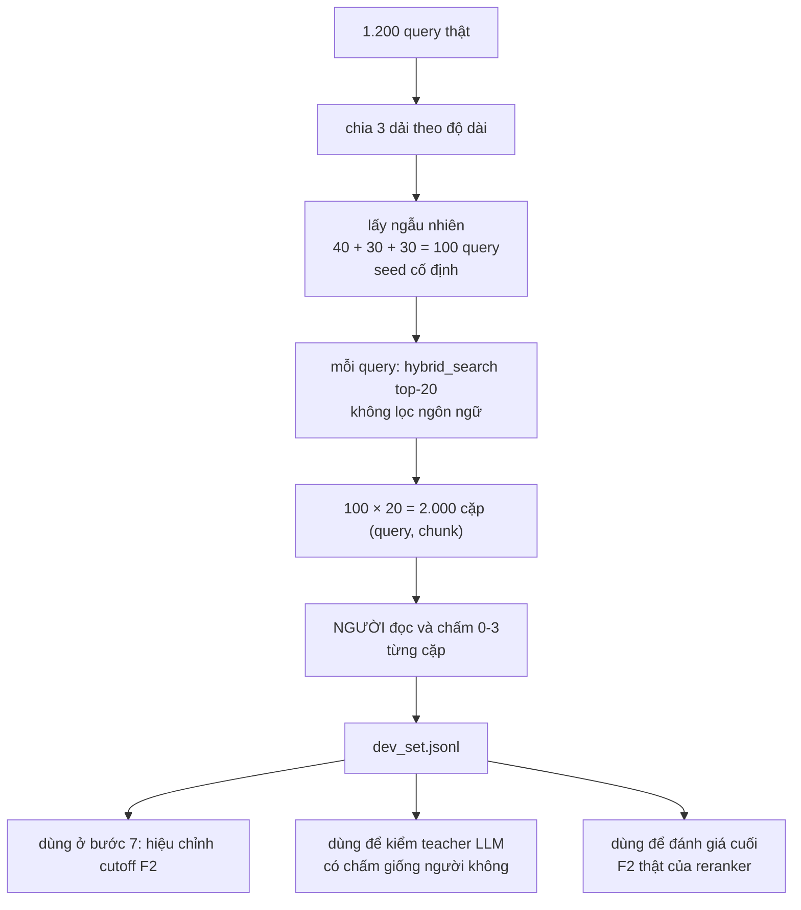

# Dev set gán tay - 100 query

**Trạng thái: THIẾT KẾ, chưa có script hỗ trợ.** Việc gán nhãn là việc tay,
nhưng bước chuẩn bị dữ liệu (chọn 100 query, lấy top-20 ứng viên) có thể
viết script. Chưa viết - xem mục "Việc cần quyết" ở cuối.

## Input / Output

| | |
|---|---|
| **Input** | 1.200 query thật + corpus trong Qdrant |
| **Output** | `data/labeling/dev_set.jsonl` - 100 query × 20 ứng viên, mỗi ứng viên có điểm người gán 0-3 |
| **Cần LLM** | không. Đây là nhãn **người**, không phải nhãn máy |



---

## Vì sao phải là NGƯỜI, không phải LLM

Nếu dùng chính Qwen3-8B để gán dev set, rồi dùng dev set đó đo xem reranker
(train từ nhãn do chính Qwen3-8B sinh ra) có tốt không - đó là **đo một model
bằng chính thước nó tự tạo ra**. Số liệu sẽ luôn đẹp dù pipeline có sai ở đâu.

Dev set tồn tại chỉ để làm một việc: là nguồn sự thật **độc lập** với toàn bộ
pipeline tự động phía trên.

---

## Bước 1 - Chọn 100 query

Không chọn ngẫu nhiên đều trên 1.200 query. Chia theo độ dài trước, vì độ dài
quyết định độ khó truy xuất rất khác nhau (câu ngắn thiếu neo, câu dài nhiễu).

| Dải | Ngưỡng | Số query lấy | Khớp với phân phối thật đã đo |
|---|---|---|---|
| Ngắn | ≤ 15 từ | 40 | 39,5% tập thật |
| Vừa | 16-30 từ | 30 | 26,8% tập thật |
| Kể bệnh dài | > 30 từ | 30 | 33,8% tập thật (21,7% + 12,1%, gộp lại) |

Ba ngưỡng này **không phải chọn bừa** - chúng khớp đúng 3 cụm phân phối độ dài
đã đo trên 1.200 query thật (xem `docs/pipeline-sinh-nhan-reranker.md` mục 4).
Ngưỡng 30 từ cũng trùng với `narrative_word_threshold` đang dùng ở bước 2, nên
dev set phản ánh đúng tỷ lệ 2 chế độ sinh query.

**Seed cố định** khi lấy mẫu ngẫu nhiên trong mỗi dải (dùng chung `cfg.seed`).
Lý do: dev set phải **ổn định qua các lần chạy lại** - nếu mỗi lần sample lại
ngẫu nhiên thì không so sánh được "prompt tuần trước" với "prompt tuần này"
trên cùng một thước đo.

---

## Bước 2 - Lấy ứng viên

Với mỗi trong 100 query: `hybrid_search(query, top_k=20)`, **không lọc ngôn
ngữ** - giống hệt cách bước 4 lấy ứng viên cho pipeline train, để dev set đo
đúng loại khó khăn mà reranker thật sự gặp (ứng viên vi/en/zh trộn lẫn).

Ra 100 × 20 = 2.000 cặp `(query, chunk)` cần đọc.

---

## Bước 3 - Người đọc và chấm

Dùng **đúng thang điểm của bước 5**, không phải thang riêng - đây là điểm mấu
chốt khiến dev set so sánh được với nhãn máy:

| Điểm | Nghĩa |
|---|---|
| 3 | Trả lời trực tiếp và đầy đủ câu hỏi |
| 2 | Có bằng chứng hữu ích nhưng chưa đủ |
| 1 | Cùng chủ đề, không trả lời được |
| 0 | Không liên quan |

Phần lớn trong 2.000 cặp loại được trong 2 giây (nhìn chủ đề là biết không
liên quan, chấm 0 luôn). Ước tính tổng 3-4 giờ.

Một dòng output:

```json
{"query": "Viêm lưỡi kéo dài có sao không?",
 "query_band": "ngan",
 "candidates": [
   {"chunk_id": "...", "language": "vi", "content": "...", "human_score": 3},
   {"chunk_id": "...", "language": "en", "content": "...", "human_score": 2},
   {"chunk_id": "...", "language": "zh", "content": "...", "human_score": 0}
 ]}
```

---

## Ba chỗ dùng - không chỉ một

Doc chính (`pipeline-sinh-nhan-reranker.md` mục 8) chỉ nhắc 1 trong 3 việc
dev set làm. Nói đủ cả 3 ở đây:

**1. Hiệu chỉnh cutoff F2 (bước 7).** Quét `k` từ 3-30, chọn `k` tối đa F2
tính trên nhãn người. Đây là việc đã biết.

**2. Kiểm teacher LLM có đáng tin không.** Lấy đúng 2.000 cặp này, cho
Qwen3-8B chấm lại (cùng prompt, cùng thang điểm), rồi so `t2_score` với
`human_score`. Tỷ lệ khớp thấp (ví dụ lệch >1 điểm trên nhiều cặp) là bằng
chứng cụ thể để quyết "có cần đổi sang 14B cho tầng 2 không" - thay vì đoán
mò như ghi chú ở mục 2 của doc chính.

**3. Đánh giá cuối cùng.** Sau khi reranker train xong, chạy nó trên 100 query
này, tính F2 thật so với `human_score`. Đây là con số duy nhất đáng tin để
báo cáo "pipeline có chạy được không" - mọi số liệu khác trong các doc trước
đều là tự đo bằng chính hệ thống đang xây.

---

## Khi nào làm

**Chưa làm bây giờ.** Corpus EN/VI chưa ingest (như đã nói ở các lượt trước).
Nếu gán nhãn 2.000 cặp bây giờ, phần lớn ứng viên sẽ là tài liệu tiếng Trung
kém liên quan - nhãn gán ra không phản ánh corpus thật, phải làm lại.

Làm **sau khi ingest xong EN/VI**.

**Một điểm không mất công nếu corpus đổi sau này:** nhãn gắn với cặp
`(query, chunk_id)` cụ thể, không gắn với thứ hạng. Nếu sau này ingest thêm
tài liệu và `hybrid_search` trả về ứng viên mới chưa từng gán, chỉ cần chấm
bổ sung cho ứng viên mới đó - không phải xoá làm lại từ đầu. Dev set là tập
**cộng dồn**, không phải tập tĩnh một lần.

---

## Việc cần quyết

**Có cần script tự động lấy 100 query + top-20 ứng viên ra file sẵn để điền
điểm không?** Phần chọn query và chạy search là việc máy làm được
(`hybrid_search` đã có sẵn trong `src/rag/labeling/steps.py`), chỉ phần đọc
và chấm điểm là việc tay. Nếu muốn, tôi viết một script nhỏ xuất ra
`dev_set_template.jsonl` với cột `human_score` để trống, bạn chỉ cần điền số
vào - chưa viết vì chưa được yêu cầu.

---

## Mức độ kiểm chứng

- Ba ngưỡng độ dài (≤15 / 16-30 / >30) và tỷ lệ 40/30/30: **suy ra** từ phân
  phối thật đã đo trên 1.200 query (mục 4 doc chính), **chưa chạy thử** việc
  lấy mẫu thật.
- Toàn bộ nội dung mục "Ba chỗ dùng": **thiết kế**, chưa có cặp nhãn thật nào
  để kiểm chứng số liệu.
