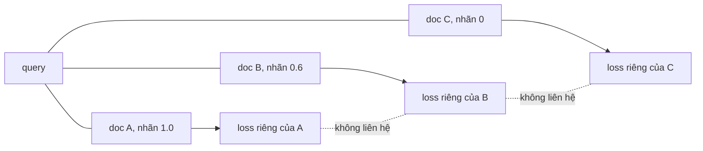
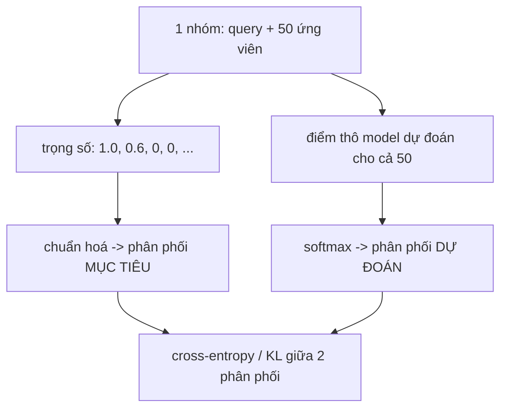

# Hàm loss cho reranker

Giải thích vì sao `BinaryCrossEntropyLoss` hiện tại trong `sft-reranker/main.py` không hợp, và listwise cross-entropy/KL thay thế nó như thế nào.
Không có code ở đây, chỉ giải thích cơ chế.

---

## 1. BCE hiện tại chấm gì

`BinaryCrossEntropyLoss` nhìn vào **một cặp (query, doc) một lúc**.
Với mỗi cặp, nó so điểm model dự đoán với một nhãn (0 hoặc 1, hoặc một số liên tục), và phạt theo công thức BCE chuẩn.

Điểm quan trọng: khi tính loss cho cặp (query, doc A), model **không biết gì về doc B, C, D** cũng đang là ứng viên của cùng query đó.
Mỗi cặp được chấm như một bài toán độc lập hoàn toàn.

Ba cái loss này cộng lại, nhưng chúng **không bao giờ so sánh A với B** trong lúc tính.
Model có thể đạt loss thấp bằng cách chấm A=0.9, B=0.5, C=0.55 - BCE không phạt việc C cao hơn B, vì BCE chưa bao giờ nhìn thấy A, B, C cùng lúc.

---

## 2. Vì sao đây là vấn đề với dữ liệu của ta

`judged.jsonl` không phải danh sách cặp phẳng.
Nó là **nhóm**: một query đi kèm 50 ứng viên, mỗi ứng viên có trọng số riêng (1.0, 0.6, bỏ, hoặc 0.0).

Việc ta cần model học không phải "cặp này đúng hay sai" - mà là **giữa 50 ứng viên này, cái nào đáng xếp trên cái nào**.
F2 tính trên một danh sách đã xếp hạng và một ngưỡng cắt, nên thứ tự tương đối giữa các ứng viên *của cùng một query* mới là thứ quan trọng, không phải điểm tuyệt đối của từng cặp riêng lẻ.

BCE bỏ phí đúng cấu trúc nhóm này, vì nó chủ động tách rời từng cặp ra khi tính loss.

---

## 3. Listwise cross-entropy / KL - cơ chế

Ý tưởng: tính loss **theo cả nhóm 1 lần**, không theo từng cặp.

1. Lấy trọng số của tất cả ứng viên trong nhóm (1.0, 0.6, 0, 0, ...).
2. Chuẩn hoá chúng thành một **phân phối xác suất mục tiêu** - chia mỗi trọng số cho tổng tất cả trọng số trong nhóm.
3. Lấy điểm thô model dự đoán cho cả nhóm, đưa qua softmax để ra một **phân phối xác suất dự đoán**.
4. Tính cross-entropy (hoặc KL divergence) giữa hai phân phối này.

Vì tất cả 50 ứng viên đi vào CÙNG một phép softmax, model buộc phải so sánh chúng với nhau để tối ưu loss - không thể "lờ" đi việc A nên cao hơn B như BCE.

---

## 4. Ví dụ số cụ thể (rút gọn về 4 ứng viên cho dễ theo)

Một nhóm nhỏ: doc A (trọng số 1.0), doc B (trọng số 0.6), doc C và D (trọng số 0).

**Bước 1-2, phân phối mục tiêu:**

Tổng trọng số = 1.0 + 0.6 + 0 + 0 = 1.6

| | A | B | C | D |
|---|---|---|---|---|
| Trọng số | 1.0 | 0.6 | 0 | 0 |
| Mục tiêu (chuẩn hoá) | 0,625 | 0,375 | 0 | 0 |

**Bước 3, điểm thô model dự đoán** (ví dụ, model chưa train kỹ): A=2.0, B=1.5, C=0.5, D=0.3

Qua softmax:

| | A | B | C | D |
|---|---|---|---|---|
| Điểm thô | 2.0 | 1.5 | 0.5 | 0.3 |
| Dự đoán (softmax) | 0,497 | 0,301 | 0,111 | 0,091 |

**Bước 4, cross-entropy** = -(0,625 × log 0,497 + 0,375 × log 0,301) ≈ 0,887

Gradient từ con số này sẽ kéo điểm A lên **nhiều hơn** điểm B (vì mục tiêu của A là 0,625, lớn hơn mục tiêu của B là 0,375), và kéo cả A, B lên so với C, D.
Đây chính là cơ chế dạy model "A đáng tin hơn B, cả hai đáng tin hơn C và D" - trong **một** phép tính, không phải 4 phép tính rời rạc như BCE.

---

## 5. So sánh trực tiếp trên cùng ví dụ

| | BCE | Listwise cross-entropy |
|---|---|---|
| Nhìn thấy cả nhóm cùng lúc | Không - từng cặp riêng | Có - cả 50 ứng viên vào 1 softmax |
| Phạt khi C xếp trên B | Không chắc - BCE không so A,B,C với nhau | Có - vì softmax ép chúng cạnh tranh |
| Dùng được nhiều positive trọng số khác nhau (1.0 và 0.6) | Khó - BCE cần 1 ngưỡng/nhãn rời | Tự nhiên - trọng số là chính phân phối mục tiêu |
| Khớp với cách F2 được tính (xếp hạng + cắt ở k) | Yếu | Đúng hướng |

---

## 6. Việc cần làm khi code (chưa làm, chỉ ghi lại)

1. **Data loader phải gom theo `qid`**: một batch/nhóm đưa vào loss phải là toàn bộ ứng viên của CÙNG một query, không phải danh sách cặp phẳng như `train.jsonl` hiện tại.
2. **Xác nhận tên class trong `sentence_transformers.cross_encoder.losses`** - thư viện có loss listwise dạng này (tên gần đúng: `ListNetLoss`, `LambdaLoss`), nhưng cần kiểm tra lại đúng tên và cách dùng theo phiên bản `sentence-transformers` đang cài, vì phần loss cho `CrossEncoder` được thêm/đổi khá thường xuyên.
3. Giữ nguyên backbone `bge-reranker-v2-m3`, `max_length=1024`, `bf16`, `gradient_checkpointing` - những cái này không liên quan đến loss, không cần đổi.

---

## 7. Mức độ kiểm chứng

- Cơ chế BCE chấm từng cặp độc lập: **đã đọc code** (`sft-reranker/main.py` dùng `BinaryCrossEntropyLoss(model)`).
- Ví dụ số ở mục 4: **minh hoạ bằng tay**, không phải số đo từ model thật - mục đích là giải thích cơ chế, không phải báo cáo kết quả.
- Listwise cross-entropy là lựa chọn đúng cho dữ liệu nhiều positive có trọng số: **suy luận** từ cấu trúc dữ liệu đã thiết kế (bước 4-5) và cách F2 được tính, khớp với hướng đã ghi trong `docs/pipeline-sinh-nhan-reranker.md` mục 1.2 và bước 6.
- Tên class cụ thể trong `sentence_transformers.cross_encoder.losses`: **chưa xác nhận**, cần kiểm tra lại khi code, không lấy từ hiểu biết sẵn có mà không xác minh.
