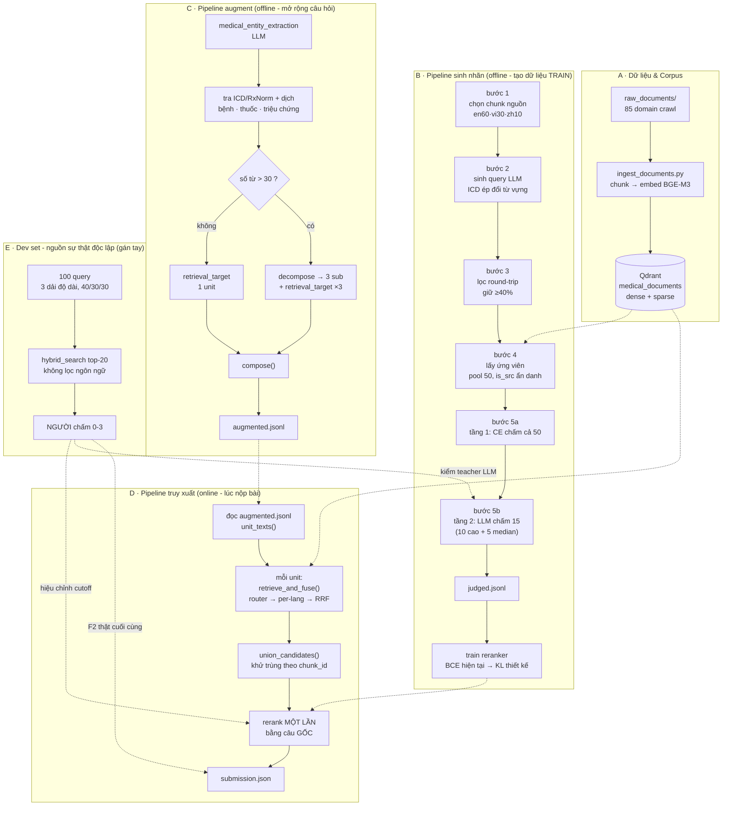

# Kiến trúc tổng quan - ViBioMIR

Doc này ghép lại bức tranh toàn hệ thống từ các quyết định đã chốt rải rác
trong các doc riêng từng bước. Mỗi doc con vẫn là nguồn chi tiết cho phần
việc của nó; doc này chỉ nối chúng lại và nói rõ cái gì phụ thuộc cái gì.

Doc con liên quan: [buoc-1-2-3-sinh-query.md](buoc-1-2-3-sinh-query.md),
[buoc-4-5-cham-utility.md](buoc-4-5-cham-utility.md),
[dev-set-gan-tay.md](dev-set-gan-tay.md),
[ham-loss-reranker.md](ham-loss-reranker.md).

---

## Sơ đồ

Mũi tên liền trong một khối = luồng dữ liệu chính của khối đó. Mũi tên chấm
xuyên khối = phụ thuộc chéo giữa các khối.

---

## Vì sao có hai pipeline offline tách rời (B và C)

Hai pipeline này giải hai bài toán khác nhau, không phải một việc chia đôi:

- **B tạo DỮ LIỆU để train** reranker - chạy một lần, hoặc vài lần khi đổi
  thiết kế, kết quả là một checkpoint model.
- **C xử lý TỪNG CÂU HỎI tại thời điểm truy xuất** - chạy cho mỗi query
  thật, kết quả là một chuỗi mở rộng dùng ngay, không lưu lại thành model.

Vì khác vai trò nên khác cả tần suất chạy, khác cả thứ tiêu tốn (B tốn GPU
local cho CE + LLM theo lô lớn một lần; C tốn LLM theo từng query nhỏ nhưng
chạy liên tục mỗi lần có câu hỏi mới).

---

## Ba điểm thiết kế dễ hiểu nhầm nhất

### 1. Khối D - rerank dùng câu GỐC, không dùng chuỗi augment

Dữ liệu train reranker (khối B) là câu hỏi tự nhiên do LLM sinh ở bước 2,
chưa từng augment. Đưa chuỗi augment (đầy thuật ngữ đa ngữ nối thêm) vào lúc
rerank là lệch phân phối train/test - mô hình thấy một dạng input khác hẳn
lúc nó học.

`MultiQueryPipeline` có cờ `rerank_with_augmented` để đo hướng ngược lại,
mặc định tắt. Bật cờ này chỉ hợp lý nếu tập train ở khối B cũng được augment
rồi train lại - nếu không, đang đo một hệ lệch.

### 2. Khối B4 - is_src trộn ẩn danh, không đánh dấu

Chunk nguồn của câu hỏi (chunk mà câu hỏi được sinh ra từ đó) được chèn vào
đúng nhóm ngôn ngữ của nó trong pool 50 ứng viên, xáo vị trí ngẫu nhiên, và
trường `is_src` không bao giờ lộ cho LLM chấm ở bước 5b. Mục đích: ép
reranker học đánh giá nội dung thật, không học mẹo "trùng từ vựng với câu
hỏi = đúng".

### 3. Khối E - dev set độc lập hoàn toàn với B và C

Nếu dùng chính Qwen3-8B gán cả dữ liệu train (khối B) lẫn dev set (khối E),
số F2 cuối cùng sẽ luôn đẹp dù pipeline sai ở đâu - vì đang đo một model
bằng chính thước nó tự tạo ra. Đây là lý do duy nhất dev set bắt buộc phải
là người chấm, không phải LLM. Chi tiết: [dev-set-gan-tay.md](dev-set-gan-tay.md).

---

## Trạng thái thật theo từng khối

| Khối | Trạng thái | Bằng chứng |
|---|---|---|
| A - Dữ liệu & Corpus | Code xong. Ingest **chưa chạy** trên server thật | `ingest_documents.py` + ledger resumable |
| B1-B3 - chọn chunk, sinh query, lọc | Code + prompt xong. Chưa chạy pilot thật | chặn bởi A (cần corpus EN/VI) |
| B4-B5 - lấy ứng viên, chấm 2 tầng | Code xong, test giả lập qua | `tests/test_labeling_judge.py`, 18 test |
| B7 - train reranker | Code có (`sft-reranker/main.py`), đang BCE | đổi sang listwise KL: thiết kế xong, **chưa code** |
| C - augment | Code xong, test giả lập qua | `tests/test_augment.py`, 30 test |
| D - truy xuất + multi-query | Code xong, test giả lập qua | `tests/test_multiquery.py`, 16 test |
| E - dev set | Chỉ có thiết kế | `docs/dev-set-gan-tay.md`, chưa script, chưa nhãn nào |

Điểm chung của B, C, D: **tất cả mới chạy qua đồ giả** (fake vectorstore, fake
LLM client, fake cross-encoder), chưa một dòng nào chạm Qdrant/vLLM thật - vì
corpus EN/VI chưa ingest. Test giả lập chứng minh *logic đúng*, không chứng
minh *chạy được trên hạ tầng thật*.

---

## Việc còn mở, chưa quyết

- **Cách tra ICD** (khối C): nhiều cụm tiếng Việt thường gặp ("loét tá
  tràng", "tiểu đường", "ung thư phổi") tra không ra vì bảng gốc lưu dạng đầy
  đủ định tố, chưa quyết cách khớp rộng hơn mà không gây khớp bừa.
- **Script lấy mẫu dev set** (khối E): chọn 100 query + chạy `hybrid_search`
  là việc máy làm được, chưa viết vì chưa được yêu cầu.
- **Đổi loss sang listwise KL** (B7): cần dữ liệu thật từ B6 mới verify được
  tên class chính xác trong `sentence_transformers.cross_encoder.losses`.
