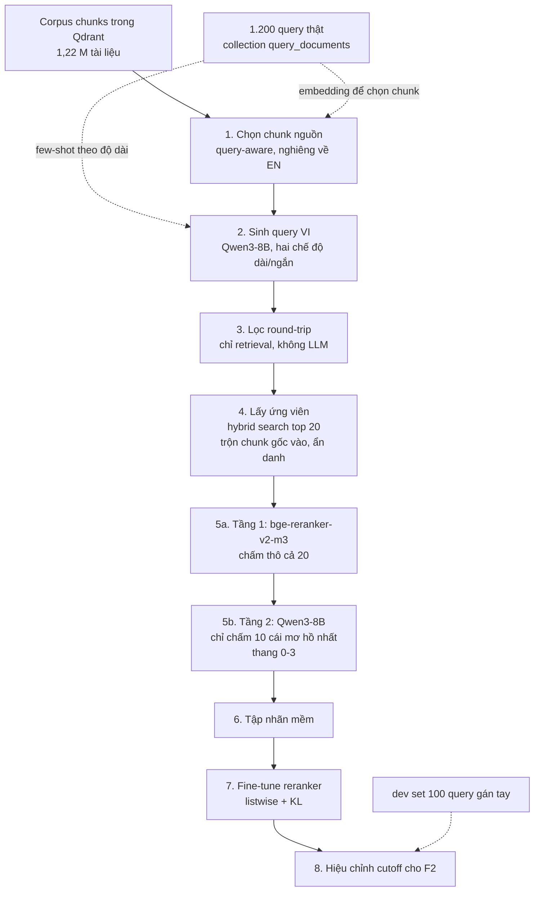

# Pipeline sinh nhãn cho reranker - chốt phương án

Phiên bản 2026-10-19.
Mục tiêu: sinh tập nhãn `(query, doc, utility)` để fine-tune reranker đa ngữ, trong điều kiện không có nhãn vàng nào từ ban tổ chức.
Chấm bằng F2, deadline 31/10.

---

## 0. Hai lỗi phải sửa trước khi làm gì khác

### 0.1 Reranker hiện tại là model chỉ biết tiếng Anh

`sft-reranker/main.py` đang fine-tune `cross-encoder/ms-marco-MiniLM-L-6-v2`.
Model này train trên MS MARCO tiếng Anh, tokenizer và vốn từ đều là tiếng Anh.
Query của cuộc thi 100% tiếng Việt, tài liệu đa số tiếng Anh.
Cặp vi→en sẽ không bao giờ hoạt động với backbone này, bất kể dữ liệu train tốt đến đâu.

Thay bằng `BAAI/bge-reranker-v2-m3` (568M, đa ngữ, cùng họ với BGE-M3 đang dùng làm retriever).
Đây là thay đổi bắt buộc, không phải tối ưu hóa.

### 0.2 Loss hiện tại là BinaryCrossEntropy pointwise

`BinaryCrossEntropyLoss` chấm từng cặp độc lập, không học được thứ tự tương đối.
Với F2 cần nhiều positive mỗi query và cần điểm số hiệu chỉnh được, loss đúng là listwise có nhãn mềm.
Chi tiết ở bước 6.

---

## 1. Chốt phần cứng và mô hình

Một GPU 5060 Ti 16GB.
Nút cổ chai là **prefill** (giai đoạn nạp prompt), không phải decode, vì khâu chấm điểm có prompt rất dài và output rất ngắn.

| Vai trò | Model | VRAM | Lý do chọn |
|---|---|---|---|
| Sinh query | Qwen3-8B-AWQ (4-bit) | ~5,5 GB weights | Mạnh đều cả vi/en/zh, tắt được thinking mode |
| Chấm utility, tầng 2 | Cùng model trên, dùng lại server | dùng chung | Không đổi model giữa chừng, đỡ thời gian nạp |
| Chấm utility, tầng 1 | `BAAI/bge-reranker-v2-m3` | ~1,2 GB | Lọc thô, rẻ hơn hàng chục lần |
| Student reranker | `BAAI/bge-reranker-v2-m3` | ~10 GB khi train | Backbone đa ngữ, cùng họ retriever |
| Router | **không train model**, chạy Qwen3-8B một lượt rồi cache | - | Xem mục 9 |

Quy tắc VRAM: **chạy tuần tự, không chạy song song**.
vLLM với `--gpu-memory-utilization 0.85` sẽ chiếm khoảng 13,6 GB, không còn chỗ cho BGE-M3 hay quá trình train.
Dừng vLLM trước khi train.

---

## 2. Sơ đồ E2E



---

## 3. Từng bước

### Bước 1 - Chọn chunk nguồn

Không sample đều trên 1,22 M tài liệu.
Câu hỏi thật tập trung vào sản phụ khoa, nhi, da liễu, nam khoa, tiêu hóa.

- Encode 1.200 query thật bằng BGE-M3, cluster thành khoảng 30 cụm.
- Với mỗi cụm, truy xuất top-N chunk gần nhất từ Qdrant làm chunk nguồn.
- Tỷ lệ ngôn ngữ chunk nguồn: **EN 60%, VI 30%, ZH 10%**.

Không chia đều ba ngôn ngữ.
EN chiếm đa số vì đó là nơi bằng chứng thật nằm, và vì cặp vi→en là thứ reranker cần học nhất.

Output `data/labeling/source_chunks.jsonl`:

```json
{"chunk_id": "...", "doc_id": 12345, "language": "en", "content": "...", "cluster": 7}
```

### Bước 2 - Sinh query tiếng Việt

Một lời gọi sinh 2 query từ 1 chunk, nhưng **hai chế độ riêng biệt**, không trộn trong cùng prompt.

| Chế độ | Tỷ lệ | Mô tả | Khớp với |
|---|---|---|---|
| `short` | 66% | Câu hỏi gọn, 8-25 từ | 66,3% tập thật dưới 30 từ |
| `narrative` | 34% | Bệnh nhân kể bệnh, 40-150 từ, có chi tiết thừa | 33,8% tập thật trên 30 từ |

Few-shot lấy từ collection `query_documents`, nhưng **stratify theo độ dài của chế độ đang sinh**.
Hiện tại `get_few_shot()` chỉ lấy top-2 theo similarity, nên chế độ `narrative` gần như không bao giờ có mẫu đúng dạng.

Ba ràng buộc bắt buộc trong prompt:

1. **Luôn sinh ra tiếng Việt**, kể cả khi chunk là tiếng Anh hoặc tiếng Trung.
2. **Dùng từ bệnh nhân hay dùng**, không bê nguyên thuật ngữ lâm sàng trong chunk. Đây là chỗ bộ từ vựng ở mục 8 giúp.
3. **Không nhắc tới tài liệu**: cấm "theo đoạn trên", "nghiên cứu này".

Output `data/labeling/gen_queries.jsonl`:

```json
{"qid": "g000123", "query": "...", "mode": "narrative", "src_chunk_id": "...", "src_language": "en"}
```

### Bước 3 - Lọc round-trip

Không dùng LLM judge để chọn câu hỏi.
Dùng chính retriever: khách quan hơn, và rẻ hơn hàng trăm lần.

Với mỗi query sinh ra, chạy `hybrid_search(query, top_k=50)`.
Giữ query nếu `src_chunk_id` nằm trong top-50, loại nếu không.
Query bị loại là query quá mơ hồ hoặc lạc đề so với chunk nguồn.

Ghi lại **thứ hạng** của chunk gốc, vì nó là tín hiệu độ khó miễn phí dùng cho router sau này:

```json
{"qid": "g000123", "src_rank": 7, "kept": true}
```

Tỷ lệ giữ kỳ vọng 50-75%.
Nếu dưới 40%, prompt sinh query đang có vấn đề, dừng lại sửa trước khi chạy tiếp.

### Bước 4 - Lấy ứng viên

`hybrid_search(query, top_k=20)`, không lọc ngôn ngữ.
Sau đó **trộn chunk gốc vào pool mà không gắn nhãn gì**, xáo thứ tự.

Đây là điểm khác quan trọng nhất so với cách làm thông thường.
Nếu mặc định chunk gốc là positive, bạn dạy reranker đếm từ trùng, vì query được viết ra từ chính chunk đó nên luôn mượn thuật ngữ của nó.

Chốt **20 ứng viên**, không phải 50 như bài báo.
Lý do thuần ngân sách tính toán, xem mục 4.

### Bước 5 - Chấm utility hai tầng

**Tầng 1 (rẻ):** `bge-reranker-v2-m3` chấm cả 20 ứng viên, vài mili-giây mỗi cặp.

**Tầng 2 (đắt):** Qwen3-8B chỉ chấm 10 ứng viên: 6 cái điểm cao nhất, cộng 4 cái quanh ngưỡng mơ hồ.
Những cái tầng 1 chấm rất thấp thì tin luôn là irrelevant, không phí lời gọi 8B.

Prompt tầng 2 đặt **query trước, tài liệu sau**.
Thứ tự này quan trọng: vLLM có prefix caching tự động, nên phần `instruction + query` dùng chung cho cả 10 tài liệu chỉ được nạp một lần.
Tiết kiệm khoảng 40% prefill.

Thang điểm 4 mức, không nhị phân:

| Điểm | Nghĩa |
|---|---|
| 3 | Trả lời trực tiếp và đầy đủ câu hỏi |
| 2 | Chứa bằng chứng hữu ích nhưng chưa đủ |
| 1 | Cùng chủ đề, không trả lời được |
| 0 | Không liên quan |

Quy tắc chuyển sang nhãn train:

- `3` và `2` thành positive, trọng số `1,0` và `0,6`.
- `0` thành negative.
- `1` thì **loại khỏi tập train**, không dùng làm negative.

Lý do loại điểm 1: trong 1,22 M tài liệu, một câu hỏi như "viêm kết mạc trẻ sơ sinh" có hàng chục tài liệu đúng.
Dùng điểm 1 làm negative là tự tạo negative giả.

Tiêu chí loại cả query: nếu không ứng viên nào đạt điểm 2 trở lên, bỏ query đó.

Output `data/labeling/judged.jsonl`:

```json
{"qid":"g000123","query":"...","candidates":[
  {"chunk_id":"...","lang":"en","t1_score":0.91,"t2_score":3,"weight":1.0},
  {"chunk_id":"...","lang":"vi","t1_score":0.44,"t2_score":1,"weight":null}
]}
```

### Bước 6 - Fine-tune reranker

Backbone `BAAI/bge-reranker-v2-m3`, LoRA r=16 trên attention, bf16, grad checkpointing.

Loss: **listwise KL divergence** giữa phân phối điểm teacher và phân phối logit của student trên cùng một nhóm ứng viên.
Không dùng BCE pointwise, không dùng softmax cross-entropy một positive.

Lý do: F2 nặng recall, cần nhiều positive mỗi query và cần điểm số có thể đặt ngưỡng.
Softmax một positive chỉ tối ưu hạng 1, đúng cho nDCG@1, sai cho F2.

Một nhóm train bằng 1 query cộng toàn bộ ứng viên đã chấm, nhãn mềm chuẩn hóa thành phân phối.

### Bước 7 - Hiệu chỉnh cutoff

Sau khi train, quét `k` từ 3 tới 30 trên dev set gán tay, chọn `k` tối đa F2.
Đừng fix top-k cứng.

Với 6 tài liệu đúng, hệ thống trả 10 cái đúng 5 (F2 = 0,735) thắng hệ thống trả 3 cái đúng cả 3 (F2 = 0,556).
Số tài liệu tối ưu cho F2 thường lớn hơn trực giác rất nhiều.

---

## 4. Ngân sách tính toán, và vì sao hôm nay không xong

Ước tính cho 5.000 query sau lọc, 20 ứng viên mỗi query.
Giả định prefill khoảng 3.000 tok/s cho Qwen3-8B-AWQ trên 5060 Ti.
**Đây là ước tính, chưa đo.** Việc đầu tiên hôm nay là đo lại.

| Bước | Khối lượng | Thời gian ước tính |
|---|---|---|
| 1. Chọn chunk | encode + cluster | 20 phút |
| 2. Sinh query | ~4.000 lời gọi, prompt ~1.000 tok | 45 phút |
| 3. Lọc round-trip | chỉ retrieval | 15 phút |
| 4. Lấy ứng viên | chỉ retrieval | 20 phút |
| 5a. Tầng 1 | 100.000 cặp, model 568M | 30 phút |
| 5b. Tầng 2 | 50.000 cặp, có prefix caching | **4-6 giờ** |
| 6. Train | LoRA 568M, 3 epoch | 1-2 giờ |

Bước 5b một mình chiếm hơn nửa tổng thời gian.
Nếu bỏ cascade hai tầng và cho 8B chấm thẳng cả 20 ứng viên của 8.000 query, con số là **khoảng 20 giờ**.
Đó là lý do có cascade.

**Kết luận thẳng: không thể sinh xong nhãn trong hôm nay.**
Hôm nay là ngày dựng và kiểm chứng trên quy mô nhỏ, rồi thả chạy qua đêm.
Cố nhồi cả vào một ngày sẽ dẫn tới chạy 6 tiếng xong mới phát hiện prompt sai.

---

## 5. Lộ trình hôm nay

| Khối | Việc | Tiêu chí xong |
|---|---|---|
| 1 | Trả lời 2 câu hỏi điều lệ ở mục 7 | Biết teacher được phép lớn tới đâu |
| 2 | Sửa backbone sang `bge-reranker-v2-m3` trong `sft-reranker/main.py` | Train thử 10 dòng chạy không lỗi |
| 3 | Dựng vLLM với Qwen3-8B-AWQ, **đo prefill thật** bằng 200 prompt mẫu | Có số tok/s thật, thay vào bảng mục 4 |
| 4 | **Bắt đầu gán tay 100 query dev set** | Việc quan trọng nhất trong ngày, xem mục 6 |
| 5 | Viết bước 1-2-3, chạy pilot 300 query | Có `gen_queries.jsonl` |
| 6 | **Soát tay 30 query sinh ra** | Phân phối độ dài khớp chưa, có leak thuật ngữ không, tỷ lệ round-trip bao nhiêu |
| 7 | Viết bước 4-5, chạy pilot trên 300 query đã lọc | Có `judged.jsonl` |
| 8 | **Soát tay 50 cặp đã chấm** | Teacher chấm đúng không. Sai nhiều thì sửa prompt rồi lặp lại khối 7 |
| 9 | Thả chạy full qua đêm | Có checkpoint, resume được, ghi log tiến độ |

Khối 6 và khối 8 là cổng chặn.
Nếu khối 8 cho thấy teacher chấm sai nhiều, **không được thả chạy qua đêm** - sẽ tạo ra 5.000 query nhãn rác và mất trọn một đêm.

Tổng khoảng 2-3 giờ chạy máy, phần còn lại là viết code và soát tay.
Khối 4 làm xen kẽ trong lúc máy chạy.

---

## 6. Dev set gán tay - làm trước tất cả

100 query lấy từ chính 1.200 query thật, stratify theo độ dài: 40 ngắn, 30 vừa, 30 kể bệnh dài.
Với mỗi query, chạy hybrid search top-20, tự đọc và đánh 0-3 theo đúng thang ở bước 5.

Khoảng 2.000 cặp phải đọc.
Nghe nhiều, nhưng phần lớn loại được trong 2 giây.
Ước tính 3-4 giờ, làm xen kẽ trong lúc máy chạy pilot.

Không có nó thì mọi thay đổi ở trên đều không đo được, và đo bằng chính teacher đã dùng để train là vòng luẩn quẩn.
100 nhãn tay có giá trị đo lường cao hơn 10.000 nhãn nhiễu.

Dev set này còn dùng để hiệu chỉnh cutoff ở bước 7, nên nó bắt buộc phải tồn tại.

---

## 7. Hai câu hỏi điều lệ cần trả lời trong 15 phút đầu ngày

| Câu hỏi | Ảnh hưởng nếu được phép |
|---|---|
| Thể lệ có cấm dùng model lớn hơn 15B để **sinh dữ liệu train** không? | Thuê API model lớn làm teacher rẻ hơn và tốt hơn nhiều so với 8B local, đồng thời bỏ được phần lớn ngân sách GPU ở mục 4 |
| Thể lệ có cấm train trên chính 1.200 query submission không? | Pseudo-label trực tiếp trên 1.200 query là đòn bẩy lớn nhất, loại bỏ hoàn toàn vấn đề lệch phân phối |

Cả hai câu đều thay đổi phần còn lại của kế hoạch, nên phải trả lời trước khi viết code.

---

## 8. Bộ từ vựng y khoa đa ngữ

**Có nên làm: có. Nhưng không phải ICD trước.**

ICD là bảng phân loại dùng cho **thống kê và thanh toán bảo hiểm**, viết bằng văn phong lâm sàng chính thức.
Bản dịch tiếng Việt là dịch sát nghĩa, không chứa một từ nào mà bệnh nhân thật sự dùng.
Khớp query bệnh nhân với thuật ngữ ICD trực tiếp cho recall rất thấp.
ICD vẫn có chỗ dùng, nhưng không phải chỗ bạn đang nghĩ.

### Ba tầng, xếp theo lợi ích trên mỗi giờ bỏ ra

**Tầng 1 - Bảng tên thuốc. Làm trước, lợi nhất.**

Query thật nhắc tên thuốc liên tục: "Dapoxetine (Priligy)", "Bralcib", "Cozaar XQ 5/50mg".
Tên thuốc là mỏ neo truy xuất chính xác cao nhất, và gần như bất biến qua ngôn ngữ.
"Dapoxetine" viết giống nhau trong tài liệu Việt và Anh, gần giống trong tài liệu Trung.

Cần ánh xạ: hoạt chất (INN) ↔ tên biệt dược ↔ cách viết trong tài liệu tiếng Việt ↔ tên tiếng Trung.
Nguồn khả dĩ: danh mục INN của WHO, RxNorm, DrugBank, cổng dữ liệu thuốc của Cục Quản lý Dược Việt Nam.
Độ tin cậy của tôi về tên và tình trạng truy cập của từng nguồn này là **trung bình**, cần kiểm tra trực tiếp trước khi dựa vào.

**Tầng 2 - Bảng bệnh ba ngôn ngữ.**

Dùng **Wikidata** làm xương sống thay vì ICD.
Lý do: Wikidata mang theo cả nhãn chính lẫn **alias** ở nhiều ngôn ngữ, còn ICD chỉ có một tên chính thức cho mỗi mã.
Alias mới chính là thứ bạn cần.

Truy vấn SPARQL lấy mọi thực thể có mã ICD-10, kèm nhãn và alias ở `vi`, `en`, `zh`.
Vẫn gắn mã ICD vào mỗi dòng, nhưng mã dùng cho mục đích ở dưới, không dùng để khớp văn bản.

**Tầng 3 - Từ điển bình dân ↔ lâm sàng tiếng Việt. Không có sẵn, phải tự đào.**

Đây là khoảng trống lớn nhất, và cũng là thứ không đối thủ nào có.
Bệnh nhân viết "ghèn mắt", "cô bé", "ngứa vùng kín"; tài liệu viết "dử mắt", "âm hộ", "viêm âm đạo".
Không bảng thuật ngữ chính thức nào chứa cặp này.

Đào từ chính corpus của bạn.
Bài trên Vinmec, suckhoedoisong thường tự chú giải:

```
hay còn gọi là X
còn gọi là X
(dân gian gọi là X)
X (tên khoa học: Y)
Y (thường gọi là X)
```

Regex trên toàn bộ chunk tiếng Việt, giữ cặp xuất hiện từ 3 lần trở lên, soát tay danh sách cuối.
Chi phí khoảng 1 giờ, cho ra vài nghìn cặp đặc thù đúng miền của bạn.

### Ba chỗ dùng, theo thứ tự quan trọng

**1. Khai thác hard negative có nguyên tắc.**

Đây là chỗ dùng giá trị nhất, và là lý do mã ICD vẫn đáng có.

Hai bệnh cùng chương ICD nhưng khác mã là **hard negative gần như hoàn hảo**: cùng chuyên khoa, cùng vốn từ, nhưng câu trả lời sai.
Ví dụ query về tắc lệ đạo bẩm sinh, lấy negative là tài liệu về viêm kết mạc sơ sinh - cùng chương mắt, triệu chứng gần giống, điều trị khác hẳn.

Negative lấy ngẫu nhiên thì quá dễ, reranker không học được gì.
Negative lấy từ top-k retriever thì hay dính false negative.
Negative lấy theo anh em cùng chương ICD thì vừa khó **vừa** chắc chắn sai.
Không nguồn nào khác cho bạn thứ đó.

**2. Neo thuật ngữ khi sinh query từ chunk tiếng Anh.**

Khi sinh query tiếng Việt từ chunk tiếng Anh, model 8B hay phiên âm máy móc hoặc dịch từng chữ, ra thứ tiếng Việt không ai nói.
Tra chunk ra các thuật ngữ lâm sàng, tra bảng lấy từ tiếng Việt tương ứng (ưu tiên từ bình dân ở tầng 3), chèn vào prompt như ràng buộc từ vựng.

Đây đồng thời là cơ chế chống rò rỉ xuất xứ: ép query dùng **từ khác** với chunk nguồn, nên chunk gốc không còn thắng chỉ nhờ trùng từ.
Một mũi tên hai đích.

**3. Mở rộng query lúc inference.**

Query tiếng Việt nhắc "xuất tinh sớm", thêm "premature ejaculation" vào nhánh sparse/BM25 trước khi truy xuất.
Dense BGE-M3 xử lý vi↔en tạm ổn ở mức ngữ nghĩa chung, nhưng thuật ngữ y khoa chính là chỗ nó yếu nhất.
Nhánh sparse thì hoàn toàn không bắc cầu được ngôn ngữ nếu không có bảng này.

Lưu ý: mở rộng query **tăng recall, giảm precision**.
Với F2 đó là đánh đổi có lợi. Với F1 thì chưa chắc.

### Chốt phạm vi cho 12 ngày còn lại

Đừng xây bộ thuật ngữ đầy đủ. Làm đúng mức này:

- Tầng 3, đào từ corpus: **làm hôm nay**, 1 giờ, lợi ích lớn nhất trên mỗi giờ bỏ ra.
- Tầng 1, tên thuốc: làm ngày mai, giới hạn ở hoạt chất thật sự xuất hiện trong 1.200 query và trong corpus. Có lẽ vài trăm cái, không phải vài chục nghìn.
- Tầng 2, Wikidata ba ngôn ngữ: làm nếu bước 5 chạy ổn và còn thời gian. Chủ yếu để khai thác hard negative.

Nguyên tắc lọc: thuật ngữ nào không xuất hiện trong 1.200 query hoặc trong corpus thì không đưa vào bảng.
Bảng 2.000 dòng đúng miền có ích hơn bảng 80.000 dòng đầy đủ nhưng không bao giờ khớp cái gì.

---

## 9. Query router - chốt phương án

### 9.1 Không train router <1B

1.200 query **chính là tập submission và đã biết trước**.
Không có traffic online, không có query lạ xuất hiện lúc inference.
Nghĩa là không có bài toán latency nào cần giải.

Chạy Qwen3-8B một lượt trên 1.200 query là việc của vài chục phút GPU, làm một lần, cache ra JSONL, dùng mãi.
Distill xuống <1B để rồi chạy nó trên đúng tập mà model thầy đã gán nhãn được là **mất mát thuần**: trần chất lượng của student bằng đúng chất lượng nhãn của thầy, cộng thêm sai số distillation.

Chỉ train router nếu một trong hai điều sau đúng:
- Cần route bên trong một vòng lặp, hàng chục nghìn lần (ví dụ route lại từng sub-query sinh động).
- Ban tổ chức yêu cầu nộp hệ thống chạy end-to-end có giới hạn thời gian.

### 9.2 Bỏ trục easy / medium / hard

Prompt trong `src/playground/test_query_router.py` đang hỏi "có đòi hỏi suy luận nhiều không, có cần nhiều thông tin để trả lời không".
Đó là **độ khó của việc trả lời**. Cuộc thi chấm F2 trên tập tài liệu truy xuất, không chấm câu trả lời.
Hai đại lượng này tương quan yếu, và đảo dấu trên chính ví dụ của bạn:

- "Uống quá liều thuốc Cozaar XQ 5/50mg có sao không?" - trả lời khó, **truy xuất rất dễ** (có tên thuốc làm mỏ neo).
- "Viêm lưỡi kéo dài có sao không?" - trả lời dễ, **truy xuất khó** (4 từ, không có neo nào).

Tên đúng của bài toán "độ khó truy xuất" trong IR là **Query Performance Prediction (QPP)**.
Điểm then chốt: độ khó không phải thuộc tính của query, mà của bộ ba (query, hệ thống, collection).
Tín hiệu QPP đáng tin chỉ tồn tại **sau** retrieval lần 1, nên nó không thể là input của một bước pre-retrieval.
Nó thuộc về một escalation gate đặt sau vòng truy xuất đầu, không phải router.

Và kể cả vậy cũng đừng kỳ vọng nhiều: đo lại QPP state-of-the-art 2025 cho r ≈ 0,34-0,46 với BM25, **r ≈ 0,07-0,15 với dense**, và trên MS MARCO không predictor nào tương quan với NDCG của BM25.
Adaptive-RAG, paper phổ biến hóa chính ý tưởng phân loại 3 lớp độ khó, có confusion matrix rất xấu: 47% query lớp A bị gán thành B.
Classifier co về lớp giữa.

### 9.3 Schema giữ lại - 6 trường

| Trường | Giá trị | Cách lấy | Thay đổi quyết định gì |
|---|---|---|---|
| `drug_spans[]` | list span | **gazetteer + regex**, không cần model | Bật nhánh exact-match, tăng trọng số BM25, dùng làm pivot vi→en không cần dịch |
| `query_form` | `short` / `narrative` | rule: word count + đại từ ngôi 1 | Có chạy bước rút câu hỏi lõi trước khi embed không |
| `core_question` | string | LLM, chỉ khi `narrative` | Text thực sự được embed cho nhánh dense |
| `sub_question_count` | 1 / 2 / ≥3 | rule: dấu `?`, "và", "còn", "ngoài ra" | Có fan-out multi-query không |
| `population` | neonate / child / pregnancy / adult, multi-label | keyword list | **Boost** metadata tài liệu, không filter |
| `intent[]` | 6 lớp, **multi-label** | LLM | Chọn template mở rộng vi→en, boost loại tài liệu |

6 lớp intent: `symptom_cause`, `diagnosis_test`, `treatment_procedure`, `drug_info`, `safety_interaction`, `prevention_prognosis`.

Multi-label chứ không single-label, vì query dài hỏi nhiều thứ cùng lúc.
Ví dụ Dapoxetine hỏi đồng thời tác dụng, cách dùng và liều.

**4 trong 6 trường không cần model nào.**
Gazetteer và regex đạt độ chính xác gần như hoàn hảo, và kiểm tra được 100% bằng mắt trên 1.200 query.
Chỉ `intent[]` và `core_question` cần LLM.

Bỏ: `difficulty` (mục 9.2), `specialty`/chương bệnh (corpus không có metadata để khớp), `query_language` và `needs_cross_lingual` (đều là hằng số).

### 9.4 Monotone safety - bất biến cứng

F2 nặng recall. Router sai đẩy query vào nhánh thiếu thì recall mất vĩnh viễn, không bước sau nào cứu được.

**Router chỉ được THÊM, không bao giờ được LOẠI.**
Không drop nhánh ngôn ngữ, không giảm `top_k` dưới baseline tĩnh, không hard-filter theo `population`.

Nếu mọi quyết định routing đều tạo ra candidate pool là **superset** của pool baseline `{vi:50, en:30, zh:20}`, thì router về mặt toán học chỉ có thể tăng recall, không thể giảm.
Lúc đó độ chính xác của router gần như không còn quan trọng: router sai chỉ lãng phí compute, không mất điểm.

Đánh đổi phải nói thẳng: luôn union thì **tiết kiệm compute bằng 0**.
Toàn bộ động lực hiệu suất của Adaptive-RAG biến mất.
Với 1.200 query chạy offline, compute không phải ràng buộc, nên đổi hết compute lấy recall là lựa chọn đúng.
Giá trị của router ở đây không phải tiết kiệm chi phí mà là **tăng recall qua mở rộng truy vấn và fan-out có mục tiêu**.

### 9.5 Đo oracle gap trước khi viết dòng code routing nào

Lấy 100-150 query, chạy **mọi** cấu hình nhánh cho từng query, giữ kết quả tốt nhất mỗi query - đó là routing hoàn hảo.
So với `always-max`: union tất cả nhánh, `top_k` cao nhất.

- Oracle ≈ always-max → **routing không có trần để vươn tới. Dừng.** Không cần đo accuracy router nào cả.
- Chỉ khi oracle vượt rõ rệt thì mới có gì đáng theo đuổi.

Với F2 thiên recall và compute offline không giới hạn, always-max rất có thể đã là tối ưu.
Test này tốn một buổi chiều và có thể tiết kiệm cả tuần.

### 9.6 Hai lỗi nhỏ trong code hiện tại

- `test_query_router.py` gửi nhiều query trong một prompt và nhận JSON array, với `max_tokens: 512`. Với 1.200 query, batch lớn gây lệch nhãn theo vị trí và JSON bị cắt. Một query một lượt, hoặc batch ≤ 10.
- Tích hợp không cần đổi kiến trúc: `RouteDecision.params` là `Dict[str, Any]`, đủ chỗ mang 6 trường. Đăng ký `MetadataRouter` cạnh `StaticRouter`, giữ nguyên `branch_top_k` mặc định.

---

## 10. Mức độ kiểm chứng của tài liệu này

- Thống kê tập query (1.200 dòng, 100% tiếng Việt, phân phối độ dài, 44,6% ngôi thứ nhất): **đã đo trực tiếp** trên file arrow trong `cache/`.
- Việc `sft-reranker/main.py` đang dùng `ms-marco-MiniLM-L-6-v2`: **đã kiểm chứng** bằng cách đọc file. Kết luận model đó đơn ngữ tiếng Anh là **từ hiểu biết sẵn có**, nên xác nhận lại trên model card.
- Toàn bộ số liệu thời gian ở mục 4: **ước tính, chưa đo**. Khối 3 của lộ trình hôm nay tồn tại chính là để thay chúng bằng số thật.
- Tên và tình trạng truy cập của các nguồn dữ liệu thuốc ở mục 8: **độ tin cậy trung bình**, cần kiểm tra trực tiếp.
- Thiết kế pipeline: **suy luận** từ dữ liệu thật cộng prior art (Promptagator, InPars-v2, UPR, LAURA), **chưa chạy thực nghiệm**.
