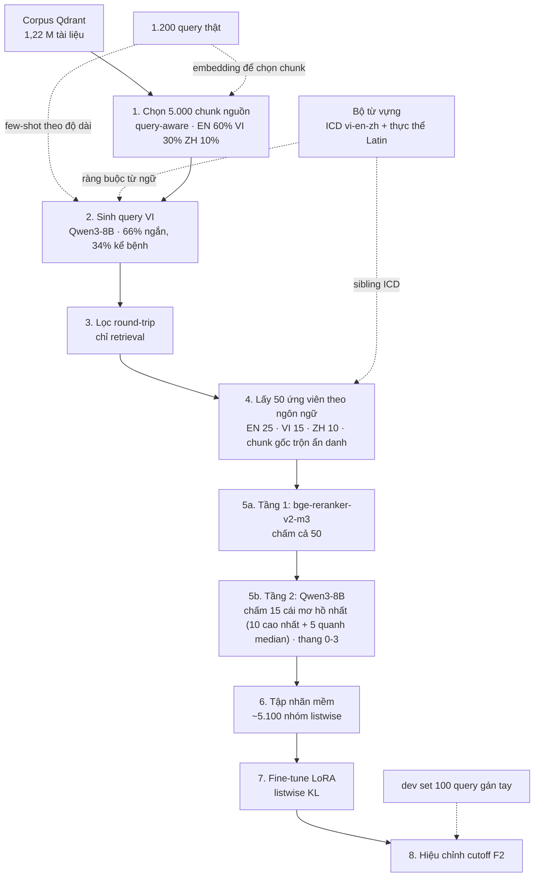

# Pipeline sinh nhãn cho reranker - bản chốt

Phiên bản 2026-10-19, sau khi chốt điều lệ và đo bộ từ vựng.
Mục tiêu: sinh tập nhãn `(query, doc, utility)` để fine-tune reranker đa ngữ, không có nhãn vàng nào từ ban tổ chức.
Chấm bằng F2, deadline 31/10.

---

## 0. Ba quyết định đã chốt

| | Quyết định | Hệ quả |
|---|---|---|
| QĐ 1 | **Chỉ dùng open-weights ≤15B, phát hành trước 01/08/2026.** Cấm model đóng | Không có đường tắt bằng API. Trần cho phép là 14B, ta chọn **8B** cho nhẹ máy |
| QĐ 2 | **5.000 chunk nguồn → ~5.100 query cuối cùng** | ~8,5 giờ GPU (cập nhật sau khi tăng pool ứng viên bước 4-5), vẫn xong trong ngày nếu chạy liên tục |
| QĐ 3 | **Có gán tay 100 query dev set** | 3-4 giờ, làm xen kẽ lúc máy chạy |

Điều lệ không phân biệt model dùng để nộp và model dùng để sinh dữ liệu, nên áp cùng một giới hạn cho cả hai.
Đây là cách đọc an toàn.

---

## 1. Hai lỗi phải sửa trước khi làm gì khác

### 1.1 Reranker hiện tại là model chỉ biết tiếng Anh

`sft-reranker/main.py` đang fine-tune `cross-encoder/ms-marco-MiniLM-L-6-v2`.
Model này train trên MS MARCO tiếng Anh, tokenizer và vốn từ đều là tiếng Anh.
Query 100% tiếng Việt, tài liệu đa số tiếng Anh.
Cặp vi→en sẽ không bao giờ hoạt động với backbone này, bất kể dữ liệu train tốt đến đâu.

Thay bằng `BAAI/bge-reranker-v2-m3` (568M, đa ngữ, cùng họ với BGE-M3 đang dùng làm retriever).
Bắt buộc, không phải tối ưu hóa.

### 1.2 Loss hiện tại là BinaryCrossEntropy pointwise

`BinaryCrossEntropyLoss` chấm từng cặp độc lập, không học được thứ tự tương đối.
Với F2 cần nhiều positive mỗi query và cần điểm số hiệu chỉnh được, loss đúng là listwise có nhãn mềm.
Chi tiết ở bước 6.

---

## 2. Phần cứng và mô hình

Một GPU 5060 Ti 16GB.
Nút cổ chai là **prefill**, không phải decode, vì khâu chấm điểm có prompt rất dài và output rất ngắn.

| Vai trò | Model | Ghi chú |
|---|---|---|
| Sinh query + chấm tầng 2 | **Qwen3-8B-AWQ** (4-bit) | ~5,5 GB weights. Thoải mái trên 16 GB, batch được sâu nên throughput cao |
| Chấm tầng 1 | `BAAI/bge-reranker-v2-m3` | ~1,2 GB. Lọc thô, rẻ hơn hàng chục lần |
| Student reranker | `BAAI/bge-reranker-v2-m3` | ~10 GB khi train LoRA |

Cấu hình vLLM:

```
--quantization awq
--gpu-memory-utilization 0.88 --max-model-len 8192
--enable-prefix-caching
```

8B để lại ~8 GB cho KV cache, đủ batch sâu nên prefill chạy gần mức trần của card.
Không cần `--kv-cache-dtype fp8` ở kích thước này.

**Ghi chú về trần chất lượng:** điều lệ cho phép tới 15B, và chất lượng teacher là trần của reranker.
Nếu sau khi soát tay 50 cặp ở cổng chặn mà thấy 8B chấm sai nhiều, phương án B là dùng 14B cho riêng bước chấm tầng 2 (bước đắt nhất nhưng cũng quyết định chất lượng nhất), giữ 8B cho bước sinh query.

Quy tắc VRAM: **chạy tuần tự, không song song**. Dừng vLLM trước khi train.

---

## 3. Sơ đồ E2E



---

## 4. Phễu số lượng

```
 5.000 chunk nguồn        EN 3.000 · VI 1.500 · ZH 500
    × 2 query mỗi chunk
10.000 query sinh ra       5.000 lời gọi LLM
    × 0,60 lọc round-trip
 6.000 query giữ lại
    × 0,85 phải có >=1 positive
 5.100 query cuối cùng  =  5.100 nhóm listwise
    × 50 ứng viên (EN 25 · VI 15 · ZH 10)
255.000 cặp được chấm     trong đó 76.500 cặp qua tầng 2
    |
~28.700 positive (điểm 3 và 2)
~207.200 negative (điểm 0, gồm cả 178.500 cặp tầng 1 tự gán)
~19.100 bỏ đi    (điểm 1, không dùng làm negative)
```

Tăng từ pool 16/tầng-2 8 lên pool 50/tầng-2 15 (chốt sau khi bàn bước 4-5).
Tỷ lệ positive/negative/bỏ đi trong đoạn trên **suy ra theo cùng tỷ lệ cũ**,
chưa đo lại trên quy mô mới — pilot sẽ thay bằng số thật.

**Một chunk nguồn cho ra:** 2 query → ~1,2 query sống sót → ~1,0 nhóm listwise → ~12 cặp có nhãn dùng được.

Chunk nguồn **không chắc** có mặt trong output.
Nó bị trộn vào pool ẩn danh và chấm như mọi ứng viên khác.
Nếu nó không đủ bằng chứng trả lời chính câu hỏi sinh ra từ nó, nó thành negative hoặc bị bỏ. Đó là chủ đích.

Các tỷ lệ 0,60 và 0,85 là **giả định chưa đo**. Pilot 300 chunk tồn tại chính là để thay chúng bằng số thật.

---

## 5. Từng bước

### Bước 1 - Chọn chunk nguồn

Không sample đều trên 1,22 M tài liệu.
Câu hỏi thật tập trung vào sản phụ khoa, nhi, da liễu, nam khoa, tiêu hóa.

- Encode 1.200 query thật bằng BGE-M3, cluster thành khoảng 30 cụm.
- Với mỗi cụm, truy xuất top-N chunk gần nhất từ Qdrant làm chunk nguồn.
- Tỷ lệ ngôn ngữ: **EN 60%, VI 30%, ZH 10%**, bám theo nơi bằng chứng thật nằm.

Output `data/labeling/source_chunks.jsonl`:

```json
{"chunk_id": "...", "doc_id": 12345, "language": "en", "content": "...", "cluster": 7}
```

### Bước 2 - Sinh query tiếng Việt

Một lời gọi sinh 2 query từ 1 chunk, **hai chế độ riêng biệt**, không trộn trong cùng prompt.

| Chế độ | Tỷ lệ | Mô tả | Khớp với |
|---|---|---|---|
| `short` | 66% | Câu hỏi gọn, 8-25 từ | 66,3% tập thật dưới 30 từ |
| `narrative` | 34% | Bệnh nhân kể bệnh, 40-150 từ, có chi tiết thừa | 33,8% tập thật trên 30 từ |

Few-shot lấy từ collection `query_documents`, **stratify theo độ dài của chế độ đang sinh**.
Hiện tại `get_few_shot()` chỉ lấy top-2 theo similarity, nên chế độ `narrative` gần như không bao giờ có mẫu đúng dạng.

Bốn ràng buộc bắt buộc trong prompt:

1. **Luôn sinh ra tiếng Việt**, kể cả khi chunk là tiếng Anh hoặc tiếng Trung.
2. **Dùng từ bệnh nhân hay dùng**, không bê nguyên thuật ngữ lâm sàng trong chunk.
3. **Không nhắc tới tài liệu**: cấm "theo đoạn trên", "nghiên cứu này".
4. Nếu chunk chứa thực thể Latin (tên thuốc, xét nghiệm, vắc xin, hội chứng), **giữ nguyên nó trong query**. Đó là mỏ neo truy xuất bất biến ngôn ngữ.

Output `data/labeling/gen_queries.jsonl`:

```json
{"qid": "g000123", "query": "...", "mode": "narrative", "src_chunk_id": "...", "src_language": "en"}
```

### Bước 3 - Lọc round-trip

Không dùng LLM judge để chọn câu hỏi.
Dùng chính retriever: khách quan hơn, rẻ hơn hàng trăm lần.

`hybrid_search(query, top_k=50)`, giữ query nếu `src_chunk_id` nằm trong top-50.
Ghi lại thứ hạng của chunk gốc.

Tỷ lệ giữ kỳ vọng 50-75%.
Dưới 40% thì prompt sinh query đang có vấn đề, dừng lại sửa.

### Bước 4 - Lấy ứng viên

3 lần `hybrid_search(query, top_k=...)` riêng theo ngôn ngữ, theo
`candidate_lang_quota` (EN 50% · VI 30% · ZH 20%, áp lên pool 50 → EN 25 / VI 15 / ZH 10).
Không lấy top-k thô trên toàn corpus: corpus lệch sẽ để en áp đảo, ứng viên
vi/zh dễ không lọt vào pool. Zh nâng từ 10% lên 20% vì corpus zh đã crawl lên
~30% (trước đó 4,1%). Trộn chunk gốc vào pool **không gắn nhãn gì**, xáo thứ
tự. Chi tiết và lý do đầy đủ ở `docs/buoc-4-5-cham-utility.md`.

Đây là điểm khác quan trọng nhất so với cách làm thông thường.
Nếu mặc định chunk gốc là positive, bạn dạy reranker đếm từ trùng, vì query được viết ra từ chính chunk đó nên luôn mượn thuật ngữ của nó.

**Tùy chọn, bật sau khi pilot chạy ổn:** thêm 2 hard negative là tài liệu về bệnh **cùng chương ICD, khác mã** với bệnh trong query.
Cùng chuyên khoa, cùng vốn từ, nhưng câu trả lời sai. Negative loại này khó hơn hẳn negative ngẫu nhiên.

### Bước 5 - Chấm utility hai tầng

**Tầng 1:** `bge-reranker-v2-m3` chấm cả 50 ứng viên.

**Tầng 2:** Qwen3-8B chỉ chấm 15 ứng viên: 10 cái điểm cao nhất, cộng 5 cái quanh ngưỡng mơ hồ.
Cái nào tầng 1 chấm rất thấp thì tin luôn là irrelevant.

Prompt tầng 2 đặt **query trước, tài liệu sau**.
Thứ tự này quan trọng: prefix caching làm phần `instruction + query` chỉ nạp một lần cho cả 15 tài liệu.
Đây là lý do ngân sách tính toán ở mục 6 khả thi.

| Điểm | Nghĩa | Thành |
|---|---|---|
| 3 | Trả lời trực tiếp và đầy đủ | positive, trọng số 1,0 |
| 2 | Có bằng chứng hữu ích nhưng chưa đủ | positive, trọng số 0,6 |
| 1 | Cùng chủ đề, không trả lời được | **bỏ khỏi tập train** |
| 0 | Không liên quan | negative |

Điểm 1 bị vứt chứ không dùng làm negative.
Trong 1,22 M tài liệu, một câu hỏi như "viêm kết mạc trẻ sơ sinh" có hàng chục tài liệu đúng.
Dùng điểm 1 làm negative là tự tạo negative giả.

Loại cả query nếu không ứng viên nào đạt điểm 2 trở lên.

Output `data/labeling/judged.jsonl`:

```json
{"qid":"g000123","query":"...","candidates":[
  {"chunk_id":"...","lang":"en","t1_score":0.91,"t2_score":3,"weight":1.0},
  {"chunk_id":"...","lang":"vi","t1_score":0.44,"t2_score":1,"weight":null}
]}
```

### Bước 6 - Fine-tune reranker

Backbone `BAAI/bge-reranker-v2-m3`, LoRA r=16 trên attention, bf16, grad checkpointing.

Loss: **listwise KL divergence** giữa phân phối điểm teacher và phân phối logit của student trên cùng một nhóm ứng viên.
Không dùng BCE pointwise, không dùng softmax cross-entropy một positive.

F2 nặng recall, cần nhiều positive mỗi query và cần điểm số có thể đặt ngưỡng.
Softmax một positive chỉ tối ưu hạng 1, đúng cho nDCG@1, sai cho F2.

### Bước 7 - Hiệu chỉnh cutoff

Quét `k` từ 3 tới 30 trên dev set gán tay, chọn `k` tối đa F2.
Đừng fix top-k cứng.

Với 6 tài liệu đúng, hệ thống trả 10 cái đúng 5 (F2 = 0,735) thắng hệ thống trả 3 cái đúng cả 3 (F2 = 0,556).
Số tài liệu tối ưu cho F2 thường lớn hơn trực giác rất nhiều.

---

## 6. Ngân sách tính toán

Giả định prefill ~3.000 tok/s cho Qwen3-8B-AWQ. **Ước tính, chưa đo.** Bước 2 lộ trình sẽ thay bằng số thật.

| Bước | Khối lượng | Ước tính |
|---|---|---|
| 1. Chọn chunk | encode + cluster | 20 phút |
| 2. Sinh query | 5.000 lời gọi | ~1 giờ |
| 3. Lọc round-trip | chỉ retrieval | 15 phút |
| 4. Lấy ứng viên | chỉ retrieval, 3 lần/query (theo ngôn ngữ) | ~30 phút |
| 5a. Tầng 1 | 255.000 cặp, model 568M | ~1 giờ 20 phút |
| 5b. Tầng 2 | 76.500 cặp, có prefix caching | **~3 giờ 45 phút** |
| 6. Train | LoRA 568M, 3 epoch | 1-1,5 giờ |

Tổng **~8,5 giờ** (tăng từ ~5 giờ ước tính trước, do pool ứng viên tăng
16→50 và tầng 2 tăng 8→15/query sau khi chốt bước 4-5). Vẫn xong trong ngày
nếu chạy liên tục, không cần qua đêm.
Vẫn phải có checkpoint và resume, vì cổng chặn có thể bắt chạy lại.

Prefix caching là thứ làm bước 5b khả thi.
Không có nó, cùng khối lượng đó mất khoảng 6,5 giờ thay vì 3,75.

---

## 7. Bộ từ vựng - đã đo, và kết luận ngược với dự đoán ban đầu

Hai file có sẵn trong `data/knowledge/`.
Tôi đã đo độ phủ của chúng trên chính 1.200 query thật.

### 7.1 Kết quả đo

| File | Quy mô | Phủ 1.200 query | Ngôn ngữ |
|---|---|---|---|
| `icd10_vn_aliases_v1.csv` | 12.919 mã, 16.894 alias | **39,2%** sau khi lọc nhiễu | chỉ tiếng Việt |
| `rxnorm_concepts_final.csv` | 229.134 concept, 51.627 tên hoạt chất/biệt dược | **4,3%** | chỉ tiếng Anh |

Số liệu bối cảnh, đo trên cùng 1.200 query:

- Chỉ **16,0%** query chứa từ "thuốc".
- Chỉ **11,8%** query có token Latin viết hoa giữa câu.

### 7.2 Đính chính

Tôi đã nói "query nhắc tên thuốc liên tục" và xếp bảng tên thuốc là tầng ưu tiên số 1.
**Số đo cho thấy điều đó sai.** Tên thuốc chỉ xuất hiện ở ~16% query, và RxNorm bắt được ~4%.

RxNorm thiên về thị trường Mỹ nên bỏ sót biệt dược Việt Nam ("Bralcib", "Cozaar XQ", "procare diamond").
Nó bắt tốt hoạt chất quốc tế (paracetamol, meloxicam, duphaston, estradiol).

Danh sách token Latin hay gặp thật ra không phải chủ yếu là thuốc:

```
Covid, AstraZeneca, HBsAg, HBeAg, Doppler, Basedow,
Trisomy, Down, Edward, Zona, Prolactin, Cobas, Avastin
```

Đó là **xét nghiệm, vắc xin, hội chứng mang tên riêng** - cũng là mỏ neo bất biến ngôn ngữ y hệt tên thuốc.
Nên bảng cần xây không phải "bảng thuốc" mà là **bảng thực thể Latin**, rộng hơn.

### 7.3 Chốt ba việc

**A. Bảng ICD song ngữ vi-en. XONG.**

Ban đầu tôi định cho LLM dịch 12.919 tên bệnh, mất ~30 phút GPU.
Với `icd10cm_2027.csv` bạn vừa thêm, việc đó thành một phép **join**: không cần GPU, và chính xác thay vì sinh ra.

`scripts/build_icd_bilingual.py` → `data/vocab/icd_bilingual.tsv`, **10.752 dòng**.

| Bước ghép | Số mã |
|---|---|
| Khớp mã tuyệt đối | 5.078 |
| Gom mã con CM về mã cha WHO | 5.674 |
| Bỏ chương Z/V/W/X/Y/U | 1.868 |
| Không khớp được | 299 |

Hai xử lý cần thiết, đã làm trong script:

1. ICD-10-CM chi tiết hơn ICD-10 WHO (bản Việt dùng), chỉ 42,7% mã khớp tuyệt đối.
   Phần còn lại gom mã con về mã cha, chọn tên **chung nhất** (ưu tiên "unspecified", rồi tên ngắn nhất).
   Lấy bừa một mã con sẽ cho thuật ngữ quá hẹp, ví dụ `A01.0` ra "Typhoid arthritis" thay vì "Typhoid fever".
2. ICD-10-CM gắn định tố không có trong bản WHO: "right side", "initial encounter", "first trimester", "without bleeding".
   Phải cắt cả đầu lẫn đuôi, nếu không thuật ngữ mở rộng sẽ nhiễu.

Kết quả kiểm tra tay:

```
Chảy nước mắt sống                  [H04.2] -> epiphora
Viêm kết mạc và/hoặc túi lệ sơ sinh [P39.1] -> Neonatal conjunctivitis and dacryocystitis
Viêm âm đạo cấp tính                [N76.0] -> Acute vaginitis
Nhiễm trùng đường hô hấp trên cấp   [J06.9] -> Acute upper respiratory infection
```

Bảng phủ **38,9%** của 1.200 query thật, và mỗi lần khớp cho ra một cầu nối vi→en dùng được ngay.

**B. Tiếng Trung: bỏ.**

Corpus zh chỉ phủ 4,1%, nên thuật ngữ tiếng Trung gần như không có tài liệu để khớp vào.
Không đáng 30 phút GPU và thêm một cột phải bảo trì.

**C. Bảng thực thể Latin, gộp RxNorm với cái đào từ query.**

Lấy RxNorm `tty` ∈ `{IN, PIN, BN, MIN}` làm nền (51.627 tên).
Bổ sung bằng cách quét token Latin viết hoa giữa câu trong 1.200 query **và** trong corpus tiếng Việt, cho LLM phân loại là thuốc / xét nghiệm / vắc xin / hội chứng / không phải.
Phạm vi bổ sung vài trăm mục, không phải vài chục nghìn.

**Tầng dân gian ↔ lâm sàng: hoãn lại.**
Nó vẫn đúng về nguyên tắc, nhưng bảng ICD đã phủ 39,2% rồi, và việc A có lợi ích cao hơn rõ rệt trên cùng một giờ bỏ ra.
Quay lại làm nếu bước 5 chạy ổn và còn thời gian.

### 7.4 Dùng ở khâu nào

| Khâu | Dùng | Làm gì |
|---|---|---|
| Bước 2, sinh query | **Có, chính yếu** | Chunk EN → tra ICD ra tên bệnh tiếng Việt → chèn vào prompt làm ràng buộc từ ngữ. Ép query dùng giọng Việt thay vì dịch máy móc, đồng thời chống rò rỉ xuất xứ |
| Bước 3, round-trip | Không | |
| Bước 4, ứng viên | Tùy chọn | Thêm hard negative cùng chương ICD khác mã |
| Bước 5, chấm utility | Không | Judge đọc cả hai bên, không cần bảng |
| Bước 6, train | Không | |
| Inference | **Có** | THÊM tên bệnh EN và thực thể Latin vào nhánh sparse. Giữ nguyên từ gốc bệnh nhân, không thay thế |
| Hậu xử lý | **Không** | Không có chỗ nào |

Nguyên tắc ở inference: **append, không substitute**.
Nghiên cứu reformulation query y tế sang thuật ngữ chuyên môn cho 42% tốt hơn, 19% tệ hơn, 39% không đổi.
Trong khi chỉ *thêm* biểu thức chuyên môn vào cho cải thiện ổn định.
Với F2 thiên recall, append là lựa chọn đúng.

---

## 8. Dev set gán tay

100 query lấy từ chính 1.200 query thật, stratify theo độ dài: 40 ngắn, 30 vừa, 30 kể bệnh dài.
Mỗi query chạy hybrid search top-20, tự đọc và đánh 0-3 theo đúng thang ở bước 5.

Khoảng 2.000 cặp phải đọc, phần lớn loại được trong 2 giây. Ước tính 3-4 giờ.

Không có nó thì mọi thay đổi đều không đo được, và đo bằng chính teacher đã dùng để train là vòng luẩn quẩn.
Dev set này còn dùng để hiệu chỉnh cutoff ở bước 7, nên bắt buộc phải tồn tại.

---

## 9. Lộ trình hôm nay

| | Việc | Tiêu chí xong |
|---|---|---|
| 1 | Sửa backbone sang `bge-reranker-v2-m3` trong `sft-reranker/main.py` | Train thử 10 dòng chạy không lỗi |
| 2 | Dựng vLLM với Qwen3-8B-AWQ, **đo prefill thật** bằng 200 prompt mẫu | Có số tok/s thật, thay vào bảng ngân sách |
| ~~3~~ | ~~Dựng bảng ICD song ngữ~~ | **XONG** - `data/vocab/icd_bilingual.tsv`, 10.752 dòng |
| 4 | Viết bước 1-2-3, chạy pilot 300 chunk | Có `gen_queries.jsonl` |
| 5 | **CỔNG CHẶN: soát tay 30 query sinh ra** | Phân phối dài/ngắn khớp chưa? Có bê nguyên thuật ngữ chunk không? Tỷ lệ round-trip bao nhiêu? Dưới 40% thì sửa prompt, chạy lại |
| 6 | Viết bước 4-5, chạy chấm trên ~306 query pilot | Có `judged.jsonl`, ~25 phút GPU |
| 7 | **CỔNG CHẶN: soát tay 50 cặp đã chấm** | Teacher chấm đúng không? Sai nhiều thì sửa prompt, lặp lại bước 6 |
| 8 | Thả chạy full 5.000 chunk | Có checkpoint, resume được, ghi log tiến độ |

Xen kẽ lúc máy chạy: **gán tay 100 query dev set**.

**Không được thả chạy qua đêm nếu cổng chặn số 7 chưa qua.**
Sai ở đó nghĩa là 5.000 query nhãn rác và mất trọn một đêm.

---

## 10. Query router - hoãn

1.200 query **chính là tập submission và đã biết trước**.
Không có traffic online, nên không có bài toán latency nào cần giải.
Chạy model một lượt rồi cache JSONL là đủ; distill xuống <1B chỉ thêm mất mát.

Trục `easy/medium/hard` trong `test_query_router.py` đo **độ khó của việc trả lời**, trong khi cuộc thi chấm F2 trên tài liệu **truy xuất**.
Hai đại lượng này đảo dấu trên chính ví dụ của bạn: "Uống quá liều Cozaar XQ" khó trả lời nhưng rất dễ truy xuất, "Viêm lưỡi kéo dài có sao không" dễ trả lời nhưng rất khó truy xuất.

Nếu quay lại làm router sau khi xong reranker, hai nguyên tắc bắt buộc:

- **Monotone safety:** router chỉ được THÊM nhánh, không bao giờ được LOẠI. Khi mọi pool là superset của baseline `{vi:50, en:30, zh:20}`, router về mặt toán học không thể giảm recall.
- **Đo oracle gap trước khi viết code:** chạy mọi cấu hình nhánh trên 100-150 query, so routing hoàn hảo với `always-max`. Nếu xấp xỉ nhau thì routing không có trần để vươn tới, dừng luôn.

---

## 11. Mức độ kiểm chứng

- Thống kê tập query (1.200 dòng, 100% tiếng Việt, phân phối độ dài, 44,6% ngôi thứ nhất): **đã đo trực tiếp**.
- Độ phủ bộ từ vựng (ICD 39,2% sau lọc, bảng song ngữ 38,9%, RxNorm 4,3%, 16,0% query chứa từ "thuốc", 11,8% có token Latin): **đã đo trực tiếp** trên 1.200 query bằng khớp n-gram.
- Bảng `icd_bilingual.tsv`: **đã build và kiểm tra tay** 7 mã. Tỷ lệ join 94,8% trước khi lọc chương.
- Quy mô hai file knowledge (12.919 mã ICD / 229.134 concept RxNorm): **đã đếm trực tiếp**.
- `ms-marco-MiniLM-L-6-v2` đang được dùng: **đã đọc code**. Kết luận model đó đơn ngữ tiếng Anh là **từ hiểu biết sẵn có**, nên xác nhận lại trên model card.
- Qwen3-8B phát hành trước 01/08/2026: **từ hiểu biết sẵn có**, cần xác nhận lại trên model card trước khi nộp.
- Toàn bộ số thời gian ở mục 6 và tỷ lệ phễu ở mục 4: **ước tính chưa đo**. Bước 2 và pilot tồn tại để thay chúng bằng số thật.
- Thiết kế pipeline: **suy luận** từ dữ liệu thật cộng prior art (Promptagator, InPars-v2, UPR, LAURA), **chưa chạy thực nghiệm**.
