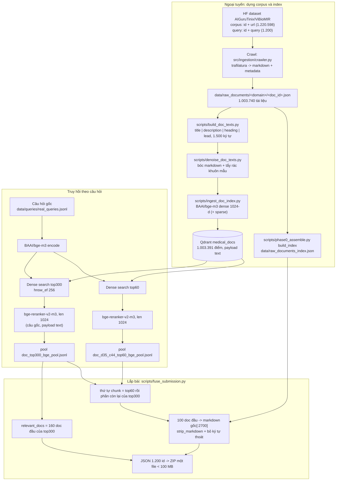

# Thuyết minh 01 - Hệ thống truy hồi SOTA (bài 0) và biến thể chunk c120 (bài 2)

Tài liệu này mô tả toàn bộ pipeline sinh ra bài nộp SOTA `fuse_d160_c100_top300_orig_ctop60+top300_cap2700` (id nộp 7910, file nộp `fuse_d160_c100_top300_orig_ctop60t.zip`).
Nghĩa tên: `fuse` = hai tầng lấy từ hai thứ hạng khác nhau, `d160` = 160 doc, `c100` = 100 đoạn, `top300` = pool doc 300 ứng viên, `orig` = xếp theo điểm rerank với câu hỏi gốc, `ctop60+top300` = danh sách đoạn nối pool top60 rồi pool top300, `cap2700` = mỗi đoạn là 2.700 ký tự đầu bài.
Public test: FINAL 0.2562, `DOCS_F2` 0.2849, `CHUNKS_F2` 0.2275 (`docs/phat-hien-tang-diem.md` mục 21).
Mục 8 mô tả bài 2 `priv_d160_bge_c120_ctop60+top300_cap2050`, dùng chung tầng doc với SOTA.
Pipeline reranker fine-tune (bài 1, 3, 4) nằm ở [02-sft-reranker.md](02-sft-reranker.md).
Bảng tổng hợp 5 bài nộp: [00-tong-quan-bai-nop.md](00-tong-quan-bai-nop.md).

## 1. Tổng quan hệ thống

### 1.1 Bài toán và cách chấm

Đầu vào là 1.200 câu hỏi y khoa tiếng Việt.
Mỗi câu phải trả về `relevant_docs` (danh sách `doc_id`) và `relevant_chunks` (danh sách `{doc_id, chunk_text}`).
Điểm `FINAL = (DOCS_F2 + CHUNKS_F2) / 2`, hai tầng đều macro-F2 với `F2 = 5PR/(4P+R)`.
Một đoạn nộp được tính trúng khi `LCS_tokens(nộp, tham chiếu) / len(token đoạn nộp) >= 0,40` (mẫu số là đoạn NỘP, cập nhật của BTC 2026-10-23).
Hai tầng chấm độc lập: `DOCS_F2` chỉ phụ thuộc `relevant_docs`, `CHUNKS_F2` chỉ phụ thuộc `relevant_chunks`.
Thiết kế cốt lõi của hệ thống dựa trên tính độc lập này: tầng doc và tầng chunk được chọn từ hai thứ hạng khác nhau, với số lượng khác nhau.

### 1.2 Phương pháp

Hệ thống là truy hồi hai bước (retrieve rồi rerank) trên một index CẤP TÀI LIỆU, không phải cấp đoạn.

1. Mỗi tài liệu của corpus được biểu diễn bằng một chuỗi ngắn (title, description, heading, phần đầu thân bài, tối đa 1.500 ký tự), encode bằng `BAAI/bge-m3` (dense) và nạp vào collection Qdrant `medical_docs` (1.003.391 điểm).
2. Câu hỏi gốc được encode bằng `BAAI/bge-m3`, tìm dense trên `medical_docs` lấy 300 tài liệu (pool top300) và 60 tài liệu (pool top60), không lọc ngôn ngữ.
3. Mọi ứng viên được chấm lại bằng cross-encoder `BAAI/bge-reranker-v2-m3` trên cặp (câu hỏi gốc, payload `text` của tài liệu), `max_length` 1024.
4. Tầng doc: 160 tài liệu điểm rerank cao nhất của pool top300.
5. Tầng chunk: hết 60 tài liệu của pool top60 (theo thứ tự rerank) rồi nối tiếp các tài liệu còn lại của pool top300, lấy 100 tài liệu đầu; mỗi tài liệu nộp 2.700 ký tự đầu của markdown gốc đã bóc cú pháp.
6. Ghi JSON đủ 1.200 id, nén ZIP một file, kiểm dưới 100 MB.

Bài SOTA KHÔNG dùng câu sửa chính tả, không dịch, không augment, không phân rã câu hỏi, không dùng index đoạn `medical_documents`.
Các biến thể đó đã được đo và thua hoặc hoà (mục 6.5).

### 1.3 Sơ đồ luồng



### 1.4 Chức năng từng thành phần

| Thành phần | File | Vai trò |
|---|---|---|
| Crawler | `src/ingestion/crawler.py`, `src/ingestion/sites/`, `src/ingestion/extraction.py`, `src/ingestion/politeness.py` | Tải HTML theo URL của corpus, trích nội dung chính thành markdown, ghi một JSON mỗi tài liệu |
| Chỉ mục doc_id -> domain | `scripts/phase0_assemble.py` (`build_index`, `RawDocs`) | Tra đường dẫn file gốc theo `doc_id`, đọc `content.markdown` |
| Văn bản đại diện tài liệu | `scripts/build_doc_texts.py`, `scripts/denoise_doc_texts.py`, `scripts/text_denoise.py`, `scripts/md_strip.py` | Dựng chuỗi encode cho mỗi tài liệu |
| Nạp index | `scripts/ingest_doc_index.py`, `src/rag/embedding.py` (`BgeM3Embedder`) | Encode và upsert vào Qdrant `medical_docs` |
| Sao lưu / khôi phục index | `scripts/qdrant_backup.py`, `scripts/backup_medical_docs.sh`, `scripts/restore_medical_docs.sh` | Snapshot collection kèm manifest sha256 |
| Truy hồi + rerank | `scripts/phase1_doc_retrieve.py`, `src/rag/pipeline/components/reranking.py` (`make_reranker`, `CrossEncoderReranker`) | Tìm dense, rerank, ghi pool `<tên>_pool.jsonl` |
| Lắp bài nộp | `scripts/fuse_submission.py`, `scripts/assemble_doc_submission.py` (`write_submission`), `src/rag/pipeline/submission.py` | Chọn doc list và chunk list từ các pool, cắt văn bản, ghi JSON, nén ZIP, chặn file >= 100 MB |
| Cấu hình | `config.yaml`, `src/rag/config.py` (`--config`, `--set khoa=giatri`) | Mọi tham số truy hồi và rerank |

## 2. Dữ liệu

### 2.1 Nguồn

Corpus và câu hỏi chính thức là HF dataset `AIGuruTinix/ViBioMIR`, nạp qua `src/ingestion/utils.py` (`get_dataset`).

| Config | Schema | Số dòng |
|---|---|---:|
| `corpus` | `id: int64`, `url: string` | 1.220.598 |
| `query` | `id: int64`, `query: string` | 1.200 |

`id` của `corpus` là `doc_id` dùng trong bài nộp.
Tên file crawl `data/raw_documents/<domain>/<doc_id>.json` mang đúng `id` này, không cần bảng ánh xạ.
Câu hỏi được xuất ra `data/queries/real_queries.jsonl` bằng `scripts/export_real_queries.py`.

### 2.2 Thu thập (crawl)

Lệnh: `python -m src.ingestion.crawler --concurrency 16` (docstring của `src/ingestion/crawler.py`).
Mỗi URL được định tuyến tới crawler của domain đó (`src/ingestion/sites/`, xem `--routes`); nhịp gửi request theo từng host (`src/ingestion/politeness.py`), có circuit breaker khi host ngừng trả lời (`src/ingestion/circuit.py`).
HTML được trích bằng `trafilatura.extract(output_format="markdown", include_tables=True, include_comments=False)`; metadata (title, description, ngày đăng) bằng `trafilatura.extract_metadata` (`src/ingestion/extraction.py`).
Ngôn ngữ mỗi tài liệu lấy từ `source.language_category` (gán theo domain trong `src/ingestion/categories.py`), không dùng `source.language` vì trường này sai nhiều.
Trạng thái từng domain và các sửa đổi theo site (Cloudflare, JS challenge...) ghi ở `docs/crawl-status.md`.

Độ phủ đo ngày 2026-10-25 bằng cách đếm `data/raw_documents_index.json` qua `language_of()`:

| Ngôn ngữ | Crawl được | Trong corpus | Độ phủ |
|---|---:|---:|---:|
| vi | 656.654 | 740.598 | 88,7% |
| en | 239.574 | 240.000 | 99,8% |
| zh | 107.512 | 240.000 | 44,8% |
| Tổng | 1.003.740 | 1.220.598 | 82,2% |

Tài liệu không crawl được không có mặt trong index, nên không bao giờ được trả về.

### 2.3 Làm sạch

Có hai loại văn bản với hai mức làm sạch khác nhau, vì ràng buộc khác nhau.

**Văn bản đem encode và rerank** (không bị chấm LCS, nên tẩy mạnh tay được):
- `scripts/build_doc_texts.py` (`doc_text`) ghép `title | description | heading > heading ... | lead`, tổng tối đa 1.500 ký tự (`--budget 1500`), heading tối đa 8 cái và 300 ký tự (`--max-heads 8 --head-budget 300`).
- Mỗi trường được bóc cú pháp markdown (`scripts/md_strip.py`), bỏ ký tự thoát `\-`, `\*`..., tẩy rác khuôn mẫu (`scripts/text_denoise.py`: dấu thời gian, nhãn khung hỏi đáp tiếng Trung, dòng "Xem thêm: <bài khác>"), cắt đoạn thân bài trùng nguyên văn description.
- `scripts/denoise_doc_texts.py` làm sạch lại file `data/doc_texts.jsonl` sinh bằng code cũ (bóc markdown + tẩy rác trên chuỗi đã ghép; dấu `|` ngăn trường cũng bị xoá thành khoảng trắng).
  Mặc định ghi `data/doc_texts.clean.jsonl`.
- Payload `text` trong `medical_docs` là bản đã làm sạch này.
  Nó khác `data/doc_texts.jsonl` ở dấu ` | `, và bge-reranker-v2-m3 cho điểm lệch tới 0,24 giữa hai bản, nên mọi điểm rerank của SOTA chấm trên payload Qdrant.
- `TODO(kiểm):` lệnh ingest chính xác đã dùng (file đầu vào có phải `data/doc_texts.clean.jsonl` qua `--set doc_index.input=...` hay không).
  Cách tái hiện an toàn là khôi phục snapshot (mục 5.3).

**Văn bản nộp bài** (`chunk_text`, bị chấm LCS và phải trích nguyên văn):
- Lấy `content.markdown` gốc, cắt `cap` ký tự đầu, rồi `strip_markdown` (chỉ bóc ký hiệu `#`, `**`, `|`, `>`, link, ảnh; giữ mọi từ và số), rồi `submission_chunk_text` bỏ ký tự thoát markdown.
- Lý do bóc cú pháp: dấu markdown do bước chuyển HTML -> markdown của ta sinh ra, trang gốc không có, và chúng chỉ làm phình mẫu số LCS. Đo trên bài N3 (35 doc + 43 cửa sổ, trần 8.000): +0,0005 FINAL (`docs/phat-hien-tang-diem.md` mục 10).
- Không tẩy rác ở văn bản nộp, vì tẩy là xoá từ thật.

### 2.4 Phân đoạn

Bài SOTA không chia đoạn theo ngữ nghĩa.
Mỗi tài liệu trong danh sách chunk đóng góp đúng MỘT đoạn: cửa sổ đầu bài, `markdown[:2700]` trước khi bóc cú pháp (nên đoạn nộp ngắn hơn 2.700 ký tự; trung bình đo được 2.158 ký tự).
Lý do: các thí nghiệm Phase 0 cho thấy chunk ngắn 877 ký tự lệch khỏi vùng tham chiếu và sụp (`F2_chunk` 0.0317), còn cửa sổ dài vài nghìn ký tự đầu bài qua ngưỡng LCS tốt hơn hẳn (`CLAUDE.md`, mục 3 và 12 của `docs/phat-hien-tang-diem.md`).
Code chia đoạn theo ngôn ngữ trong `src/rag/chunker/` và index đoạn `medical_documents` (3.927.800 điểm) là của các vòng trước, không tham gia bài SOTA.

### 2.5 Truy cập dữ liệu

| Dữ liệu | Đường dẫn trong repo | Dung lượng | Cách lấy |
|---|---|---:|---|
| Câu hỏi | `data/queries/real_queries.jsonl` | 0,23 MB | `python -m scripts.export_real_queries`, hoặc [Drive](https://drive.google.com/drive/folders/1YDmbMep_DnX0eSjIW43awca_6F5O-Hlp?usp=sharing), gói `01_inputs_dung_bai.zip` |
| Tài liệu gốc đã crawl | `data/raw_documents/` | `TODO(kiểm): dung lượng` | HF dataset `quyenpro/vibiomir-raw-documents` (85 file zip theo domain, giải nén bằng `bash scripts/unzip_raw_documents.sh`), hoặc [Drive](https://drive.google.com/drive/folders/1YDmbMep_DnX0eSjIW43awca_6F5O-Hlp?usp=sharing), gói `05_raw_documents.zip`. `TODO(kiểm):` repo HF có để public không. |
| Chỉ mục doc_id -> domain | `data/raw_documents_index.json` | 30,3 MB | Sinh lại bằng `build_index()` sau khi giải nén, hoặc [Drive](https://drive.google.com/drive/folders/1YDmbMep_DnX0eSjIW43awca_6F5O-Hlp?usp=sharing), gói `01_inputs_dung_bai.zip` |
| Snapshot Qdrant `medical_docs` | `data/backups/medical_docs-20261024-211206/` (`manifest.json`, `medical_docs.snapshot`) | 7,0 GB | HF dataset `quyenpro/vibiomir-medical-docs` qua `restore_medical_docs.sh`, hoặc [Drive](https://drive.google.com/drive/folders/1YDmbMep_DnX0eSjIW43awca_6F5O-Hlp?usp=sharing), gói `04_qdrant_medical_docs_snapshot.zip` |
| Văn bản đại diện (để dựng lại index) | `data/doc_texts.jsonl` | 2,14 GB | `python -m scripts.build_doc_texts`, hoặc không upload (file trung gian, sinh lại được) |
| Pool top300 đã rerank | `data/tmp/phase1/doc_top300_bge_pool.jsonl` | 73,7 MB | [Drive](https://drive.google.com/drive/folders/1YDmbMep_DnX0eSjIW43awca_6F5O-Hlp?usp=sharing), gói `01_inputs_dung_bai.zip` |
| Pool top60 đã rerank | `data/tmp/phase1/doc_d35_c44_top60_bge_pool.jsonl` | 13,6 MB | [Drive](https://drive.google.com/drive/folders/1YDmbMep_DnX0eSjIW43awca_6F5O-Hlp?usp=sharing), gói `01_inputs_dung_bai.zip` |
| Điểm rescore (fuse_submission luôn mở file này) | `data/tmp/phase1/rescore_bge.jsonl` | 8,9 MB | [Drive](https://drive.google.com/drive/folders/1YDmbMep_DnX0eSjIW43awca_6F5O-Hlp?usp=sharing), gói `01_inputs_dung_bai.zip` |
| Bài nộp SOTA | `data/fuse_d160_c100_top300_orig_ctop60+top300_cap2700.zip` | 98,9 MB | [Drive](https://drive.google.com/drive/folders/1YDmbMep_DnX0eSjIW43awca_6F5O-Hlp?usp=sharing), gói `02_bai_nop_private.zip` |

Có hai pool đã rerank là đủ để dựng lại bài SOTA bằng CPU, không cần GPU hay Qdrant.

## 3. Mô hình

| Vai trò | Định danh HF | Cấu hình dùng | Ở đâu trong code |
|---|---|---|---|
| Embedding tài liệu và câu hỏi | `BAAI/bge-m3` | `FlagEmbedding.BGEM3FlagModel`, fp16 trên CUDA, `max_length` 1024, dense 1024 chiều, khoảng cách cosine; sparse nạp kèm nhưng SOTA không dùng (`retrieval.doc.hybrid: false`) | `src/rag/embedding.py` (`BgeM3Embedder`) |
| Rerank | `BAAI/bge-reranker-v2-m3` | `sentence_transformers.CrossEncoder`, fp16, `max_length` 1024 tính cho cả cặp, input (câu hỏi gốc, payload `text`) | `src/rag/pipeline/components/reranking.py` (`make_reranker`), `config.yaml` khoá `rerank.*` |

Bài SOTA không dùng LLM.
Hai model đều là open weights, dưới 15B tham số, có trước 2026-08-01, đúng luật cuộc thi.
Model tự tải từ HuggingFace ở lần chạy đầu (`huggingface_hub` cache mặc định); không cần token vì cả hai là repo public.
Lý do `max_length` 1024 thay vì 512: đo bằng tokenizer của reranker trên `data/doc_texts.jsonl`, 43% tài liệu tiếng Trung vượt 512 token (ghi chú trong `config.yaml`).

## 4. Mã nguồn

### 4.1 Script dùng thật cho bài 0 và bài 2

| Bước | Lệnh / script |
|---|---|
| Crawl | `src/ingestion/crawler.py` |
| Đóng gói / giải nén tài liệu gốc | `scripts/zip_raw_documents.py`, `scripts/upload_raw_documents.py`, `scripts/unzip_raw_documents.sh` |
| Văn bản đại diện | `scripts/build_doc_texts.py`, `scripts/denoise_doc_texts.py` |
| Index | `scripts/ingest_doc_index.py`; sao lưu `scripts/backup_medical_docs.sh`; khôi phục `scripts/restore_medical_docs.sh` |
| Truy hồi + rerank | `scripts/phase1_doc_retrieve.py` |
| Lắp bài 0 | `scripts/fuse_submission.py` |
| Lắp bài 2 | `scripts/build_private_submissions.py` |

### 4.2 Thư viện

`requirements.txt` không ghim phiên bản.
Phiên bản dưới đây đọc từ `venv` của máy local (Python 3.12.9) bằng `pip list`, ngày 2026-11-04:

| Gói | Phiên bản |
|---|---|
| torch | 2.14.1+cu126 |
| transformers | 5.20.1 |
| sentence-transformers | 6.1.0 |
| FlagEmbedding | 1.4.2 |
| qdrant-client | 1.19.1 |
| trafilatura | 2.3.1 |
| httpx | 0.28.1 |
| curl_cffi | 0.16.3 |
| datasets | 5.1.0 |
| huggingface_hub | 1.33.0 |
| numpy | 2.5.4 |
| PyYAML | 6.0.3 |

Qdrant chạy bằng Docker theo `docker-compose.yaml` (image `qdrant/qdrant:latest`, cổng 6333/6334).
`TODO(kiểm):` phiên bản Qdrant server thực tế (image `latest` không ghim), và phiên bản thư viện trên server GPU đã chạy truy hồi.

### 4.3 File cấu hình

`config.yaml` là nguồn tham số duy nhất của `phase1_doc_retrieve.py`; ghi đè bằng `--set khoa=giatri`.
Khoá liên quan bài SOTA:

| Khoá | Giá trị | Ý nghĩa |
|---|---|---|
| `qdrant.collection_docs` | `medical_docs` | collection tài liệu |
| `retrieval.doc.top_docs` | 60 (ghi đè 300 cho pool top300) | số ứng viên lấy về và rerank |
| `retrieval.doc.hybrid` | `false` | chỉ dense |
| `retrieval.doc.hnsw_ef` | 256 | độ rộng tìm HNSW |
| `retrieval.doc.variants` | `[orig]` | chỉ câu gốc |
| `rerank.model` | `BAAI/bge-reranker-v2-m3` | reranker |
| `rerank.max_length` | 1024 | độ dài cặp |
| `rerank.fp16` | `true` | |

Tham số lắp bài (`m_doc`, `m_chunk`, `cap`) truyền qua dòng lệnh `fuse_submission.py`, không lấy từ `config.yaml`.

## 5. Hướng dẫn tái hiện

Lệnh trên máy Windows ghi cú pháp PowerShell, chạy từ thư mục gốc repo.
Lệnh trên server Linux ghi bash và ghi rõ.

### 5.1 Môi trường

```powershell
git clone https://github.com/quyen244/medial-retrieval r2ai; cd r2ai
git checkout main
py -3.12 -m venv venv
.\venv\Scripts\Activate.ps1
pip install torch==2.14.1 --index-url https://download.pytorch.org/whl/cu126
pip install -r requirements.txt
pip install "transformers==5.20.1" "sentence-transformers==6.1.0" "FlagEmbedding==1.4.2" "qdrant-client==1.19.1"
docker compose up -d qdrant
```

Mã nguồn: [GitHub](https://github.com/quyen244/medial-retrieval), nhánh `main`.

### 5.2 Đường tắt: dựng lại bài 0 từ pool đã rerank (chỉ CPU)

Cần: `data/raw_documents/` + `data/raw_documents_index.json`, hai pool và `rescore_bge.jsonl` đặt đúng đường dẫn ở bảng 2.5.

```powershell
python -m scripts.fuse_submission --doc-pool top300 --methods orig --m-doc 160 --m-chunk 100 --cap 2700 `
    --out-dir data --chunk-pool top60 top300
```

Ra `data/fuse_d160_c100_top300_orig_ctop60+top300_cap2700.json` và `.zip` (98,9 MB).
Script tự dừng và xoá zip nếu file nặng từ 100 MB trở lên.
`fuse_submission.py` luôn mở `--rescore` (mặc định `data/tmp/phase1/rescore_bge.jsonl`) dù cách xếp `orig` không dùng điểm trong đó.

### 5.3 Đường đầy đủ: từ corpus tới pool (cần GPU)

Bước 1, tài liệu gốc (bash trên server Linux, hoặc Git Bash trên Windows):

```bash
# tải 85 file zip của HF dataset quyenpro/vibiomir-raw-documents về zip_folder/, rồi:
bash scripts/unzip_raw_documents.sh     # giải nén vào data/raw_documents/ và dựng data/raw_documents_index.json
```

Muốn crawl lại từ đầu thì thay bằng `python -m src.ingestion.crawler --concurrency 16` rồi dựng index bằng `build_index()`.
Crawl lại không cho ra đúng cùng nội dung vì trang web thay đổi theo thời gian.

Bước 2, index `medical_docs`.
Cách khuyến nghị là khôi phục snapshot, vì nó đúng từng byte với index đã dùng (bash trên server):

```bash
docker compose up -d qdrant
HF_REPO=quyenpro/vibiomir-medical-docs bash scripts/restore_medical_docs.sh
# hoặc đặt bundle từ Drive vào data/backups/ rồi: bash scripts/restore_medical_docs.sh
```

Cách dựng lại từ đầu (GPU, chậm; không đảm bảo trùng từng điểm với snapshot):

```bash
python -m scripts.build_doc_texts                     # data/doc_texts.jsonl, chỉ CPU + đọc đĩa
python -m scripts.denoise_doc_texts                   # data/doc_texts.clean.jsonl
python -m scripts.ingest_doc_index --recreate --set doc_index.input=data/doc_texts.clean.jsonl
```

Bước 3, truy hồi + rerank hai pool (GPU, Qdrant đang chạy):

```bash
python scripts/phase1_doc_retrieve.py --name doc_d35_c44_top60_bge --set retrieval.doc.top_docs=60
python scripts/phase1_doc_retrieve.py --name doc_top300_bge --set retrieval.doc.top_docs=300
```

Mỗi lệnh ghi `data/tmp/phase1/<tên>_pool.jsonl` (mỗi dòng: `id`, `query`, `rr_model`, `rr_len`, `candidates` đã xếp theo `rerank_score` giảm dần) và kèm một zip theo `submission.*` của `config.yaml`; zip kèm đó KHÔNG phải bài nộp (`docs/phat-hien-tang-diem.md` mục 16).
`TODO(kiểm):` hai lệnh trên dựng lại từ code và tên pool, không tìm thấy dòng lệnh gốc trong log; pool top60 có thể sinh lúc `config.yaml` còn mặc định khác (tên `d35_c44` là số nộp kèm, không ảnh hưởng nội dung pool).

Bước 4, lắp bài: như mục 5.2.

### 5.4 `rescore_bge.jsonl`

File này là điểm rerank theo câu sửa / en / zh của `scripts/rescore_pools.py`, chỉ các cách xếp `matched`, `max`, `mix*`, `rrf`, `maxall` dùng tới.
Bài 0 không dùng nội dung file, nhưng `fuse_submission.py` vẫn mở nó.
`TODO(kiểm):` lệnh `rescore_pools.py` đã sinh file; nếu không có file thì có thể tạo file rỗng cùng tên (`New-Item -ItemType File data\tmp\phase1\rescore_bge.jsonl`) và bài `orig` vẫn ra như cũ (cách làm vòng, không phải bước gốc).

### 5.5 Kiểm trước khi nộp

```powershell
@'
import json, sys, zipfile
z = zipfile.ZipFile(sys.argv[1])
names = z.namelist()
assert len(names) == 1 and names[0].endswith(".json") and "/" not in names[0], names
rows = json.loads(z.read(names[0]))
assert sorted(r["id"] for r in rows) == list(range(1, 1201))
assert all(isinstance(d, int) for r in rows for d in r["relevant_docs"])
print("doc/câu", {len(r["relevant_docs"]) for r in rows}, "| chunk/câu max", max(len(r["relevant_chunks"]) for r in rows))
'@ | python - data\fuse_d160_c100_top300_orig_ctop60+top300_cap2700.zip
(Get-Item data\fuse_d160_c100_top300_orig_ctop60+top300_cap2700.zip).Length / 1e6
```

Kỳ vọng: một file `.json`, đủ 1.200 id, 160 doc mỗi câu, tối đa 100 đoạn mỗi câu (ít hơn khi doc thiếu bản gốc), dưới 100 MB.

## 6. Lý do chọn các tham số (số đo thật trên public test)

Mọi số dưới đây từ `docs/phat-hien-tang-diem.md` và `docs/experiments.json`.
`h` = số trúng trung bình mỗi câu, tính bằng `h = P x m` từ `scores.txt`.
Ngưỡng đáng thêm một phần tử là `h/(4g+m)`, với `g_doc` khoảng 51, `g_chunk` khoảng 53-54.

### 6.1 Index cấp tài liệu thay index đoạn (mục 13)

| Bài | Cách tìm | h_doc | DOCS_F2 | h_chunk | CHUNKS_F2 | FINAL |
|---|---|---:|---:|---:|---:|---:|
| `chunk_d35_c44_full8k_plain` | index đoạn `medical_documents` | 6,93 | 0.1280 | 5,55 | 0.0955 | 0.1117 |
| `doc_d35_c44_top60_bge` | index tài liệu `medical_docs`, 60 doc, rerank bge | 11,63 | 0.1972 | 11,89 | 0.1815 | 0.1894 |

Đây là bước tăng lớn nhất; bài này đổi cả biểu diễn lẫn reranker nên không tách được phần của từng thứ.

### 6.2 Pool sâu top300 cho tầng doc, pool nông top60 cho tầng chunk (mục 15, 19, 20)

| Bài | Pool doc | m_doc | h_doc | DOCS_F2 | Pool chunk | m_chunk | h_chunk | CHUNKS_F2 | FINAL |
|---|---|---:|---:|---:|---|---:|---:|---:|---:|
| `doc_d50_c55_top60_bge` | top60 | 50 | 14,90 | 0.2251 | top60 | 55 | 13,67 | 0.1930 | 0.2090 |
| `doc_d80_c55_top300_bge` | top300 | 80 | 18,95 | 0.2574 | top300 | 55 | 12,60 | 0.1887 | 0.2230 |
| `doc_d110_c55_top300_bge` | top300 | 110 | 22,83 | 0.2745 | top300 | 55 | 12,60 | 0.1887 | 0.2316 |
| `fuse_d160_c55_top300_orig_ctop60` | top300 | 160 | 27,84 | 0.2849 | top60 | 55 | 13,67 | 0.1930 | 0.2389 |

Pool sâu tăng tầng doc nhưng làm tụt tầng chunk ở cùng `m_chunk` (13,67 -> 12,60).
Lấy chunk từ pool top60 và doc từ pool top300 giữ được cả hai, đó là lý do tên bài có `fuse`.

### 6.3 m_doc = 160 (mục 19, 20, 24)

Biên trúng theo hạng doc trên pool top300:

| Hạng doc | Biên mỗi doc | Ngưỡng `h/(4g+m)` |
|---|---:|---:|
| 81-110 | 12,9% | 7,3% |
| 111-160 | 10,0% | 7,6% |
| 161-220 | 6,8% | dưới biên, F2 tụt |

| m_doc | DOCS_P | DOCS_R | h_doc | DOCS_F2 | FINAL |
|---:|---:|---:|---:|---:|---:|
| 160 | 0.1740 | 0.4168 | 27,84 | 0.2849 | 0.2562 |
| 220 | 0.1450 | 0.4601 | 31,90 | 0.2810 | 0.2542 |

Phán quyết: giữ 160, nới lên 220 thua.

### 6.4 c100 trần 2.700 (mục 21)

Tầng chunk bị chặn bởi giới hạn 100 MB: ở trần 8.000 ký tự mỗi đoạn chiếm khoảng 1,58 MB cho 1.200 câu, nên tối đa khoảng 58-60 đoạn.
Đổi độ dài lấy số lượng, giữ nguyên `relevant_docs` để cô lập:

| Bài | m_chunk | ký tự TB | h_chunk | CHUNKS_P | CHUNKS_F2 | FINAL | zip |
|---|---:|---:|---:|---:|---:|---:|---:|
| c55 trần 8.000 | 55 | 3.540 | 13,67 | 0.2485 | 0.1930 | 0.2389 | 86,1 MB |
| c100 trần 2.700 | 100 | 2.158 | 19,16 | 0.1916 | 0.2275 | 0.2562 | 98,9 MB |

Biên hạng 56-100: 12,2% mỗi đoạn, ngưỡng 6,1%.
Ràng buộc dung lượng đo được: 1,37 byte JSON mỗi ký tự, tỉ lệ nén zip 0,277, nên ở biên 100 MB thì `m_chunk x ký tự TB ≈ 215.000`.

### 6.5 Thứ tự doc theo điểm rerank câu gốc, không biến thể nào thắng

| Thí nghiệm | Thay đổi so với SOTA | DOCS_F2 | FINAL | Phán quyết |
|---|---|---:|---:|---|
| T06 (`chunkrrf`) | RRF doc list với doc từ nhánh index đoạn | 0.2743 | 0.2509 | thua |
| T08 (`d220`) | 220 doc | 0.2810 | 0.2542 | thua |
| T20 (`vifirst`) | mọi doc tiếng Việt lên trước doc en/zh | 0.2813 | 0.2538 | thua |
| T22 | thêm doc tiếng Việt của pool HyDE | 0.2850 | 0.2562 | hoà |
| T25a (`gate300_0.6`) | pool top1000, doc hạng >300 chỉ vào khi điểm bge >= 0,6 | 0.2796 | 0.2535 | thua |

Các hướng pool B (thêm câu sửa chính tả + bản dịch en/zh, RRF) và pool C (thêm aspects) đã đo ở 80/55 và thua pool chỉ câu gốc (mục 17, 18).
Vì vậy bài SOTA chỉ dùng câu gốc.
Câu sửa chính tả chỉ được dùng trong pipeline reranker fine-tune ([02-sft-reranker.md](02-sft-reranker.md)).

## 7. Giới hạn 100 MB và định dạng

- `assemble_doc_submission.write_submission` tính dung lượng zip sau khi nén và xoá zip, dừng có lỗi nếu từ 100 MB trở lên.
- `build_private_submissions.py` dùng ngưỡng 100e6 byte (MB thập phân, nhỏ hơn 100 MiB) và báo `VƯỢT 100 MB`.
- ZIP chứa đúng một file `.json` ở gốc (`zip_submission`, `arcname = tên file`).
- `doc_id` ép kiểu số nguyên (`submission_doc_id`); `chunk_text` là trích đoạn markdown gốc chỉ bóc ký hiệu.
- Đủ 1.200 id, có `assert` trong cả hai script lắp bài.

## 8. Bài 2: `priv_d160_bge_c120_ctop60+top300_cap2050`

Nghĩa tên: `priv` = bài vòng private, `d160_bge` = 160 doc xếp bằng bge-reranker-v2-m3 câu gốc (đúng tầng doc của SOTA), `c120` = 120 đoạn, `ctop60+top300` = cùng thứ tự đoạn như SOTA, `cap2050` = 2.050 ký tự đầu bài.

| Tầng | Bài 0 (SOTA) | Bài 2 |
|---|---|---|
| `relevant_docs` | 160 doc đầu pool top300, bge câu gốc | giống hệt |
| Thứ tự đoạn | top60 rồi top300, bỏ trùng | giống hệt |
| Số đoạn | 100 | 120 |
| Trần ký tự | 2.700 | 2.050 |

Lý do: ở SOTA, biên hạng đoạn 56-100 vẫn là 12,2%, gấp đôi ngưỡng 6,1% (mục 6.4), nên thêm đoạn còn đáng nếu trả được bằng độ dài.
Theo ràng buộc `m_chunk x ký tự TB ≈ 215.000`, 120 đoạn cần trung bình khoảng 1.790 ký tự để vừa 100 MB.

Chọn trần qua hai lần dựng:

| Lần dựng | Trần | Đoạn TB | Zip | Kết quả |
|---|---:|---:|---:|---|
| 1 | 2.250 (lần dựng đầu) | 1.897 ký tự | 106,1 MB mỗi zip | vượt 100 MB, bỏ |
| 2 | 2.050 | 1.769 ký tự (median 2.015) | 99,5 MB mỗi zip (94,9 MiB) | bản nộp |

Trần 2.250 cho đoạn trung bình 1.897 ký tự, cao hơn mức khoảng 1.790 mà ràng buộc trên cho phép, nên zip vượt giới hạn; vì vậy hạ trần xuống 2.050.
Rủi ro đã biết: mục 21 ghi vách sụp của độ dài đoạn nằm đâu đó giữa 877 ký tự (sụp) và 1.967 ký tự (vẫn tốt), CHƯA đo; c120 ở trần 2.050 chưa từng được chấm (nút T09a, trạng thái `pending` trong `docs/experiments.json`, ghi theo trần 2.250 lúc lập kế hoạch).
Bài 2 chưa có điểm (vòng private không hiện điểm).

Lệnh dựng (dựng cùng lúc bài 1, 3, 4; chi tiết ở [02-sft-reranker.md](02-sft-reranker.md) mục 6):

```powershell
python -m scripts.build_private_submissions --cap 2050
```

Mặc định của script đã đổi thành 2.050 sau lần dựng đầu ở 2.250 (zip 106,1 MB).
Cần: pool top60, pool top300, pool `ftrr_qc` (bắt buộc vì script dựng cả 4 bài), zip SOTA ở `data/fuse_d160_c100_top300_orig_ctop60+top300_cap2700.zip`, tài liệu gốc.
Ra `data/tmp/phase1/priv_d160_bge_c120_ctop60+top300_cap2050.zip`.
Script in `[doc] bge d160 trùng relevant_docs SOTA: N/1200`; lần dựng thật in 1200/1200, tức tầng doc của bài 2 đúng bằng SOTA.
Script cũng in ký tự trung bình, median và số doc thiếu bản gốc của danh sách c120.
Đo khi dựng ở trần 2.050: đoạn trung bình 1.769 ký tự, median 2.015, không thiếu bản gốc doc nào, zip 99,5 MB (94,9 MiB).
