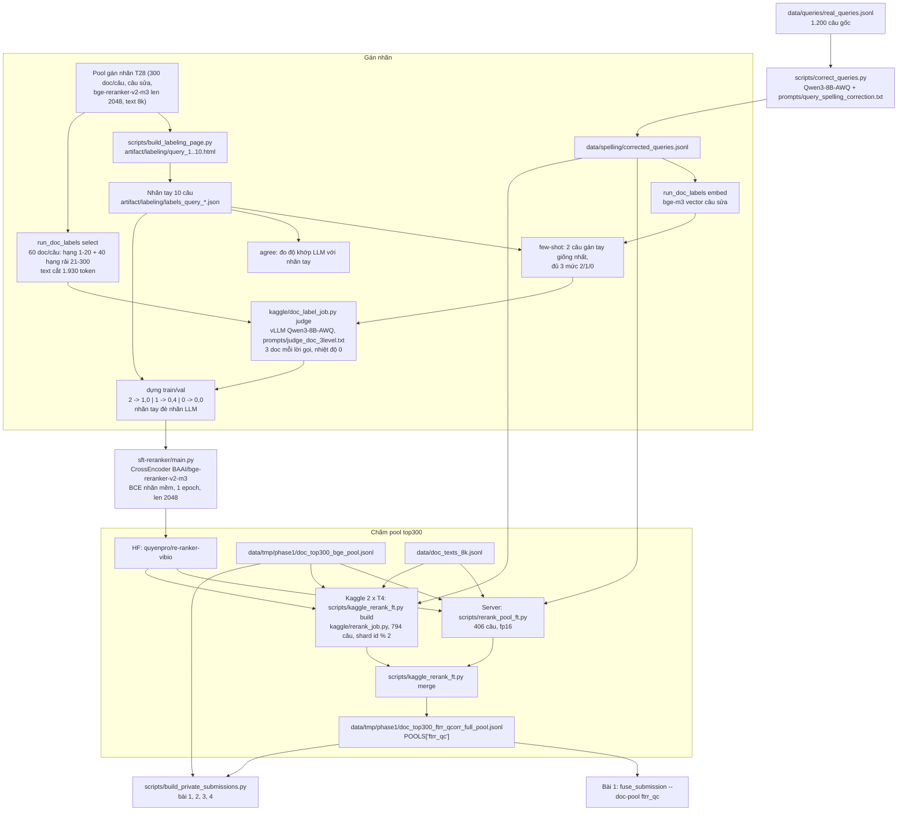

# Thuyết minh 02 - Reranker fine-tune `quyenpro/re-ranker-vibio` (bài 1, 3, 4)

Tài liệu này mô tả pipeline tạo reranker fine-tune và cách nó xếp lại tầng doc của ba bài nộp private:

| Bài | Tên | `relevant_docs` | `relevant_chunks` |
|---|---|---|---|
| 1 | `fuse_d160_c100_ftrr_qc_orig_ctop60+top300_cap2700` | 160 doc xếp bằng reranker fine-tune (`ftrr`), câu sửa chính tả (`qc`) | y hệt bài SOTA (100 đoạn, trần 2.700) |
| 3 | `priv_d160_ftrr_c120_ctop60+top300_cap2050` | như bài 1 | 120 đoạn, trần 2.050 |
| 4 | `priv_d160_ens_ftrrw0.6_bge_c120_ctop60+top300_cap2050` | RRF có trọng số của thứ hạng ftrr (0,6) và thứ hạng bge (0,4) | 120 đoạn, trần 2.050 |

Nghĩa mã: `ftrr` = fine-tuned reranker `quyenpro/re-ranker-vibio`; `qc` = câu hỏi đã sửa chính tả (`corrected_query`); `bge` = `BAAI/bge-reranker-v2-m3` với câu gốc (tầng doc của bài SOTA); `ens` = gộp hai thứ hạng; `c120 ... cap2050` = 120 cửa sổ đầu bài, mỗi cửa sổ 2.050 ký tự.
Phần chung (crawl, index `medical_docs`, pool top300, tầng chunk) nằm ở [01-he-thong-sota.md](01-he-thong-sota.md).
Bài 1, 3, 4 chưa có điểm (vòng private không hiện điểm).

## 1. Tổng quan

### 1.1 Ý tưởng

Bài SOTA đã chạm đỉnh theo số lượng: nới `m_doc` 160 -> 220 làm tụt `DOCS_F2` (biên hạng 161-220 chỉ 6,8%, `docs/phat-hien-tang-diem.md` mục 24).
Mục 24 kết luận muốn tăng điểm phải đổi doc nằm TRONG top 160, tức phải xếp hạng tốt hơn trên cùng 300 ứng viên.
Pool top300 chỉ chứa 48,9% gold (mục 28), nên ranh giới hạng 160 là nơi reranker tạo khác biệt.

Pipeline:
1. Sửa chính tả 1.200 câu hỏi bằng LLM (`data/spelling/corrected_queries.jsonl`).
2. Gán nhãn tay 10 câu, mỗi câu khoảng 30 doc, thang 3 mức (2 / 1 / 0), dùng làm few-shot và làm thước đo độ khớp.
3. LLM `Qwen/Qwen3-8B-AWQ` (qua vLLM) chấm 60 doc mỗi câu theo thang 3 mức, few-shot lấy từ các câu gán tay giống nhất.
4. Dựng cặp train (nhãn mềm 1,0 / 0,4 / 0,0), SFT `BAAI/bge-reranker-v2-m3` ở `max_length` 2048, ra `quyenpro/re-ranker-vibio`.
5. Chấm lại 300 ứng viên mỗi câu của pool top300 bằng model này (câu sửa, text dài `data/doc_texts_8k.jsonl`), trên server RTX 5060 Ti (406 câu) và Kaggle 2 x T4 (794 câu), gộp thành pool `ftrr_qc`.
6. Lắp bài 1 (doc ftrr + chunk SOTA), bài 3 (doc ftrr + chunk c120), bài 4 (doc ens + chunk c120).

### 1.2 Sơ đồ luồng



## 2. Dữ liệu

### 2.1 Câu hỏi đã sửa chính tả

Script: `scripts/correct_queries.py`, mỗi câu một lời gọi LLM, kết quả cache ra `data/spelling/corrected_queries.jsonl` (trường `corrected_query`).
Trước LLM có bảng chuẩn hoá tất định (`src/rag/augment/query_normalize.py`, `src/rag/augment/query_normalize.tsv`: bung viết tắt, khẩu ngữ).
Few-shot cố định: `prompts/query_spelling_correction_fewshots.jsonl` (14 ví dụ).
Prompt: `prompts/query_spelling_correction.txt` (mục 3.3).
LLM mặc định `Qwen/Qwen3-8B-AWQ` tại `http://localhost:8000/v1`, nhiệt độ 0, seed 42 (`src/rag/augment/config.py`).
Theo `CLAUDE.md`, 224/1.200 câu sửa khác chuỗi câu gốc; theo chú thích trong `scripts/phase1_doc_retrieve.py`, 131/1.200 câu khác câu gốc khi bỏ qua dấu câu và hoa/thường.
Từ sau thí nghiệm T12 (pool top1000), quyết định 2026-10-27 là dùng câu sửa cho cả truy xuất lẫn rerank ở mọi thí nghiệm mới; bài SOTA (đến hết T12) dùng câu gốc.
Trong ba bài của tài liệu này, câu sửa chỉ được dùng ở bước rerank; 300 ứng viên vẫn là pool top300 tìm bằng câu gốc.

### 2.2 Pool gán nhãn

Ứng viên để gán nhãn lấy từ pool `data/T28_rrf_bge_q3e/w0.6_qc_vi90_bge_q3etext2048_full_pool.jsonl` (hằng `POOL` trong `src/rag/labeling/run_doc_labels.py`): 300 doc mỗi câu, câu sửa, rerank bằng `BAAI/bge-reranker-v2-m3` len 2048 trên `data/doc_texts_8k.jsonl`, đủ 1.200 câu (567 câu chấm ở server, 633 câu trên Kaggle ngày 2026-11-03 bằng `scripts/kaggle_rerank_vllm.py`).
`TODO(kiểm):` nghĩa đầy đủ của mã `T28` và hậu tố `w0.6_qc_vi90` (không có trong `docs/ky-hieu-bai-nop.md`); file pool này chỉ có trên server.
Pool gán nhãn KHÁC pool top300 dùng để nộp bài: nó chỉ là nguồn cặp (câu, doc) cho tập train.

### 2.3 Văn bản tài liệu dài `data/doc_texts_8k.jsonl`

Sinh bằng `python -m scripts.embed_q3e texts --out data/doc_texts_8k.jsonl`: cùng hàm `doc_text()` của `scripts/build_doc_texts.py` (title | description | heading | thân bài, đã bóc markdown và tẩy rác) nhưng ngân sách 8.000 ký tự thay vì 1.500.
Lý do (đo 2026-10-27 trên 3.000 doc từ top 50 của pool top300): trọn bài nằm trong 1.500 ký tự chỉ 16% doc, trong 8.000 ký tự là 95% (docstring `scripts/embed_q3e.py`).
Dung lượng 4,08 GB.
Reranker ở len 2048 chỉ thấy phần đầu: `DOC_TOKENS = 1930` token tài liệu (2048 trừ 4 token đặc biệt và 114 token của câu hỏi dài nhất).
Khi gán nhãn, text đã được cắt đúng 1.930 token bằng tokenizer `BAAI/bge-reranker-v2-m3` để LLM không chấm dựa vào chữ mà reranker không bao giờ thấy.

### 2.4 Nhãn tay

Trang gán nhãn offline: `scripts/build_labeling_page.py` sinh `artifact/labeling/query_<id>.html` cho mỗi câu (300 doc, kèm text reranker thấy ở len 1024 và 2048, thân bài gốc).

```powershell
python -m scripts.build_labeling_page --query-id 1 --through-query-id 10
```

Người gán làm chế độ "Mẫu nhanh 30": các hạng 1-10, 21, 30, 40, ..., 100, 120, 170, 185, ..., 300 (danh sách `sampleRanks` trong script).
Ba nút: Đúng -> mức 2, Một nửa -> mức 1 ("đúng đối tượng nhưng không đáp ứng nhu cầu", quyết định 2026-11-03), Sai -> mức 0 (`HUMAN_SCALE` trong `src/rag/labeling/doc_labels.py`).
Xuất ra `artifact/labeling/labels_query_<id>_<fingerprint>.json` (có trong git).
Hiện có 10 câu (id 1-10), 300 cặp: 100 mức 2, 73 mức 1, 127 mức 0 (đếm bằng `load_human_labels` ngày 2026-11-04, sau khi sửa nhãn câu 5 ở commit `ad49dcf`).

### 2.5 Nhãn LLM

`run_doc_labels select` chọn 60 doc mỗi câu: 20 hạng đầu và 40 hạng rải đều trên 21-300, luôn gồm hạng cuối (`pick_ranks`); cố định, không ngẫu nhiên.
Lý do (docstring `doc_labels.py`): F2 chấm trên tập 160 doc nộp, nên reranker chỉ tạo khác biệt ở ranh giới hạng 160; nhãn kiểu top 10 bỏ trống đúng vùng đó.
LLM chấm từng lô 3 doc; thứ tự doc xáo theo `seed * 100003 + id câu` trước khi chia lô, để lô đầu không toàn doc mạnh.
Output phải là mảng JSON `[{"doc_id", "score"}]` đủ đúng các doc của lô; sai thì thử lại tối đa 3 lần, hỏng hết thì gán `-1` và bỏ khỏi tập train.
Mỗi file kết quả gắn mã băm 12 ký tự của prompt (`judged_<sha>.jsonl`); bản prompt đã dùng có sha `71b3b840a577` (`docs/ban-giao-ftrr-submission.md`).
Độ khớp với người (lệnh `agree`): precision của mức 2 so với nhãn tay là 0,60, tức LLM chấm dễ dãi hơn người.
File kết quả LLM gốc (`judged_71b3b840a577.jsonl`) và báo cáo `agree_71b3b840a577_report.json` nằm trong `out_labels/` của server và đã bị xoá trước khi sao lưu.
Nhãn LLM vẫn còn ở dạng đã quy đổi trong tập train/val (mục 2.6): mỗi cặp (câu, doc) mang nhãn 1,0 / 0,4 / 0,0 tương ứng mức 2 / 1 / 0, chỉ mất `doc_id` và các cặp bị bỏ.

### 2.6 Tập train

Hàm `build_pairs` (`doc_labels.py`), lệnh `run_doc_labels build --partial-label 0.4`:
- mức 2 -> nhãn 1,0; mức 0 -> 0,0; mức 1 -> 0,4 (positive yếu, không làm negative vì gold khoảng 51 doc mỗi câu là một cụm cùng chủ đề);
- nhãn tay đè nhãn LLM trên cùng cặp, và cặp gán tay ngoài 60 doc được thêm vào;
- câu không có cặp mức 2 nào bị bỏ;
- tách val theo CÂU, seed 42, `--val-frac 0.05` mặc định.

Tập đã dùng để train: 15.870 cặp từ 263 câu; val 18 câu (`docs/ban-giao-ftrr-submission.md`).
Bản train/val đã dùng còn nguyên ở `data/labeling_doc_qcorr_fit/train.jsonl` (15.870 cặp, 263 câu) và `val.jsonl` (1.080 cặp, 18 câu), mỗi dòng `{query, passage, label}`.
Hai con số này khớp đúng "15,870 training samples" và "1,080 evaluation samples" trên model card của `quyenpro/re-ranker-vibio`.
Phân bố nhãn train: 1,0 là 6.319 cặp, 0,4 là 4.168, 0,0 là 5.383; val: 527 / 261 / 292.
Câu train và val đều nằm trong id 1-350 (đối chiếu qua `corrected_query`); val gồm id 27, 54, 66, 89, 91, 134, 152, 159, 166, 178, 204, 214, 220, 266, 284, 307, 315, 350.
10 câu gán tay là id 1-10: không câu nào trong val; id 1, 2, 3, 5, 8, 9 nằm trong train.
Script `after_labels_train.py` dựng hai file này chạy trên server và đã mất cùng `out_labels/`; quy tắc tách val vì thế chỉ suy được từ chính hai file trên.

### 2.7 Truy cập dữ liệu

| Dữ liệu | Đường dẫn | Dung lượng | Cách lấy |
|---|---|---:|---|
| Câu sửa | `data/spelling/corrected_queries.jsonl` | 1,1 MB | [Drive](https://drive.google.com/drive/folders/1YDmbMep_DnX0eSjIW43awca_6F5O-Hlp?usp=sharing), gói `01_inputs_dung_bai.zip` |
| Nhãn tay | `artifact/labeling/labels_query_*.json` | 10 file, khoảng 6 KB mỗi file | trong git |
| Trang gán nhãn | `artifact/labeling/query_*.html`, `artifact/labeling.zip` | 3,1-4,8 MB mỗi trang, zip 5,7 MB | `không upload (file trung gian, sinh lại được); nhãn tay nằm trong git` |
| Ứng viên + text gán nhãn | `data/labeling_doc_qcorr/candidates.jsonl`, `texts.jsonl` | 6,0 MB + 310 MB | không upload (file trung gian, sinh lại được) |
| Tập train/val SFT | `data/labeling_doc_qcorr_fit/train.jsonl`, `val.jsonl` | 93,0 MB + 6,9 MB | [Drive](https://drive.google.com/drive/folders/1YDmbMep_DnX0eSjIW43awca_6F5O-Hlp?usp=sharing), gói `06_sft_reranker_data.zip` |
| Pool gán nhãn | `data/T28_rrf_bge_q3e/w0.6_qc_vi90_bge_q3etext2048_full_pool.jsonl` | 88,8 MB | [Drive](https://drive.google.com/drive/folders/1YDmbMep_DnX0eSjIW43awca_6F5O-Hlp?usp=sharing), gói `06_sft_reranker_data.zip` |
| Văn bản dài | `data/doc_texts_8k.jsonl` | 4,08 GB | [Drive](https://drive.google.com/drive/folders/1YDmbMep_DnX0eSjIW43awca_6F5O-Hlp?usp=sharing), gói `03_doc_texts_8k.zip` |
| Pool top300 (đầu vào chấm) | `data/tmp/phase1/doc_top300_bge_pool.jsonl` | 73,7 MB | [Drive](https://drive.google.com/drive/folders/1YDmbMep_DnX0eSjIW43awca_6F5O-Hlp?usp=sharing), gói `01_inputs_dung_bai.zip` |
| Pool ftrr đủ 1.200 câu | `data/tmp/phase1/doc_top300_ftrr_qcorr_full_pool.jsonl` | 86,3 MB | [Drive](https://drive.google.com/drive/folders/1YDmbMep_DnX0eSjIW43awca_6F5O-Hlp?usp=sharing), gói `01_inputs_dung_bai.zip` |
| Phần chấm ở server | `data/tmp/phase1/doc_top300_ftrr_qcorr_pool.jsonl` (406 câu) | khoảng 30 MB | [Drive](https://drive.google.com/drive/folders/1YDmbMep_DnX0eSjIW43awca_6F5O-Hlp?usp=sharing), gói `01_inputs_dung_bai.zip` |
| Điểm Kaggle | `data/kaggle/out/ftrr_rest/scores_ftrr_rest.s0.jsonl`, `.s1.jsonl`, `log_ftrr_rest.txt` | 2,4 MB mỗi shard | `không upload (file trung gian, sinh lại được); điểm đã gộp vào `doc_top300_ftrr_qcorr_full_pool.jsonl`` |

## 3. Mô hình

### 3.1 Danh sách

| Vai trò | Định danh HF | Ghi chú |
|---|---|---|
| Sửa chính tả câu hỏi | `Qwen/Qwen3-8B-AWQ` | vLLM, `scripts/serve_vllm.sh` (`--quantization awq --max-model-len 8192 --enable-prefix-caching`) |
| Chấm nhãn doc 3 mức | `Qwen/Qwen3-8B-AWQ` | vLLM mỗi GPU một server, `--dtype half --max-model-len 12288 --gpu-memory-utilization 0.90 --max-num-seqs 16 --enable-prefix-caching` (`kaggle/doc_label_job.py`); tắt chế độ suy nghĩ (`enable_thinking: False`), nhiệt độ 0, seed 42, `max_tokens` 320 |
| Vector câu hỏi để chọn few-shot | `BAAI/bge-m3` | `max_seq_length` 512, chuẩn hoá, cosine |
| Backbone reranker | `BAAI/bge-reranker-v2-m3` | XLM-RoBERTa, vocab đa ngữ |
| Reranker fine-tune | `quyenpro/re-ranker-vibio` | repo HF public (`docs/ban-giao-ftrr-submission.md`); model lưu bằng sentence-transformers 6.2.0 (cảnh báo trong `log_ftrr_rest.txt`) |
| Reranker đối chứng tầng doc (bge) | `BAAI/bge-reranker-v2-m3` | len 1024, câu gốc, payload Qdrant (tài liệu 01) |

Mọi model là open weights, không quá 15B tham số.
`TODO(kiểm):` ngày phát hành của `Qwen/Qwen3-8B-AWQ` để đối chiếu luật "trước 2026-08-01" (ghi kèm link model card).

### 3.2 Cách tải và dùng `quyenpro/re-ranker-vibio`

```python
import torch
from sentence_transformers import CrossEncoder

model = CrossEncoder("quyenpro/re-ranker-vibio", num_labels=1, max_length=2048,
                     model_kwargs={"torch_dtype": torch.float16})
scores = model.predict([(corrected_query, doc_text_8k)], batch_size=32)
```

Đầu vào phải đúng điều kiện lúc train: câu SỬA chính tả và text từ `data/doc_texts_8k.jsonl` (không phải payload Qdrant 1.500 ký tự), `max_length` 2048.
Điểm có thang khác `BAAI/bge-reranker-v2-m3`, nên không trộn điểm của hai model; muốn gộp thì gộp theo hạng (mục 6.3).

### 3.3 Prompt

Sửa chính tả (`prompts/query_spelling_correction.txt`, tiếng Anh): sửa lỗi chính tả và lỗi gõ nhất là thuật ngữ y khoa, giữ nguyên nghĩa, phủ định, thời gian, mức độ; không dịch, không thêm bớt hay suy diễn thông tin lâm sàng; câu không lỗi thì trả nguyên văn; output một JSON `{"corrected_query": "..."}`.
Biến `{{query}}` và `{{few_shots}}`.

Chấm doc 3 mức (`prompts/judge_doc_3level.txt`, tiếng Việt), tóm tắt:
- Bước 1: tách câu hỏi thành nhu cầu chính và bối cảnh; xác định đối tượng chính kèm định ngữ (thể bệnh, nhóm người bệnh, hoàn cảnh).
- Score 2: đúng đối tượng chính (kể cả định ngữ) VÀ có nội dung cụ thể trả lời nhu cầu chính.
- Score 1: đúng đối tượng nhưng không trả lời nhu cầu; hoặc câu hỏi về một thể bệnh cụ thể, doc nói về bệnh chung hay thể gần nhưng cùng bối cảnh.
- Score 0: còn lại (bệnh khác kể cả biến chứng, bệnh chung khác bối cảnh, doc chỉ nói về bối cảnh, từ trùng khác nghĩa).
- Phân vân 1/2 chọn 1, phân vân 0/1 chọn 0; không đánh giá theo độ dài, ngôn ngữ hay độ chuyên sâu.
- Output chỉ một mảng JSON `[{"doc_id": 1, "score": 2}, ...]`.
- Biến: `{{few_shots}}`, `{{query}}`, `{{documents}}` (mảng JSON `[{"doc_id": 1..3, "text": ...}]`, không lộ hạng, điểm hay ngôn ngữ).
  `{{documents}}` đặt cuối để vLLM dùng lại prefix cache giữa các lô của cùng một câu.

Few-shot (`make_vars_of`, `select_few_shots`): sắp các câu gán tay theo cosine với câu đang chấm (vector bge-m3 của câu sửa), lấy 2 câu giống nhất, mỗi câu 1 doc cho mỗi mức có (doc hạng tốt nhất của mức đó), rồi lấy thêm từ câu kế tiếp cho tới khi đủ cả 3 mức; không bao giờ lấy chính câu đang chấm; doc ví dụ cắt 500 ký tự, kèm ghi chú của người gán nếu có.
Entity và aspect KHÔNG đưa vào prompt (quyết định 2026-11-04): smoke `agree` cho thấy danh sách aspect kéo LLM chấm dễ dãi (157 nhãn 2 so với 100 của người, commit `484b902`).

### 3.4 Cấu hình SFT

Script `sft-reranker/main.py`:

| Tham số | Giá trị mặc định của script | Giá trị đã dùng cho `quyenpro/re-ranker-vibio` |
|---|---|---|
| Backbone | `BAAI/bge-reranker-v2-m3` | như mặc định |
| Loss | `BinaryCrossEntropyLoss`, nhãn mềm 1,0 / 0,4 / 0,0 | như mặc định |
| `--epochs` | 2 | 1 |
| `--max-length` | 1024 | 2048 |
| `--batch-size` x `--grad-accum` | 4 x 4 = 16 | 16 x 2 = 32 (model card) |
| `--lr` | 2e-5 | 2e-5, lịch linear (model card) |
| `--warmup-ratio` | 0,1 | 0,1 (model card) |
| `--eval-batch-size` | 32 (ở len 2048 trên GPU 16 GB phải hạ, vd 8) | 32 (model card) |
| Độ chính xác | bf16 nếu GPU hỗ trợ, TF32 bật | bf16 (model card) |
| Seed | 42 | 42 (model card) |
| Chọn checkpoint | `eval_loss` nhỏ nhất trên val, lưu mỗi epoch | |

Kết quả trên val (18 câu, nhãn chủ yếu là LLM), pairwise accuracy trong cùng câu hỏi, đo bằng hàm `pairwise_accuracy` của script:

| | `BAAI/bge-reranker-v2-m3` gốc | `quyenpro/re-ranker-vibio` |
|---|---:|---:|
| Mọi cặp nhãn khác nhau | 0,7903 | 0,8248 |
| Chỉ cặp 1,0 so với 0,4 | 0,6985 | 0,7331 |

Đây là phép đo trên nhãn LLM, không phải trên gold của BTC.
GPU train: RTX 5060 Ti 16 GB (server riêng).

## 4. Mã nguồn

| Bước | File |
|---|---|
| Sửa chính tả | `scripts/correct_queries.py`, `src/rag/augment/query_normalize.py`, `prompts/query_spelling_correction.txt`, `prompts/query_spelling_correction_fewshots.jsonl` |
| Phục vụ LLM | `scripts/serve_vllm.sh` (sửa chính tả); `kaggle/doc_label_job.py` (`start_servers`, chấm nhãn) |
| Trang gán nhãn tay | `scripts/build_labeling_page.py` |
| Chọn ứng viên, few-shot, chấm, đo khớp, dựng tập train | `src/rag/labeling/doc_labels.py`, `src/rag/labeling/run_doc_labels.py`, `src/rag/labeling/prompts.py`, `src/rag/labeling/config.py` |
| Chạy chấm nhãn | `kaggle/doc_label_job.py` (Kaggle hoặc server), `scripts/run_doc_labels_server.sh` (server một lệnh) |
| SFT | `sft-reranker/main.py`; đẩy model lên HF: `scripts/upload_reranker.py` (đọc `HF_TOKEN` từ biến môi trường hoặc `.env`) |
| Chấm pool trên server | `scripts/rerank_pool_ft.py` |
| Chấm pool trên Kaggle | `scripts/kaggle_rerank_ft.py` (build / kernels / merge), `kaggle/rerank_job.py`, `scripts/kaggle_rerank_vllm.py` (`KERNEL_CE`, `kernels()`), `scripts/kaggle_jobs.py` (`write_job`, `ensure_dataset_meta`) |
| Lắp bài | `scripts/fuse_submission.py` (bài 1), `scripts/build_private_submissions.py` (bài 1-4) |
| Test | `tests/test_doc_labels.py`, `tests/test_labeling_judge.py`, `tests/test_rerank_vllm_job.py` |

Phiên bản đã quan sát được:
- vLLM 0.33.0 trên Kaggle T4 (`--vllm-spec` mặc định của `scripts/kaggle_rerank_vllm.py`; commit `484b902`).
- sentence-transformers 6.2.0 lúc lưu model fine-tune; 5.7.0 trong kernel Kaggle lúc chấm (cảnh báo trong `log_ftrr_rest.txt`); 6.1.0 ở `venv` local.
- Thư viện local khác: xem bảng ở tài liệu 01 mục 4.2.
- `TODO(kiểm):` phiên bản torch, transformers, vLLM trên server RTX 5060 Ti (`run_doc_labels_server.sh` in ra ở đầu `out_labels/run.log`).

## 5. Hướng dẫn tái hiện

Lệnh Windows ghi PowerShell; lệnh server Linux ghi bash.
Môi trường cơ bản như tài liệu 01 mục 5.1.
Không bao giờ ghi token vào lệnh: Kaggle dùng `~/.kaggle/kaggle.json` (Windows `C:\Users\<bạn>\.kaggle\kaggle.json`), HF dùng biến môi trường `HF_TOKEN` hoặc `huggingface-cli login`.
kaggle CLI trên Windows hỏng với `/` trong `-p`, nên đường dẫn dùng `\`.

### 5.1 Đường tắt: chỉ dựng bài từ pool đã chấm (CPU)

Đặt `doc_top300_ftrr_qcorr_full_pool.jsonl`, hai pool bge, zip SOTA, tài liệu gốc đúng chỗ (bảng 2.7 và tài liệu 01 mục 2.5), rồi sang mục 6.

### 5.2 Sửa chính tả (GPU, server)

```bash
bash scripts/serve_vllm.sh                      # Qwen/Qwen3-8B-AWQ ở cổng 8000
python -m scripts.correct_queries --sample 20 --out data/spelling/smoke20.jsonl --show    # thử
python -m scripts.correct_queries               # đủ 1.200 câu -> data/spelling/corrected_queries.jsonl, chạy lại là làm tiếp
```

Kết quả LLM với nhiệt độ 0 vẫn có thể lệch nhẹ giữa phiên bản vLLM; muốn bám đúng bài nộp thì dùng file trên Drive.

### 5.3 Gán nhãn tay (local)

```powershell
python -m scripts.build_labeling_page --query-id 1 --through-query-id 10
```

Mở `artifact\labeling\query_<id>.html` bằng trình duyệt, gán "Mẫu nhanh 30", xuất JSON vào `artifact\labeling\`.

### 5.4 Nhãn LLM

Chuẩn bị ở local (cần pool gán nhãn và `data/doc_texts_8k.jsonl`):

```powershell
python -m src.rag.labeling.run_doc_labels select      # data\labeling_doc_qcorr\candidates.jsonl + texts.jsonl
python -m src.rag.labeling.run_doc_labels embed       # query_vecs.npz (bge-m3)
python -m src.rag.labeling.run_doc_labels kaggle --owner <kaggle-user>    # zip job data\kaggle\doclabel_dataset\doc_labels_<sha>.zip
```

Chạy trên server GPU (bash), không giới hạn giờ:

```bash
bash scripts/run_doc_labels_server.sh doc_labels_71b3b840a577.zip           # agree: độ khớp với nhãn tay, đọc báo cáo trước
bash scripts/run_doc_labels_server.sh doc_labels_71b3b840a577.zip judge     # chấm, chạy lại là làm tiếp
```

Hoặc trên Kaggle 2 x T4 theo các lệnh `kaggle datasets create` / `kaggle kernels push` mà lệnh `kaggle` in ra.
Đo trên 2 x T4 (vLLM 0.33.0): khoảng 0,1 lời gọi/s, quá chậm để chấm đủ 1.200 câu trong một phiên (commit `484b902`).
`TODO(kiểm):` lệnh chấm thật đã giới hạn bao nhiêu câu (`--limit`) để ra 263 + 18 câu.

### 5.5 Dựng tập train và SFT (server, GPU 16 GB)

```bash
python -m src.rag.labeling.run_doc_labels build --out out_labels --partial-label 0.4
python sft-reranker/main.py --data-dir out_labels --dry-run         # chỉ thống kê dữ liệu
python sft-reranker/main.py --data-dir out_labels --epochs 1 --max-length 2048 \
    --batch-size <B> --grad-accum <32/B> --eval-batch-size 8 --out ./models/medical-reranker
python scripts/upload_reranker.py --model-dir ./models/medical-reranker --repo-id quyenpro/re-ranker-vibio --public
```

`TODO(kiểm):` thay hai dòng `build` và `main.py` bằng đúng lệnh đã chạy (tập train thật dựng bằng `out_labels/after_labels_train.py`, xem mục 2.6); tắt vLLM trước khi train.
Người tái hiện không cần train lại: tải thẳng `quyenpro/re-ranker-vibio`.

### 5.6 Chấm pool top300 bằng reranker fine-tune

Phần server (bash, 1 GPU):

```bash
python scripts/rerank_pool_ft.py --pool data/doc_top300_bge_pool.jsonl --out data/doc_top300_ftrr_qcorr_pool.jsonl \
    --model quyenpro/re-ranker-vibio --dtype fp16 --max-minutes <N>
```

Mặc định của script: `--model models/medical-reranker` (thư mục model local), `--model-name quyenpro/re-ranker-vibio` (tên ghi vào pool), câu sửa, text `data/doc_texts_8k.jsonl`, len 2048, batch 32.
Mỗi dòng ra giữ đúng 300 ứng viên, điểm mới ở `rerank_score`, điểm cũ ở `rerank_score_prev`, câu sửa ở `query`, câu gốc ở `query_orig`, kèm `rr_model` và `rr_len`.
Tốc độ đo được trên RTX 5060 Ti: khoảng 33-35 cặp/s fp16; dừng tay sau 406 câu (câu 1 chấm bf16, lệch fp16 tối đa 0,008).

Phần Kaggle cho 794 câu còn lại (PowerShell ở local, sau khi chép file 406 câu về `data\tmp\phase1\doc_top300_ftrr_qcorr_pool.jsonl`):

```powershell
python -m scripts.kaggle_rerank_ft build --owner <kaggle-user>
kaggle datasets create -p data\kaggle\rerank_ft_dataset
kaggle datasets status <kaggle-user>/vibiomir-rerank-ft
kaggle kernels push -p data\kaggle\kernel_ftrr_rest_ce
kaggle kernels status <kaggle-user>/vibiomir-ftrr-rest-ce
kaggle kernels output <kaggle-user>/vibiomir-ftrr-rest-ce -p data\kaggle\out\ftrr_rest --file-pattern "scores_.*jsonl|log_.*txt"
python -m scripts.kaggle_rerank_ft merge
```

Job Kaggle: `kaggle/rerank_job.py`, `CrossEncoder` fp16, batch 16, mỗi GPU T4 một tiến trình chia câu theo `id % 2`, tự dừng sau 11 giờ, kernel bật internet để tải model từ HF.
Shard 0 chấm lại 32 cặp đã chấm trên server trước khi chạy và dừng nếu lệch quá 0,05; lần chạy thật lệch lớn nhất 0,00086, trung bình 0,00021 (`log_ftrr_rest.txt`).
Tốc độ đo được: 13,9 cặp/s mỗi GPU T4, 397 câu mỗi shard trong khoảng 2 giờ 24 phút (02:50 -> 05:14).
`merge` ghép 406 câu server + 794 câu Kaggle (câu có ở cả hai thì lấy điểm server), ra `data\tmp\phase1\doc_top300_ftrr_qcorr_full_pool.jsonl`, phải in `thiếu 0`.
Bỏ qua dòng `python -m scripts.kaggle_rerank_vllm merge ...` mà lệnh build in ra (template dùng chung).

Kiểm pool:

```powershell
@'
import json
rows = [json.loads(l) for l in open("data/tmp/phase1/doc_top300_ftrr_qcorr_full_pool.jsonl", encoding="utf-8")]
print(len(rows), "câu", {(r["rr_model"], r["rr_len"]) for r in rows}, {len(r["candidates"]) for r in rows})
'@ | python -
```

Kỳ vọng: `1200 câu {('quyenpro/re-ranker-vibio', 2048)} {300}`.

## 6. Dựng bài 1, 3, 4

### 6.1 Ba biến số so với SOTA ở tầng doc

Cùng 300 ứng viên mỗi câu (pool top300), chỉ thứ tự đổi:
1. Reranker: `BAAI/bge-reranker-v2-m3` -> `quyenpro/re-ranker-vibio`.
2. Câu chấm: câu gốc -> câu sửa.
3. Text doc: payload Qdrant 1.500 ký tự, len 1024 -> `data/doc_texts_8k.jsonl`, len 2048.
Ba thứ đi chung vì model được train đúng trên điều kiện 2 và 3; các bài này không tách được hiệu ứng riêng của từng thứ.

### 6.2 Bài 1 bằng `fuse_submission.py`

```powershell
python -m scripts.fuse_submission --doc-pool ftrr_qc --base-pool top300 --chunk-pool top60 top300 `
    --methods orig --cap 2700 --m-chunk 100 --m-doc 160
```

`--methods orig` ở đây nghĩa là xếp theo `rerank_score` có trong pool, tức điểm ftrr.
Cột "trùng orig" in ra là số doc mỗi câu trùng top 160 của SOTA (`--base-pool top300`), tức mức thay đổi thực của reranker.
Ra `data\tmp\phase1\fuse_d160_c100_ftrr_qc_orig_ctop60+top300_cap2700.zip`.
`relevant_chunks` dựng lại từ đúng thứ tự top60 + top300 với trần 2.700, nên phải trùng từng câu với bài SOTA.
`TODO(kiểm):` "trùng orig" thực đo (số doc / 160) để ghi vào tài liệu.

### 6.3 Bài 1, 2, 3, 4 bằng `build_private_submissions.py`

```powershell
python -m scripts.build_private_submissions --cap 2050
```

Mặc định của script: `--m-doc 160 --m-chunk 120 --cap 2050 --w-new 0.6`.
Bản nộp dùng `--cap 2050`: ở trần 2.250 đoạn trung bình 1.897 ký tự và mỗi zip c120 nặng 106,1 MB, vượt giới hạn 100 MB (tài liệu 01 mục 8).
Script đọc markdown gốc MỘT lần cho danh sách c120 rồi ghi 4 bài vào `data\tmp\phase1\`:

| # | Tên file (`.zip`) | Doc list | Chunk list |
|---|---|---|---|
| 1 | `fuse_d160_c100_ftrr_qc_orig_ctop60+top300_cap2700` | ftrr | `relevant_chunks` chép thẳng từ zip SOTA |
| 2 | `priv_d160_bge_c120_ctop60+top300_cap2050` | bge (= SOTA) | c120 |
| 3 | `priv_d160_ftrr_c120_ctop60+top300_cap2050` | ftrr | c120 |
| 4 | `priv_d160_ens_ftrrw0.6_bge_c120_ctop60+top300_cap2050` | ens | c120 |

Bài 1 ra cùng tên với lệnh ở 6.2 và ghi đè nó; hai đường cho cùng `relevant_docs`, còn `relevant_chunks` ở đây chép từ zip SOTA nên trùng SOTA theo cấu trúc.
`TODO(kiểm):` file bài 1 đã nộp là bản của đường nào.

Ba danh sách doc (hàm `doc_lists`):
- `bge`: `rank_docs(..., "orig")` trên pool top300, tức xếp theo điểm bge câu gốc; phải trùng `relevant_docs` của SOTA ở 1200/1200 câu (script in ra).
- `ftrr`: 300 ứng viên của pool `ftrr_qc` xếp theo điểm ftrr giảm dần.
- `ens`: RRF có trọng số trên cùng 300 ứng viên, `k = 60`:

```
khoá(d) = 0,6 / (60 + hạng_ftrr(d)) + 0,4 / (60 + hạng_bge(d))
```

xếp giảm dần, hoà thì theo hạng ftrr; lấy 160 đầu.
Gộp theo HẠNG chứ không theo điểm vì hai model cho điểm trên hai thang khác nhau, cộng điểm thì trọng số mất nghĩa (docstring script).
Script `assert` hai pool cùng tập câu và cùng tập 300 ứng viên mỗi câu.
`TODO(kiểm):` cơ sở chọn trọng số 0,6 (không có phép đo nào trong repo cho riêng trọng số này trên pool ftrr).

Danh sách chunk c120 (hàm `chunk_list`): nối thứ tự pool top60 rồi pool top300 (bỏ trùng), lấy 120 doc đầu, bỏ doc thiếu bản gốc, `chunk_text = submission_chunk_text(strip_markdown(markdown[:2050]))`.
Lý do chọn c120 trần 2.050 và rủi ro: tài liệu 01 mục 8.
Nếu bài nào từ 100e6 byte trở lên thì script dừng với lỗi; khi đó phải hạ `--cap` rồi chạy lại.

Số doc trùng mỗi câu mà script in ra ở lần dựng thật (trung bình trên 1.200 câu, trong top 160):

| So sánh | Doc trùng / 160 |
|---|---:|
| bge với `relevant_docs` của SOTA | trùng hẳn ở 1200/1200 câu |
| ftrr với bge | 124,1 |
| ens với bge | 138,1 |
| ens với ftrr | 145,0 |

Vậy reranker fine-tune thay khoảng 36 trong 160 doc mỗi câu so với SOTA, còn bản ens thay khoảng 22.
Bài 2, 3, 4 dùng chung một chunk list: đoạn trung bình 1.769 ký tự, median 2.015, mỗi zip 99,5 MB (94,9 MiB).

### 6.4 Kiểm trước khi nộp

Dùng đoạn kiểm ở tài liệu 01 mục 5.5 cho từng zip, cộng thêm:
- `len(relevant_docs)` = 160 ở mọi câu; `len(relevant_chunks)` = 100 (bài 1) hoặc 120 (bài 3, 4), trừ câu có doc thiếu bản gốc.
- Bài 1: `relevant_chunks` trùng từng câu với bài SOTA; không trùng là sai tầng chunk.
- Bài 3 và bài 2: `relevant_chunks` trùng nhau từng câu; bài 3 và bài 1: `relevant_docs` trùng nhau từng câu.

### 6.5 Đọc kết quả khi có điểm

Bài 1 so `DOCS_F2` với 0.2849 của SOTA (tầng chunk giống hệt nên `CHUNKS_F2` phải ra 0.2275; khác là bài dựng sai).
Bài 2 so `CHUNKS_F2` với 0.2275 (tầng doc giống SOTA).
Bài 3 tách được nhờ bài 1 và bài 2: tầng doc của nó trùng bài 1, tầng chunk trùng bài 2.
Bài 4 so `DOCS_F2` với bài 1 và SOTA.
Tính `h = P x m` từ `scores.txt`, không suy từ dạng đóng.
